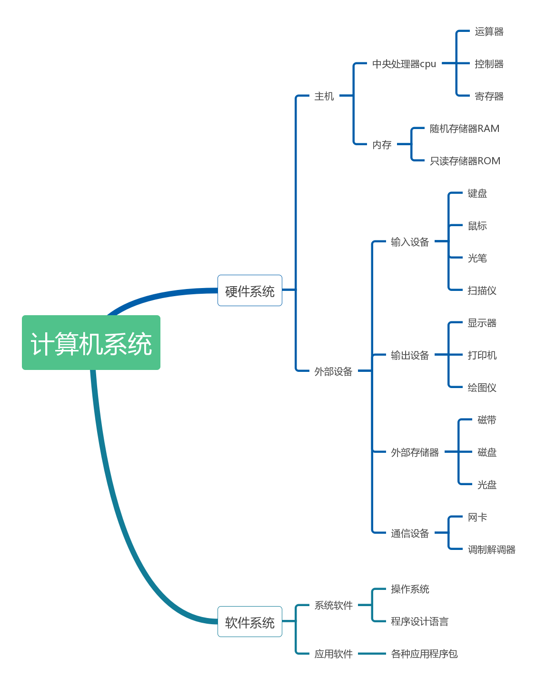
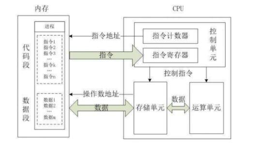
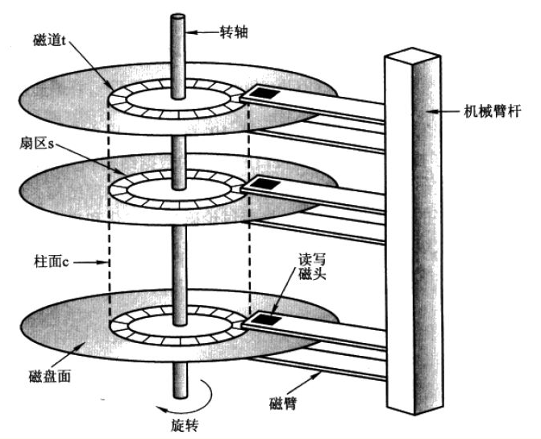
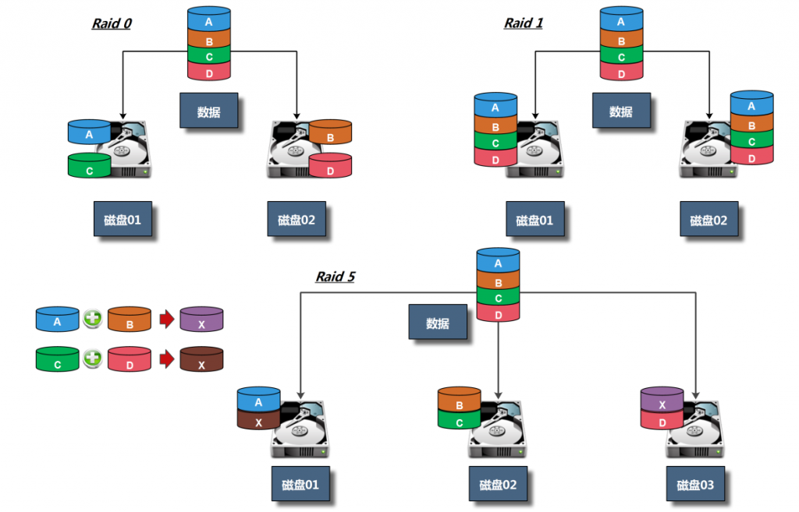
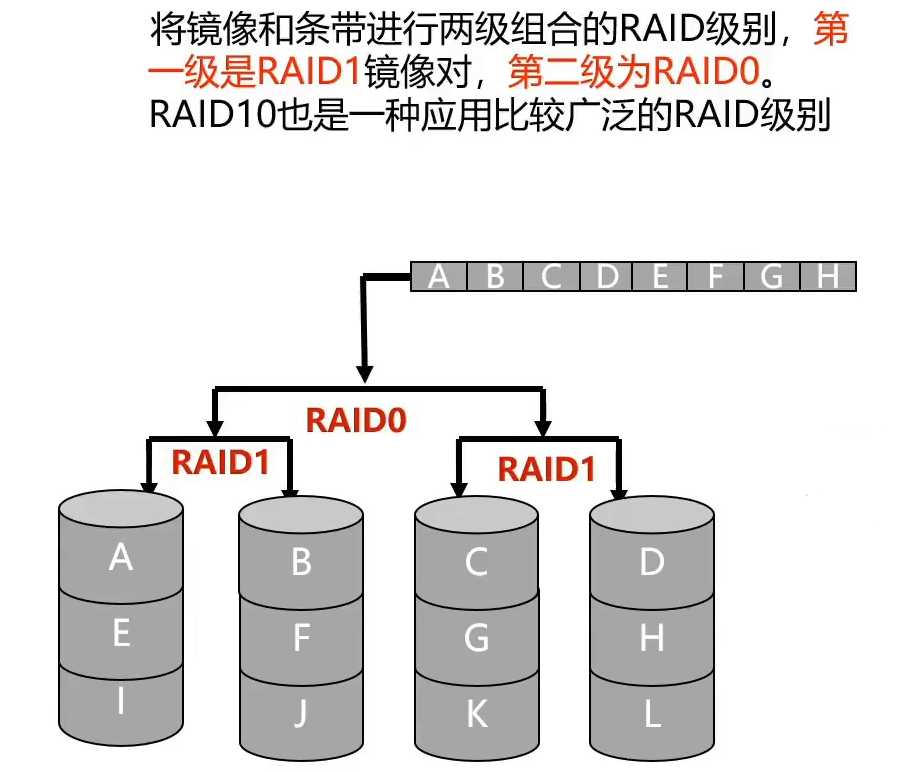

# 计算机硬件与操作系统

计算机由硬件和软件协同工作。硬件提供计算、存储和输入输出能力，操作系统管理这些资源，并为应用程序提供统一的运行环境

本文从运维学习所需的硬件概念出发，说明 CPU、内存、磁盘和启动过程，再介绍操作系统的职责与常见 Linux 发行版

## 阅读路径

| 学习目标 | 建议阅读 |
|:---|:---|
| 理解计算机各部件如何协作 | 计算机的基本组成、总线 |
| 判断 CPU 架构、核心和线程的关系 | CPU |
| 区分内存、缓存、虚拟内存和 Swap | 存储系统 |
| 选择磁盘并理解 RAID 的能力边界 | 磁盘、RAID |
| 理解 Linux 如何启动 | 固件与启动流程 |
| 选择 Linux 发行版 | 操作系统、Linux 发行版 |

## 计算机的基本组成

现代计算机通常按功能划分为五个部分：

| 部件 | 职责 | 常见设备或位置 |
|:---|:---|:---|
| 运算器 | 执行算术和逻辑运算 | CPU 内的算术逻辑单元 |
| 控制器 | 解析指令并协调各部件工作 | CPU 内的控制单元 |
| 存储器 | 保存程序和数据 | 寄存器、缓存、内存、SSD、HDD |
| 输入设备 | 将外部信息送入计算机 | 键盘、鼠标、网卡、磁盘 |
| 输出设备 | 将处理结果送到外部 | 显示器、打印机、网卡、磁盘 |



运算器和控制器是 CPU 的核心部件。CPU、内存和输入输出设备通过片内互连、内存通道及 PCIe 等总线交换数据；磁盘和网卡既能输入数据，也能输出数据

## CPU

### 指令执行与指令集

中央处理器（Central Processing Unit，CPU）负责执行指令。一个简化的指令周期包括取指、译码、执行和写回结果，现代 CPU 还会通过流水线、乱序执行和缓存提高吞吐量



指令集架构（Instruction Set Architecture，ISA）规定指令格式、寄存器和寻址方式等软件可见接口。程序必须编译为当前 CPU 支持的机器指令，或由兼容的解释器、虚拟机执行

| 类型 | 主要特点 | 代表架构 |
|:---|:---|:---|
| 精简指令集计算（RISC） | 通常强调简单、规则的指令格式，便于流水线实现 | ARM、RISC-V |
| 复杂指令集计算（CISC） | 指令功能和编码较丰富，x86 指令长度可变 | x86、x86-64 |

RISC 与 CISC 是设计思路，不是直接的性能排名。现代处理器会结合多种微架构技术，实际性能还受核心设计、频率、缓存、功耗和软件优化影响

### 字长与软件兼容

CPU 字长通常指通用寄存器的典型宽度，常见为 32 位或 64 位。字长影响整数和指针的表示范围，但内存容量还受物理地址宽度、操作系统和硬件平台限制

| 对比项 | 32 位架构 | 64 位架构 |
|:---|:---|:---|
| 通用寄存器典型宽度 | 32 位 | 64 位 |
| 单个进程的虚拟地址空间 | 理论上最多 \(2^{32}\) 字节，即 4 GiB | 由 64 位架构和具体实现决定 |
| 运行 64 位程序 | 不支持 | 支持 |
| 运行 32 位程序 | 原生支持 | 需要 CPU 和操作系统兼容支持，并安装相应运行库 |

64 位不代表所有计算速度都翻倍。它的主要价值是扩大寻址能力、增加可表示的数据范围，并为软件提供更多寄存器和新的指令能力

### 寄存器

寄存器是 CPU 内部的高速存储单元，用于保存指令地址、操作数、运算结果和处理器状态。CPU 执行运算时通常先把数据装入寄存器，再将结果写回缓存或内存

| 寄存器 | 作用 |
|:---|:---|
| 通用寄存器 | 保存操作数和中间结果，如 x86-64 的 RAX、RBX |
| 程序计数器（PC） | 保存下一条待执行指令的地址，跳转指令会改变它 |
| 指令寄存器（IR） | 保存当前正在译码或执行的指令 |
| 状态或标志寄存器 | 保存零、进位、溢出等状态，供条件跳转使用 |

寄存器属于 CPU 微架构的一部分，数量更多或位宽更大并不必然带来更高的整体性能

### 用户态与内核态

CPU 通过特权级隔离普通程序和操作系统内核。Linux 主要使用用户态和内核态两种运行状态：

| 状态 | 运行内容 | 访问能力 |
|:---|:---|:---|
| 用户态 | 应用程序及其运行库 | 访问自己的允许地址空间，不能直接执行特权指令 |
| 内核态 | 操作系统内核和驱动 | 管理硬件、内存和进程等受保护资源 |

用户程序需要读文件、创建进程或发送网络数据时，通过系统调用请求内核完成：

1. 应用程序调用运行库提供的接口，运行库准备系统调用号和参数
2. CPU 执行系统调用指令，保存必要状态并切换到内核态
3. 内核检查权限并执行请求，将结果或错误码写回
4. CPU 返回用户态，应用程序继续执行

> **注意**：系统调用是应用请求内核服务的标准入口，中断和异常也会让 CPU 进入内核处理流程

### 多核、线程与并行

**并发**表示多个任务在一段时间内都有进展，**并行**表示多个任务在同一时刻实际执行。单核可以通过快速切换实现并发，多核或多个处理器可以同时执行多个线程

进程是资源分配和隔离的基本单位，线程是操作系统调度执行的基本对象。同一进程的线程共享地址空间和打开的资源，但各自拥有独立的栈、寄存器状态和线程局部数据

线程切换需要保存和恢复执行上下文，还会带来缓存失效等成本，因此增加线程数并不总能提高性能

多核与同时多线程（Simultaneous Multithreading，SMT）解决不同问题：

| 对比项 | 多核 | SMT，如 Intel Hyper-Threading |
|:---|:---|:---|
| 实现方式 | 一个处理器封装内集成多个物理核心 | 一个物理核心提供多个硬件线程上下文 |
| 执行资源 | 各核心拥有独立的执行资源，并共享部分缓存或内存控制器 | 硬件线程共享核心的执行单元和部分缓存 |
| 主要收益 | 增加可并行执行的核心数量 | 减少执行单元空闲，提高核心利用率 |
| 性能边界 | 受任务并行度、内存带宽和同步开销限制 | 不等于增加完整核心，收益取决于工作负载 |

SMT 中的多个硬件线程可以同时推进指令，只是它们共享核心资源。Linux 看到的逻辑 CPU 数通常等于物理核心数乘以每核硬件线程数，再计入其他物理处理器

对称多处理（Symmetric Multiprocessing，SMP）强调多个处理器或核心由同一操作系统统一调度；非统一内存访问（Non-Uniform Memory Access，NUMA）强调访问本地和远程内存的延迟不同。两者描述不同维度，服务器可以同时是 SMP 和 NUMA 系统

## 存储系统

### 存储层次

计算机用不同速度、容量和成本的介质组成存储层次。越靠近 CPU 的存储通常越快、容量越小，单位容量成本也越高

| 层次 | 常见介质 | 主要作用 |
|:---|:---|:---|
| 寄存器 | CPU 内部触发器等电路 | 保存当前指令直接使用的数据 |
| CPU 缓存 | SRAM，通常分为 L1、L2、L3 | 保存近期使用的指令和缓存行 |
| 主存 | DRAM | 保存运行中的程序和数据 |
| 外部存储 | SSD、HDD、磁带 | 持久保存文件、镜像和备份 |

缓存命中时，CPU 可以直接使用高速缓存中的数据；未命中时才访问下一级存储。操作系统中的页缓存和 DNS 缓存也利用了相同思想，但它们属于软件机制

容量单位需要区分十进制和二进制：

* 内存和二进制容量常用 KiB、MiB、GiB、TiB，按 1024 进位
* 磁盘厂商通常用 kB、MB、GB、TB，按 1000 进位
* `1 B = 8 bit`，网络速率中的 Gb/s 与文件传输中的 GB/s 不能直接混用

### 内存

随机存取存储器（Random Access Memory，RAM）支持按地址直接读写。服务器主存主要使用动态随机存取存储器（DRAM），CPU 缓存则主要使用静态随机存取存储器（SRAM）

| 类型 | 特点 | 主要用途 |
|:---|:---|:---|
| SRAM | 无需定期刷新，速度快，集成度低、成本较高 | CPU 缓存 |
| DRAM | 需要定期刷新，容量密度高，断电后数据丢失 | 系统主存 |

程序通常先从磁盘加载到内存，再由 CPU 通过缓存层次访问。选购或评估内存时，重点关注以下参数：

* **容量**：决定可容纳的工作集，不足时会产生内存回收和换页压力
* **传输速率**：常用 MT/s 表示，不能简单等同于时钟频率
* **时序**：影响访问延迟，比较 CL 值时还要结合传输速率
* **通道数**：更多有效通道可提高理论带宽，实际收益受平台和负载影响

### 虚拟内存与 Swap

虚拟内存为进程提供独立的虚拟地址空间。操作系统按页维护虚拟地址到物理地址的映射，CPU 中的内存管理单元（Memory Management Unit，MMU）负责地址转换，并在缺页时通知内核处理

**虚拟内存不等于 Swap**。Swap 是 Linux 使用的磁盘交换分区或交换文件，在内存压力下为部分内存页提供后备空间；虚拟内存还包括程序文件映射、匿名页和页缓存等机制

```bash
# 查看内存与 Swap 概况
free -h

# 每秒采样一次，共采样 5 次，观察换入换出
vmstat 1 5
```

判断内存压力先看 `available`，再结合 `vmstat` 的 `si`、`so` 是否持续非零以及应用延迟。仅凭 Swap 已用容量较高，不能断定当前物理内存不足

### 固件与闪存

主板固件通常保存在可擦写的闪存中，可通过厂商工具更新。固态硬盘和 U 盘也使用闪存，但其写入和擦除寿命有限，需要主控进行磨损均衡

早期资料常把 BIOS 设置统称为 CMOS 参数。现代平台由实时时钟和固件非易失性存储分别维护时间及启动配置，不应再把所有设置理解成同一块电池供电的 CMOS 内容

## 磁盘

磁盘用于持久保存数据。机械硬盘依赖机械运动，固态硬盘使用闪存，两者在延迟、吞吐量和故障模式上存在明显差异

### 机械硬盘

机械硬盘（Hard Disk Drive，HDD）通过磁头在旋转盘片上读写数据。一次随机访问主要包括寻道、旋转等待和数据传输：

* **寻道时间**：磁头移动到目标磁道的时间
* **旋转延迟**：目标扇区旋转到磁头下方的时间，平均约为盘片旋转半圈的时间
* **传输时间**：实际读取或写入数据的时间

例如 7200 RPM 硬盘每转约需 8.33 ms，平均旋转延迟约为 4.17 ms。机械延迟使 HDD 的随机 I/O 能力远低于 SSD



| 组成 | 含义 |
|:---|:---|
| 盘片 | 保存磁性数据的圆形盘片 |
| 主轴与磁头臂 | 驱动盘片旋转并移动磁头 |
| 磁道 | 单个盘面上的一圈数据区域 |
| 扇区 | 磁盘读写的基本地址单元，逻辑扇区常见为 512 或 4096 字节 |
| 柱面 | 多个盘面上相同半径磁道的集合，主要用于传统 CHS 寻址模型 |

现代大容量硬盘使用逻辑块寻址，不再通过柱面、磁头和扇区数量计算实际容量

### 固态硬盘

固态硬盘（Solid State Drive，SSD）使用 NAND 闪存保存数据，没有寻道和旋转等待，因此随机访问延迟通常远低于 HDD

| 部件 | 作用 |
|:---|:---|
| 主控 | 管理读写、纠错、磨损均衡和垃圾回收 |
| NAND 闪存 | 实际保存数据，按页读写、按块擦除 |
| DRAM 缓存 | 部分 SSD 用于保存映射表和缓存数据，并非必需部件 |
| 固件 | 控制主控和闪存的内部程序 |

| 闪存类型 | 每单元存储位数 | 相对特点 |
|:---|---:|:---|
| SLC | 1 bit | 耐久度和性能较高，成本较高 |
| MLC | 2 bit | 容量成本与耐久度介于 SLC 和 TLC 之间 |
| TLC | 3 bit | 消费级和企业级 SSD 中常见 |
| QLC | 4 bit | 容量密度较高，持续写入和耐久度通常更低 |

每单元存储位数只是评估 SSD 的一个维度，实际体验还受主控、固件、缓存策略、剩余空间和写入量影响

### 接口、总线与物理形态

接口、协议和外形规格不能混为一谈：

* **PCIe**：高速串行总线，可连接 SSD、网卡和显卡等设备
* **NVMe**：面向非易失性存储的协议，通常通过 PCIe 传输
* **M.2**：设备外形和插槽规格，M.2 SSD 可能使用 SATA，也可能使用 PCIe/NVMe

| 接口或协议 | 常见设备 | 主要特点 |
|:---|:---|:---|
| SATA | HDD、SATA SSD | 兼容性好，SATA 6 Gb/s 设备的实际顺序吞吐量通常不超过约 550 MB/s |
| SAS | 企业级 HDD、SSD | 支持双端口等企业特性，具体速率取决于 SAS 代际 |
| PCIe/NVMe | NVMe SSD | 延迟低、队列并行度高，带宽取决于 PCIe 代际和通道数 |

选择 M.2 SSD 时，需要同时核对主板插槽支持的协议、尺寸和通道配置，不能只看外形能否插入

## RAID

独立磁盘冗余阵列（Redundant Array of Independent Disks，RAID）把多个磁盘组织成逻辑设备，用于改善性能、容量或在磁盘故障时维持数据可用性

| 级别 | 最少磁盘数 | 可用容量 | 容错能力 | 主要特点 |
|:---|---:|:---|:---|:---|
| RAID 0 | 2 | 各磁盘容量之和 | 无 | 条带化读写，任一磁盘故障都会破坏整个阵列 |
| RAID 1 | 2 | 两面镜像时为单盘容量 | 一面镜像损坏后仍可读取 | 数据写入多个镜像，容量成本较高 |
| RAID 5 | 3 | \((N-1)\) 倍单盘容量 | 允许 1 盘故障 | 分布式单奇偶校验，重建期间风险升高 |
| RAID 6 | 4 | \((N-2)\) 倍单盘容量 | 允许 2 盘故障 | 双奇偶校验，写入开销通常高于 RAID 5 |
| RAID 10 | 4 | 通常为总容量的 50% | 每个镜像组可容忍 1 盘故障 | 先做镜像再做条带，兼顾性能和冗余 |





RAID 的实际性能和重建时间还受控制器、磁盘类型、条带大小和负载影响。大容量 RAID 5 重建时间较长，应根据故障风险选择级别并监控阵列状态

> **警告**：RAID 不是备份。误删除、文件系统损坏、恶意加密和控制器故障仍可能造成数据丢失，重要数据需要独立备份并定期验证恢复

## 总线

总线（Bus）是部件之间传输数据、地址和控制信号的通道。早期计算机常让多个设备共享总线，现代平台更多使用内存通道、PCIe 等点对点或交换式互连

传统主板用北桥连接 CPU、内存和高速显卡，用南桥连接磁盘、USB 等低速设备。现代 CPU 通常已集成内存控制器和部分 PCIe 控制器，主板上的平台控制器中枢（Platform Controller Hub，PCH）负责其余 I/O 功能，部分平台还将更多功能集成到单芯片中

这种演变减少了 CPU 到内存和高速设备之间的转发层级，但内存带宽、PCIe 通道数量和 NUMA 拓扑仍会影响整机性能

## 固件与启动流程

基本输入输出系统（Basic Input/Output System，BIOS）和统一可扩展固件接口（Unified Extensible Firmware Interface，UEFI）都是开机后首先运行的固件，负责硬件初始化并寻找操作系统引导程序

| 对比项 | 传统 BIOS | UEFI |
|:---|:---|:---|
| 常见引导方式 | Legacy BIOS 引导 | UEFI 原生引导，也可提供兼容支持模块 |
| 常见分区方案 | MBR | GPT |
| 引导文件位置 | 从 MBR 中的引导代码开始 | 通常从 EFI 系统分区加载 `.efi` 程序 |
| 扩展能力 | 接口和寻址能力较受限 | 支持模块化驱动、图形界面和 Secure Boot 等能力 |

以使用 GRUB 的 UEFI Linux 系统为例，启动过程如下：

1. 加电后，固件完成硬件自检与初始化
2. UEFI 按启动项顺序，从 EFI 系统分区加载 GRUB
3. GRUB 根据配置加载 Linux 内核和初始内存文件系统 initramfs
4. 内核初始化驱动与关键子系统，initramfs 协助找到并挂载根文件系统
5. 内核启动第一个用户空间进程，RHEL 系通常由 systemd 接管
6. systemd 挂载文件系统、启动服务并进入配置的 target，最终提供登录界面

传统 BIOS 启动会先读取 MBR 中的引导代码，再逐级加载 Bootloader。排查启动故障时，先判断平台使用 BIOS 还是 UEFI，再检查启动项、引导程序、内核和根文件系统

## 操作系统

### 定义与层次

操作系统（Operating System，OS）是管理硬件资源、隔离运行环境并为应用程序提供服务的系统软件。它让应用不必直接处理磁盘扇区、物理内存和设备寄存器等底层细节

```text
用户空间：应用程序、Shell、系统运行库
                ↓ 系统调用
内核空间：进程、内存、文件、网络与设备管理
                ↓ 驱动和硬件接口
计算机硬件：CPU、内存、磁盘、网卡及其他外设
```

Shell 是用户与系统交互的一种程序，不是内核本身；系统运行库可以封装系统调用，但文件系统、进程调度和设备访问等核心决策由内核完成

### 核心功能

| 功能 | 主要职责 |
|:---|:---|
| 进程管理 | 创建和终止进程，调度线程，处理同步与通信 |
| 内存管理 | 分配和回收内存，维护虚拟地址空间与页映射 |
| 文件与存储管理 | 组织目录和文件，管理权限、缓存及块设备 I/O |
| 设备管理 | 通过驱动控制硬件，处理中断和设备状态 |
| 网络管理 | 提供协议栈、套接字和网络设备接口 |
| 用户与安全 | 验证身份，执行权限检查并提供审计等机制 |

按应用场景可粗分为桌面、服务器、移动和嵌入式操作系统。服务器系统更重视远程管理、稳定性、安全更新和资源调度，但与桌面系统并不存在绝对的功能边界

## Linux 发行版

Linux 严格来说指操作系统内核。完整系统还需要 C 运行库、Shell、核心工具、软件包管理器和安装程序等组件，这些组件与内核的组合称为 Linux 发行版

### RHEL 生态

| 发行版 | 定位 | 常见使用场景 |
|:---|:---|:---|
| Fedora | 社区驱动的上游发行版，较快引入新技术 | 桌面、开发和新技术验证 |
| CentOS Stream | RHEL 的上游持续交付版本 | 参与 RHEL 生态开发、测试和集成 |
| RHEL | Red Hat 提供商业支持的企业发行版 | 需要认证、长期支持和商业服务的环境 |
| Rocky Linux | 面向 RHEL 兼容的社区企业发行版 | 学习 RHEL、服务器和 CentOS 替代 |
| AlmaLinux | 面向 RHEL 应用二进制接口兼容的社区发行版 | 学习 RHEL、服务器和 CentOS 替代 |

Fedora 和 CentOS Stream 为 RHEL 提供上游演进，Rocky Linux 和 AlmaLinux 则面向 RHEL 兼容生态。传统 CentOS Linux 已停止维护，不应再把 CentOS Stream 理解为 RHEL 的下游免费重建版

### Debian 生态

| 发行版 | 定位 | 常见使用场景 |
|:---|:---|:---|
| Debian | 社区维护的通用发行版，稳定分支重视一致性和维护周期 | 服务器、桌面和其他发行版的基础 |
| Ubuntu | Canonical 支持的 Debian 衍生发行版，提供桌面和服务器版本 | 桌面、服务器和云环境 |
| Kali Linux | 面向安全测试的专用发行版 | 渗透测试和安全审计，不作为通用服务器首选 |

两大生态最明显的日常差异是软件包格式与管理工具：

| 生态 | 软件包格式 | 常用管理工具 |
|:---|:---|:---|
| RHEL 系 | RPM | DNF，旧系统使用 YUM |
| Debian 系 | DEB | APT、dpkg |

包格式不同不代表安全性或稳定性存在固定高低。默认分区方案、SELinux 和更新策略也会随发行版、版本及安装方式变化，应针对具体版本判断

### 国产服务器发行版

| 发行版 | 社区或厂商背景 | 定位 |
|:---|:---|:---|
| Anolis OS | 龙蜥开源社区 | 面向服务器和云环境，提供 CentOS 迁移方案 |
| openEuler | 开放原子开源基金会旗下的欧拉社区 | 面向服务器、云、边缘和嵌入式等场景，采用 RPM 软件包生态 |

选择发行版时，优先核对应用兼容性、硬件驱动、安全更新周期、商业支持和团队熟悉程度。学习 RHEL 管理可选用 Rocky Linux 或 AlmaLinux，需要商业支持时选用 RHEL，已有 Debian 或 Ubuntu 运维体系则不必仅因包管理差异更换生态
