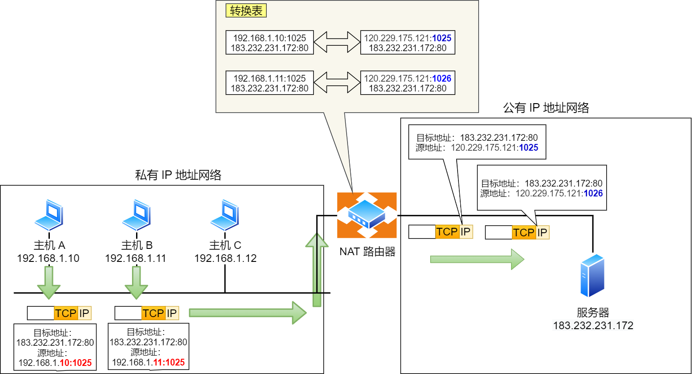
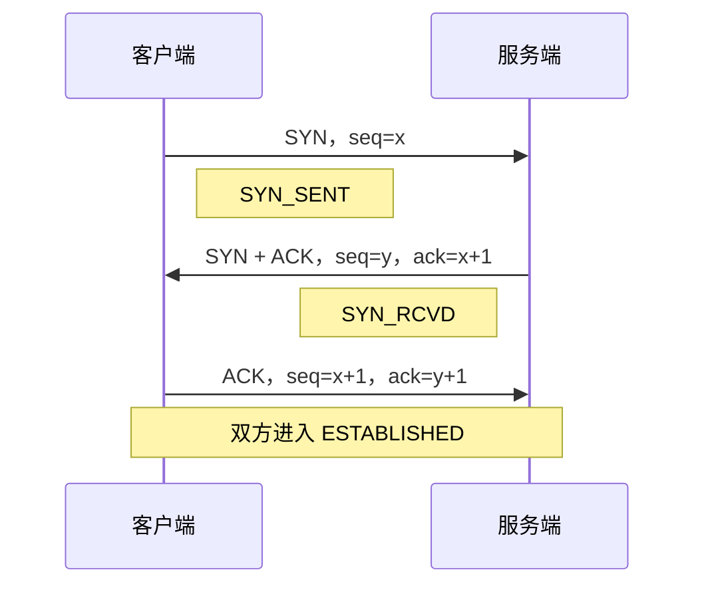

# 网络基础

网络协议负责让不同主机和进程交换数据。学习网络基础的重点，是理解数据如何封装、如何找到下一跳、如何建立端到端通信，以及应用如何获得地址和域名信息

本文以 TCP/IP 协议族为主线，介绍数据链路层、网络层、传输层和应用层的核心概念，并给出 Linux 中常用的观察与验证命令

## 阅读路径

| 学习目标 | 建议阅读 |
|:---|:---|
| 理解协议分层和数据封装 | 网络分层与数据封装 |
| 区分 MAC、交换机与局域网通信 | 物理层与数据链路层 |
| 计算子网、理解路由、ARP 和 NAT | 网络层 |
| 区分 TCP、UDP、端口和 Socket | 传输层 |
| 理解地址自动分配和域名解析 | 应用层 |

## 网络分层与数据封装

开放系统互连（Open Systems Interconnection，OSI）参考模型将网络通信划分为七层，便于分析不同协议的职责。实际互联网主要使用 TCP/IP 协议族，常见教材将其表示为四层或五层模型

### OSI 与 TCP/IP 的对应关系

| OSI 层次 | TCP/IP 五层模型 | 核心职责 | 数据单位 | 常见协议或技术 |
|:---|:---|:---|:---|:---|
| 应用层、表示层、会话层 | 应用层 | 为应用提供数据格式和通信规则 | 数据 | HTTP、DNS、DHCP、SSH |
| 传输层 | 传输层 | 提供进程之间的端到端通信 | 报文段、数据报 | TCP、UDP |
| 网络层 | 网络层 | 逻辑寻址、路由和跨网络转发 | 数据包 | IPv4、IPv6、ICMP |
| 数据链路层 | 数据链路层 | 同一链路内的寻址、成帧和差错检测 | 帧 | Ethernet、ARP |
| 物理层 | 物理层 | 在介质上传输比特 | 比特 | 网线、光纤、无线电波 |

OSI 的应用层规定应用服务，表示层关注数据表示和转换，会话层关注会话管理。TCP/IP 模型不强制应用分别实现这三层，相关功能通常由应用协议或库共同完成

分层模型用于解释职责，不表示每种协议都能被严格放进唯一一层。例如 ARP 同时涉及链路层地址和网络层地址，TLS 位于应用与传输层之间的实际协议栈中

### 数据封装与转发

发送数据时，各层为本层数据添加控制信息；接收方再按相反顺序解析：

1. 应用生成数据，交给 TCP 或 UDP，并指定目标端口
2. 传输层添加源端口、目标端口等信息，形成 TCP 报文段或 UDP 数据报
3. 网络层添加源 IP、目标 IP 等信息，形成 IP 数据包
4. 数据链路层添加源 MAC、目标 MAC 和校验信息，形成帧并交给物理介质发送

交换机主要根据目标 MAC 转发帧，路由器主要根据目标 IP 转发数据包。经过路由器时，链路层帧会被重新封装，IP 的 TTL 或 Hop Limit 会减小；默认情况下，端到端的源 IP 和目标 IP 保持不变，NAT 等中间处理可能修改地址和端口

## 物理层与数据链路层

### 物理层

物理层规定接口、电气或光学信号、传输介质和比特传输方式。双绞线、光纤和无线介质在带宽、延迟、距离和抗干扰能力上各有差异，但上层协议不需要直接处理每一次信号变化

### 以太网帧

以太网（Ethernet）是常见的局域网技术，定义帧格式和链路传输规则。传统以太网帧的主要字段如下：

| 字段 | 长度 | 作用 |
|:---|:---|:---|
| 目标 MAC | 6 字节 | 标识帧的接收方 |
| 源 MAC | 6 字节 | 标识帧的发送方 |
| 类型或长度 | 2 字节 | 标识上层协议或载荷长度，如 IPv4 为 `0x0800` |
| 数据与填充 | 46～1500 字节 | 承载上层数据，不足最小长度时填充 |
| FCS | 4 字节 | 检测帧在传输中的比特错误 |

不计前导码和帧起始界定符时，传统以太网帧长度为 64～1518 字节。VLAN 标签会增加 4 字节，巨型帧则允许更大的载荷，需要链路各设备共同支持

### MAC 地址与局域网转发

媒体访问控制（Media Access Control，MAC）地址用于标识链路接口，常见长度为 48 位：

```text
9C:2D:CD:41:D6:3D
```

前 3 字节通常表示组织唯一标识符（OUI），后 3 字节由厂商分配。虚拟机、容器和手动配置的本地管理地址可以修改，因此 MAC 地址不能被当作永远不变的硬件身份证明

| 对比项 | MAC 地址 | IP 地址 |
|:---|:---|:---|
| 主要作用 | 标识链路上的通信接口 | 标识网络中的逻辑接口 |
| 典型范围 | 同一广播域内使用 | 可跨多个网络路由 |
| 配置方式 | 厂商分配或由软件配置 | 手动配置、DHCP、自动配置 |
| 转发依据 | 交换机 MAC 地址表 | 主机和路由器路由表 |

目标 MAC 为 `FF:FF:FF:FF:FF:FF` 的帧是链路层广播帧。交换机会向除接收端口外的其他端口泛洪，路由器通常不转发该广播，因此路由器接口构成广播域边界

| 设备 | 主要转发依据 | 对未知单播和广播的典型处理 |
|:---|:---|:---|
| 集线器 | 不识别帧，只中继物理信号 | 向其他所有端口复制，现已很少使用 |
| 交换机 | MAC 地址表 | 未知单播和广播通常泛洪，可按 VLAN 隔离广播域 |
| 路由器 | IP 路由表 | 不转发链路层广播，按路由转发 IP 数据包 |

广播是 ARP、DHCP 等协议发现设备的重要手段，但广播规模过大时会消耗链路和处理资源。大型网络通常使用 VLAN 和路由划分广播域

## 网络层

网络层负责逻辑寻址和路由，使数据包能够跨越多个链路到达目标主机。数据链路层解决同一链路内的通信，网络层解决不同网络之间的通信

### IPv4 与 CIDR

IPv4 地址长 32 位，通常写成 4 组十进制数：

```text
二进制：11000000 10101000 00000001 00000001
十进制：192.168.1.1
```

IP 地址配置在接口上，一台主机可以有多个接口，一个接口也可以配置多个地址

无类别域间路由（Classless Inter-Domain Routing，CIDR）使用 `地址/前缀长度` 表示网络。前缀表示网络位长度，其余部分是主机位：

| 项目 | `10.100.122.2/24` 的结果 |
|:---|:---|
| 子网掩码 | `255.255.255.0` |
| 网络地址 | `10.100.122.0` |
| 主机地址 | `10.100.122.2` |
| 广播地址 | `10.100.122.255` |
| 常见可分配范围 | `10.100.122.1`～`10.100.122.254` |

A、B、C 类分类编址是早期 IPv4 的分配方式，现代网络使用 CIDR，可以按实际需要选择前缀并聚合路由，不再受固定类别边界限制

### 子网划分

子网划分通过增加网络位，把一个较大的网络拆成多个较小网络。对于前缀长度为 \(p\) 的 IPv4 网络，主机位数量为：

\[h = 32 - p\]

在传统主机子网中，网络地址和广播地址各保留一个，常见可分配地址数为：

\[2^h - 2\]

例如将 `192.168.1.0/24` 拆成 4 个 `/26` 子网，需要借用 2 个主机位，每个子网保留 6 个主机位：

| 子网 | 网络地址 | 常见可分配范围 | 广播地址 |
|:---|:---|:---|:---|
| 1 | `192.168.1.0/26` | `192.168.1.1`～`192.168.1.62` | `192.168.1.63` |
| 2 | `192.168.1.64/26` | `192.168.1.65`～`192.168.1.126` | `192.168.1.127` |
| 3 | `192.168.1.128/26` | `192.168.1.129`～`192.168.1.190` | `192.168.1.191` |
| 4 | `192.168.1.192/26` | `192.168.1.193`～`192.168.1.254` | `192.168.1.255` |

`/31` 可用于点对点链路，`/32` 表示单个主机地址或主机路由，不能套用上述“减 2”规则

### 特殊 IPv4 地址与通信方式

| 地址范围 | 用途 |
|:---|:---|
| `10.0.0.0/8` | 私有网络 |
| `172.16.0.0/12` | 私有网络 |
| `192.168.0.0/16` | 私有网络 |
| `127.0.0.0/8` | 环回通信，常用地址为 `127.0.0.1` |
| `169.254.0.0/16` | 链路本地地址，不能跨路由转发 |
| `224.0.0.0/4` | 多播地址 |

| 通信方式 | 目标范围 | 示例 |
|:---|:---|:---|
| 单播 | 一个明确接口 | 访问某台服务器 |
| 广播 | 本地链路或子网中的全部节点 | ARP 请求、DHCP Discover |
| 多播 | 加入特定多播组的节点 | 路由协议、流媒体分发 |

`255.255.255.255` 是受限广播地址，只在本地链路使用。`192.168.1.255/24` 这类指向特定子网的地址称为定向广播地址，现代路由器通常禁止跨网络转发定向广播

多播能否跨网段取决于路由器是否配置多播路由以及接收者是否加入相应多播组，并不是只要使用多播地址就能自动跨网段

### 路由与最长前缀匹配

主机和路由器都根据路由表决定下一跳。路由项至少包含目标前缀和转发方式，直连网络通过本地接口发送，非直连网络通常交给下一跳路由器

| 目标前缀 | 下一跳或接口 | 含义 |
|:---|:---|:---|
| `192.168.1.0/24` | 本地接口 `eth0` | 本地直连网络 |
| `192.168.1.128/25` | `192.168.1.254` | 更具体的子网路由 |
| `10.0.0.0/8` | `192.168.1.254` | 私网汇总路由 |
| `0.0.0.0/0` | `192.168.1.1` | 默认路由，匹配未被更具体路由覆盖的目标 |

多条路由同时匹配目标地址时，选择前缀最长的一条。例如目标是 `192.168.1.200`，`/25` 比 `/24` 更具体，因此使用 `192.168.1.254` 作为下一跳

Linux 中查看路由并验证实际选路：

```bash
ip route show
ip route get 192.168.1.200
```

### ARP 与邻居发现

地址解析协议（Address Resolution Protocol，ARP）用于在 IPv4 局域网中查询目标 IP 对应的 MAC 地址。发送方先根据本机前缀和路由判断目标的下一跳：

| 通信场景 | 实际需要解析的 MAC |
|:---|:---|
| 目标与本机在同一子网 | 目标主机的 MAC |
| 目标在其他网络 | 下一跳网关的 MAC |

同一子网内的基本过程：

1. 主机广播 ARP 请求，询问某个 IP 对应的 MAC
2. 拥有该 IP 的主机通常以单播返回 ARP 响应
3. 发送方将映射加入邻居缓存，后续通信优先使用缓存

查看 Linux 邻居表：

```bash
ip neigh show
```

条目可能显示 `REACHABLE`、`STALE`、`FAILED` 等状态。排障时应结合接口、IP 和交换机配置判断，不要只凭缓存状态断定对端故障

IPv6 不使用 ARP，而通过邻居发现协议（Neighbor Discovery Protocol，NDP）完成地址解析、路由器发现和地址配置等功能

### MTU、IP 分片与 TCP MSS

最大传输单元（Maximum Transmission Unit，MTU）是链路允许承载的单个网络层数据包大小，常见以太网 MTU 为 1500 字节

* IPv4 在允许分片时，可以由发送方或沿途路由器分片，目标主机负责重组；设置 DF 标志后不允许路由器分片
* IPv6 只允许源主机分片，中间路由器发现数据包过大时会丢弃并返回 ICMPv6 信息
* 路径 MTU 发现用于确定整条路径可用的 MTU，依赖相应的 ICMP 或 ICMPv6 反馈

最大报文段长度（Maximum Segment Size，MSS）是 TCP 单个报文段中载荷的最大长度。TCP 根据 MSS 分段，常见 IPv4 以太网环境中可按 `1500 - 20 - 20 = 1460` 字节估算，但 IP 选项、TCP 选项和隧道都会改变实际值

### IPv6

IPv6 地址长 128 位，分成 8 组十六进制数，每组 16 位：

```text
完整形式：2001:0db8:0000:0000:0000:0000:0000:0001
压缩形式：2001:db8::1
```

每组可以省略前导零，连续的全零组可以用 `::` 压缩一次。一个地址中只能使用一次 `::`，否则无法确定省略了多少组

| 特性 | 说明 |
|:---|:---|
| 地址空间 | 128 位，缓解 IPv4 地址耗尽问题 |
| 基本首部 | 固定 40 字节，扩展功能通过扩展首部实现 |
| 广播 | 不使用广播，相应功能由多播和 NDP 实现 |
| 自动配置 | 支持 SLAAC，也可使用 DHCPv6 |
| 安全 | 不天然防窃听或防伪造，仍需 TLS、IPsec 等机制 |

常见地址类型：

| 类型或范围 | 用途 |
|:---|:---|
| `::1/128` | 环回地址 |
| `fe80::/10` | 链路本地单播地址 |
| `fc00::/7` | 唯一本地地址，用于内部网络 |
| `ff00::/8` | 多播地址 |

### ICMP

互联网控制报文协议（Internet Control Message Protocol，ICMP）用于传递网络层诊断和差错信息，报文封装在 IP 中

| 类型 | 名称 | 常见用途 |
|:---|:---|:---|
| `8 / 0` | Echo 请求与应答 | `ping` 检查基本 IP 连通性 |
| `3` | 目标不可达 | 报告网络、主机、协议或端口不可达等原因 |
| `11` | 超时 | TTL 减为 0 或重组超时，路径跟踪常用该机制 |
| `5` | 重定向 | 通知主机使用更合适的下一跳 |

```bash
ping -c 4 192.168.1.1
tracepath 192.0.2.10
```

`ping` 成功只说明收到了相应 ICMP 应答，不代表应用服务正常；`ping` 失败也可能是 ICMP 被过滤，需要结合路由、端口和应用检查

### NAT 与 NAPT

网络地址转换（Network Address Translation，NAT）是一种修改数据包地址信息的机制，不是单一协议。网络地址与端口转换（Network Address and Port Translation，NAPT）还会修改端口号，使多个内网连接共享一个公网地址



NAPT 设备记录内部地址端口、外部地址端口和目标地址端口等映射。返回流量命中映射后，再被转换并交还对应的内网主机

| 类型 | 主要转换对象 | 常见用途 |
|:---|:---|:---|
| SNAT | 源地址，必要时同时转换源端口 | 内网主动访问外网，共享出口地址 |
| DNAT | 目标地址，必要时同时转换目标端口 | 将公网请求映射到内部服务 |
| 端口映射 | 外部地址端口到内部地址端口 | DNAT 的一种常见配置形式 |

NAT 设备重启或映射过期会影响经过它的现有连接。外部主动访问内部服务通常需要静态映射、NAT 穿透或中继机制

> **注意**：NAT 主要解决地址转换问题，不等同于完整的访问控制。对外发布服务仍需配置防火墙、认证和应用安全策略

## 传输层

传输层通过端口区分同一主机上的不同通信端点，并为应用提供 TCP 或 UDP 服务

### 端口与 Socket

端口号是 16 位整数，范围为 `0`～`65535`。`IP 地址 + 协议 + 端口号` 标识一个通信端点，TCP 连接则由源 IP、源端口、目标 IP、目标端口共同区分

| 分类 | 范围 | 说明 |
|:---|:---|:---|
| 知名端口 | `0`～`1023` | 常见服务注册使用，如 22、53、80、443；0 通常保留 |
| 注册端口 | `1024`～`49151` | 应用注册或自定义服务使用 |
| 动态端口 | `49152`～`65535` | 常用于客户端临时端口，具体范围可由系统配置 |

Linux 中绑定小于 1024 的端口通常需要 root 或 `CAP_NET_BIND_SERVICE` 能力。端口能否复用还取决于地址、协议和 Socket 选项，不能简单理解为“一个端口永远只能属于一个进程”

Socket 是操作系统提供的网络编程接口，不是网络协议：

```text
服务端：socket() → bind() → listen() → accept() → recv()/send() → close()
客户端：socket() → connect() → send()/recv() → close()
```

UDP Socket 不需要 `listen()` 和 `accept()`，通常使用 `sendto()`、`recvfrom()` 收发数据。UDP 也可以调用 `connect()` 设置默认对端并过滤来源，但这不会建立 TCP 式连接或执行握手

查看本机监听和连接情况：

```bash
ss -lntup
ss -ntp
```

重点检查监听地址是 `127.0.0.1`、具体网卡地址还是 `0.0.0.0`，以及协议、端口和进程是否符合预期

### TCP 与 UDP

| 对比项 | TCP | UDP |
|:---|:---|:---|
| 连接方式 | 面向连接 | 无连接 |
| 数据形式 | 有序字节流，不保留应用消息边界 | 保留数据报边界 |
| 可靠机制 | 确认、重传、排序、去重 | 协议本身不提供，可由应用补充 |
| 流量与拥塞控制 | 支持 | 协议本身不提供 |
| 通信模式 | 点对点、全双工 | 支持单播、广播和多播 |
| 首部开销 | 基本首部 20 字节 | 8 字节 |
| 典型应用 | HTTP、SSH、数据库连接 | DNS、DHCP、实时音视频 |

TCP 的可靠性作用于一条正常维持的连接，并不表示网络故障时应用请求一定成功。应用仍需处理超时、重连、重复请求和业务一致性

### TCP 首部与控制机制

TCP 基本首部为 20 字节，主要字段：

| 字段 | 作用 |
|:---|:---|
| 源端口、目标端口 | 标识通信端点 |
| 序列号 | 标识本报文段数据在字节流中的位置 |
| 确认号 | 表示期望收到的下一个字节编号 |
| 首部长度与控制位 | 表示选项长度和 SYN、ACK、FIN、RST 等状态 |
| 窗口大小 | 通告接收方可接收的数据量 |
| 校验和、紧急指针 | 校验数据及处理紧急数据 |

| 标志 | 作用 |
|:---|:---|
| SYN | 建立连接并同步初始序列号 |
| ACK | 表示确认号有效 |
| FIN | 表示发送方不再发送数据，请求关闭本方向 |
| RST | 异常中止或拒绝连接 |

TCP 使用序列号、确认、超时重传和排序实现可靠字节流，并同时处理两种不同问题：

| 机制 | 保护对象 | 主要依据 |
|:---|:---|:---|
| 流量控制 | 接收方处理能力 | 接收窗口 |
| 拥塞控制 | 网络承载能力 | 丢包、延迟等拥塞信号 |

### TCP 三次握手



三次握手让双方确认彼此的发送和接收能力，并同步双方的初始序列号。客户端对服务端 SYN 的最终确认，也能避免服务端仅因一个延迟到达的旧 SYN 就建立失效连接

SYN 和 FIN 即使不携带应用数据，也会消耗一个序列号。第三次握手可以携带应用数据

### TCP 四次挥手与 TIME_WAIT

两个方向的数据通道需要分别关闭，因此常见断开过程包含四个报文。以下由客户端主动关闭：

1. 客户端发送 FIN，表示不再发送数据，进入 `FIN_WAIT_1`
2. 服务端返回 ACK，进入 `CLOSE_WAIT`；客户端收到后进入 `FIN_WAIT_2`，服务端仍可发送剩余数据
3. 服务端发送完数据后发出 FIN，进入 `LAST_ACK`
4. 客户端返回 ACK 并进入 `TIME_WAIT`，服务端收到后关闭；客户端等待 2 倍最大报文段生存时间（MSL）后关闭

被动关闭方没有剩余数据时，ACK 和 FIN 可以合并，因此抓包中也可能看到三个断开报文

主动关闭方保留 `TIME_WAIT` 主要有两个作用：

* 最后一个 ACK 丢失时，仍能响应对方重传的 FIN 并再次确认
* 等待旧连接报文从网络中消失，避免相同四元组的新连接收到旧数据

## 应用层

应用层协议规定应用程序交换的数据格式和交互规则。HTTP 用于 Web 资源传输，SSH 用于安全远程管理，DHCP 和 DNS 则分别提供网络配置与名称解析

### DHCP

在 IPv4 网络中，动态主机配置协议（Dynamic Host Configuration Protocol，DHCP）自动分配 IP 地址、子网掩码或前缀、默认网关、DNS 服务器等配置，减少手工维护

首次获取 IPv4 地址通常经过 DORA 流程：

| 阶段 | 报文 | 作用 |
|:---|:---|:---|
| Discover | 客户端广播发现报文 | 寻找可用 DHCP 服务器 |
| Offer | 服务器提供报文 | 提供候选地址和配置 |
| Request | 客户端请求报文 | 请求使用所选配置，并告知其他服务器选择结果 |
| Acknowledgement | 服务器确认报文 | 确认租约并交付配置 |

初始 Discover 和 Request 使用广播；Offer 与 ACK 可以单播或广播，取决于客户端状态、标志位和网络环境。跨网段使用时需要 DHCP 中继把请求转发到服务器

地址具有租期，客户端通常在租期过半时向原服务器续租。续租失败后还会继续尝试重新绑定，租约最终失效时需要重新获取地址

Linux 中核对实际获得的配置：

```bash
ip -brief address
ip route show
resolvectl status
```

重点检查接口地址、默认路由和 DNS 服务器是否来自预期网络

### DNS

域名系统（Domain Name System，DNS）是分布式、层次化的命名系统，用于查询域名对应的地址和其他资源记录

以 `www.example.com.` 为例，末尾的点表示根域，从右向左依次是顶级域 `com`、二级域 `example` 和主机标签 `www`。域名层级与管理边界相关，不应简单把所有左侧标签都理解为物理主机

| 角色 | 职责 |
|:---|:---|
| 根域名服务器 | 返回顶级域服务器的引荐信息 |
| 顶级域服务器 | 返回下一级域的权威服务器信息 |
| 权威域名服务器 | 提供所负责区域的最终记录 |
| 递归解析器 | 接受客户端请求，缓存结果并完成后续查询 |

以客户端查询 `www.example.com` 为例：

1. 应用先经过系统名称解析配置，检查本地缓存和静态主机记录
2. 缓存未命中时，客户端向递归解析器请求最终答案
3. 递归解析器缓存也未命中时，从根服务器获得顶级域服务器引荐
4. 再向顶级域服务器获得该域权威服务器的引荐
5. 向权威服务器查询目标记录，并将结果返回客户端
6. 解析器和客户端按 TTL 缓存结果，缓存过期后重新查询

客户端通常使用递归查询，递归解析器向根、顶级域和权威服务器查询时通常采用迭代方式。实际过程还可能遇到 CNAME、转发器、负缓存和缓存命中，不必每次都访问根服务器

常见记录类型：

| 记录 | 作用 |
|:---|:---|
| `A` | 域名到 IPv4 地址 |
| `AAAA` | 域名到 IPv6 地址 |
| `CNAME` | 域名别名，指向另一个规范名称 |
| `NS` | 指定区域的权威域名服务器 |
| `MX` | 指定邮件接收服务器 |
| `TXT` | 保存文本信息，常用于验证和邮件策略 |
| `PTR` | 反向解析，通常将地址映射到名称 |

使用 `dig` 验证解析结果和完整查询路径：

```bash
dig +short www.example.com A
dig +short www.example.com AAAA
dig +trace www.example.com
```

`+short` 便于检查最终记录，`+trace` 从根开始显示迭代查询过程。应用解析异常时，还应检查系统实际使用的 DNS 服务器、搜索域和缓存，而不能只比较某一条 `dig` 命令的结果
