# Linux 发行版与安装

本文先介绍 Linux 的组成、主流发行版和红帽生态，再在 VMware Workstation 中安装 RHEL 9.3，最后验证系统能否正常登录和访问

> 示例环境为 VMware Workstation Pro 25H2、RHEL 9.3 x86_64。官网页面和安装界面可能随版本变化，但选择镜像、配置虚拟机、分区和创建用户的流程基本一致

## Linux 与发行版

Linux 是开源的类 Unix 操作系统内核，日常所说的 Linux 操作系统通常还包含 Shell、系统工具和应用程序，并支持多用户与多任务

### Linux 系统组成

从学习与系统管理的角度，可以重点关注以下组件：

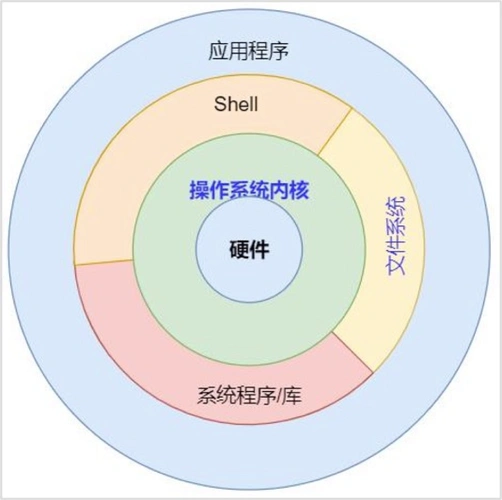

| 组件 | 定位 | 主要功能 | 常见组成或示例 |
|:---|:---|:---|:---|
| 内核（Kernel） | 底层核心 | 管理硬件资源，为上层程序提供系统调用 | 进程、内存、文件、网络和设备管理 |
| 文件系统（File System） | 数据组织 | 组织、存储和检索数据，提供目录层级 | ext4、XFS、NFS、虚拟文件系统 |
| Shell | 命令交互 | 解析用户命令并启动程序 | Bash、Zsh、fish |
| 应用程序 | 用户空间 | 完成具体任务，通过系统调用请求内核服务 | 系统工具、办公软件、浏览器 |

### 内核态与用户态

CPU 通过**内核态（Kernel Mode）**和**用户态（User Mode）**隔离内核与应用程序。应用程序通常在用户态运行，需要访问硬件或受保护资源时，通过系统调用切换到内核态

| 对比项 | 内核态 | 用户态 |
|:---|:---|:---|
| 执行代码 | 操作系统内核 | 应用程序及用户空间组件 |
| 访问权限 | 可访问受保护的硬件和内存 | 受进程权限和地址空间限制 |
| 故障影响 | 严重错误可能影响整个系统 | 通常首先影响当前进程 |

以应用程序读取文件为例：应用程序发起系统调用，内核检查权限并操作存储设备，再将数据和执行结果返回应用程序。这样既能让程序使用硬件，又不必把硬件权限直接开放给每个程序

### 主流发行版

Linux 发行版是在 [Linux 内核](https://www.kernel.org/)之上，组合软件包、安装工具、配置和更新机制形成的完整系统

| 体系 | 代表发行版 | 常用包管理器 | 软件包格式 |
|:---|:---|:---|:---|
| RHEL 系 | RHEL、Fedora、CentOS Stream、Rocky Linux、AlmaLinux、OpenEuler | DNF，部分系统兼容 YUM 命令 | RPM |
| Debian 系 | Debian、Ubuntu、Linux Mint、Kali Linux | APT | DEB |
| Arch 系 | Arch Linux、Manjaro | Pacman | `pkg.tar.zst` 等 |
| SUSE 系 | SLES、openSUSE | Zypper | RPM |

RHEL 系和 Debian 系在服务器环境中最常见。选择发行版时，除了包管理器，还要考虑支持周期、软件生态、硬件兼容性和团队经验

> 早期 Linux 内核曾用次版本号的奇偶区分开发版和稳定版，2.6 之后不再沿用这套规则。生产环境应结合发行版支持周期和内核分支维护状态判断，不能只看版本号

### 红帽生态与 CentOS 变迁

| 系统 | 定位 | 主要特点 |
|:---|:---|:---|
| RHEL | 企业级商业产品 | 提供长期维护、认证和商业支持，个人学习可使用符合条件的开发者订阅 |
| Fedora | 社区创新发行版 | 新特性引入较快，为红帽生态提供技术验证 |
| CentOS Stream | RHEL 的上游开发分支 | 持续交付将进入后续 RHEL 小版本的更新，不同于传统 CentOS 的下游重建 |

传统 CentOS 与 CentOS Stream 的位置变化如下：

```text
传统模式：Fedora → RHEL → CentOS
当前模式：Fedora → CentOS Stream → RHEL
```

2020 年底，红帽宣布 CentOS 8 于 2021 年底停止维护，CentOS 项目重点转向 CentOS Stream。Stream 并不等同于传统 CentOS 的稳定重建版本，是否用于生产应结合更新节奏和应用验证流程评估

需要与传统 CentOS 使用方式相近的系统时，常见选择包括：

* **Rocky Linux**：由 CentOS 原始创始人 Gregory Kurtzer 发起，以与 RHEL 兼容为目标
* **AlmaLinux**：由 CloudLinux 发起并交由社区治理，以与 RHEL 二进制兼容为目标

### 开源与许可

开源软件的源代码可按许可证约定被查看、使用、修改和分发。开源与闭源描述的是授权和代码开放方式，不直接决定软件质量、安全性或是否收费

| 对比项 | 开源软件 | 闭源软件 |
|:---|:---|:---|
| 源代码 | 按许可证公开 | 通常不公开 |
| 修改与分发 | 在许可证允许范围内进行 | 通常受厂商授权限制 |
| 支持方式 | 社区支持或商业支持 | 通常由厂商提供服务 |

> **注意**：开源不等于免费，也不等于没有使用条件。未附带许可证的公开源码仍受版权保护，不能据此假定他人可以自由复制、修改和分发

自由软件基金会（Free Software Foundation，FSF）定义了四项基本自由：

* **自由 0**：以任何目的运行软件
* **自由 1**：研究软件工作原理，并按需要修改源代码
* **自由 2**：重新分发软件副本
* **自由 3**：分发修改后的衍生版本

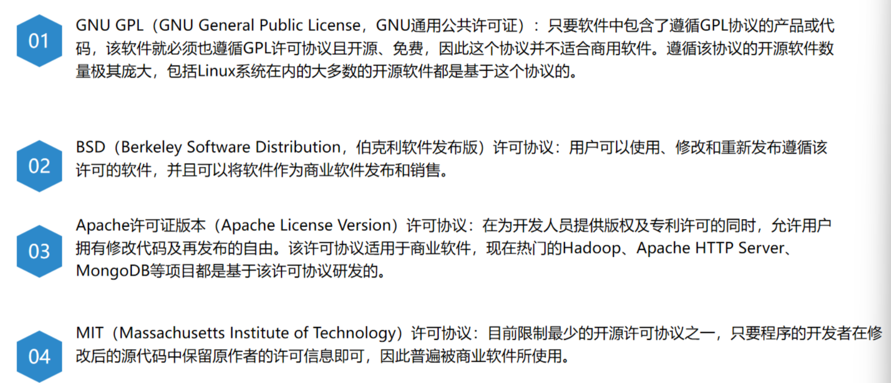

| 协议 | 主要特点 |
|:---|:---|
| GPL | 具有 Copyleft 要求，分发衍生作品时通常需采用相同许可证并提供对应源代码，Linux 内核采用 GPL-2.0 |
| MIT | 宽松许可，主要要求保留版权和许可声明 |
| Apache 2.0 | 宽松许可，包含明确的专利授权与相关保护条款 |
| 木兰宽松许可证 | 中英文双语的宽松许可证，OpenEuler 的部分软件采用该许可证 |

## 安装前准备

| 项目 | 示例配置 |
|:---|:---|
| 虚拟化软件 | VMware Workstation Pro 25H2 |
| 系统镜像 | `rhel-9.3-x86_64-dvd.iso` |
| 虚拟硬件 | 4 个虚拟 CPU、4 GiB 内存、50 GiB 磁盘 |
| 网络 | NAT，使虚拟机可通过宿主机访问外部网络 |

以上资源用于学习演示，不是固定最低要求。分配 CPU、内存和磁盘时，应为宿主机及其他虚拟机保留足够资源

### 加入开发者订阅

个人学习 RHEL 时，可通过红帽开发者订阅获取符合订阅条款的镜像和更新服务：

* 红帽官网：https://www.redhat.com/en
* 红帽客户门户：https://access.redhat.com/

1. 注册并登录红帽账号，按页面提示完善注册信息

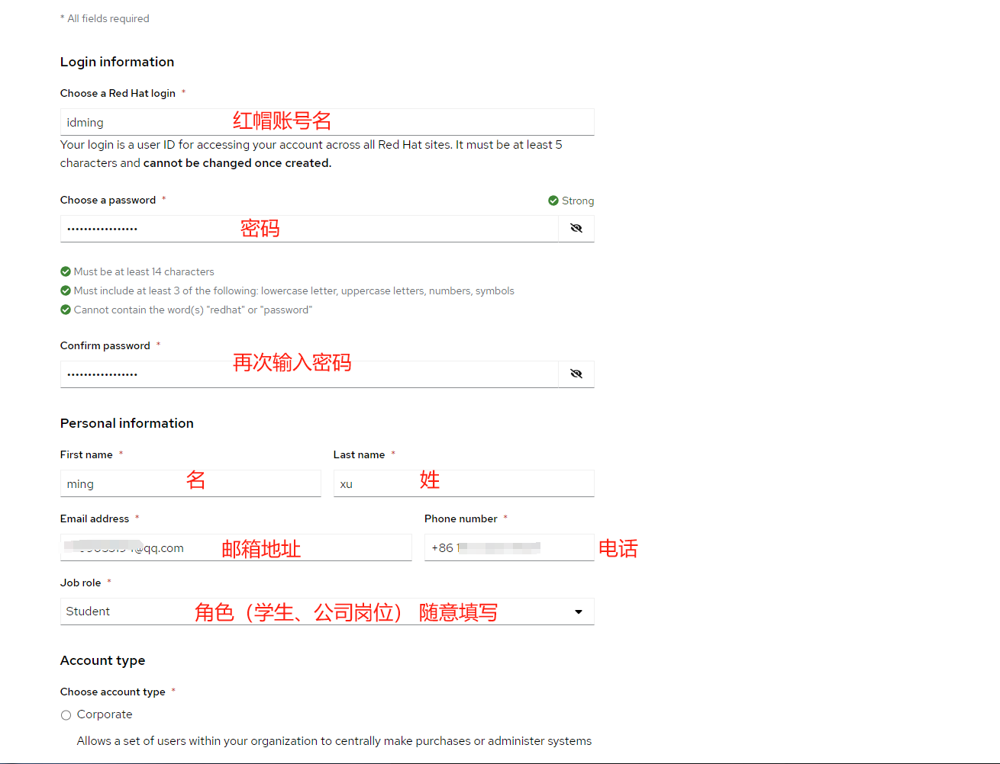

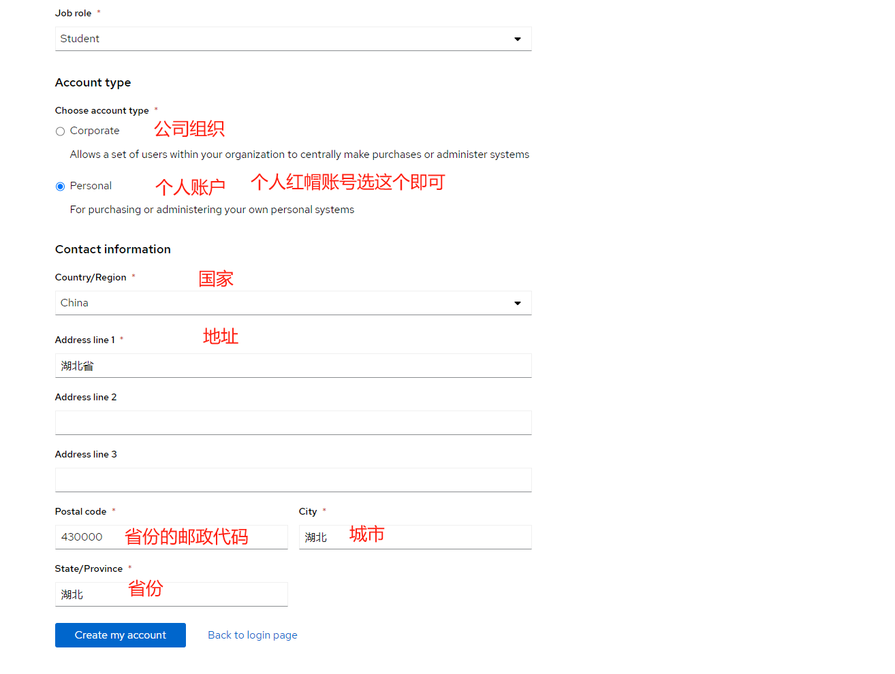

2. 加入开发者订阅

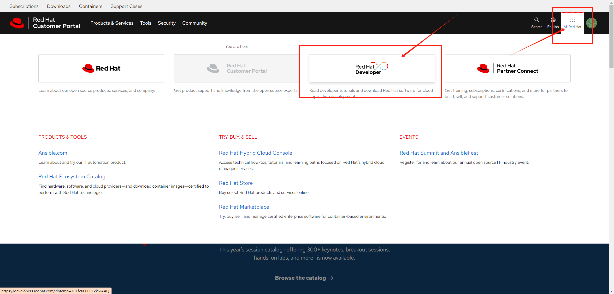

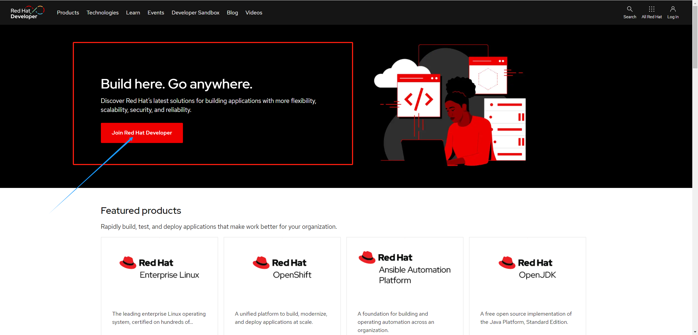

3. 在账号订阅页面确认开发者订阅已经生效

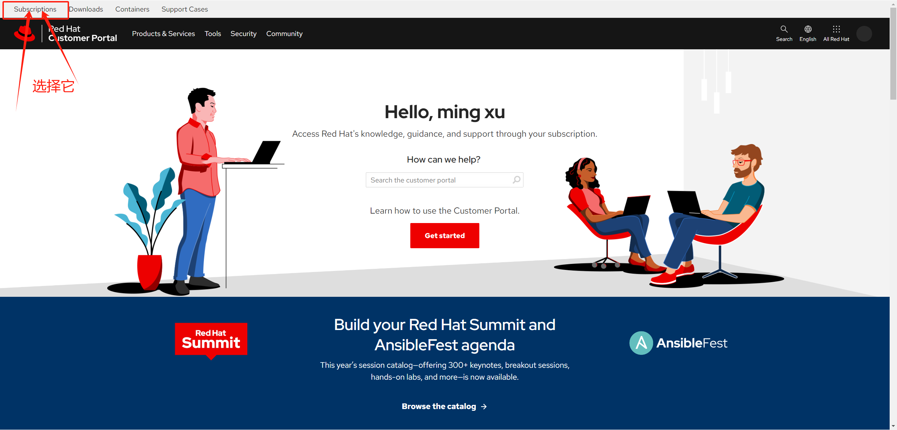

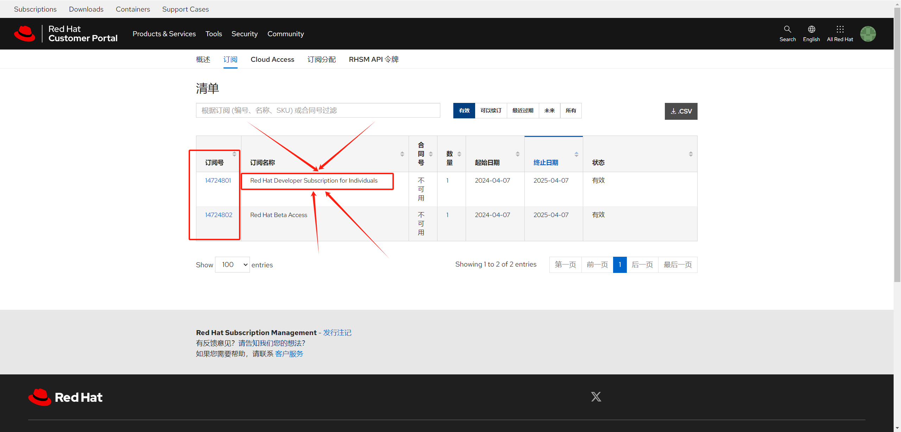

### 下载 RHEL 9.3

打开 [RHEL 9.3 下载页面](https://access.redhat.com/downloads/content/479/ver=/rhel---9/9.3/x86_64/product-software)，选择产品版本 `9.3` 和架构 `x86_64`

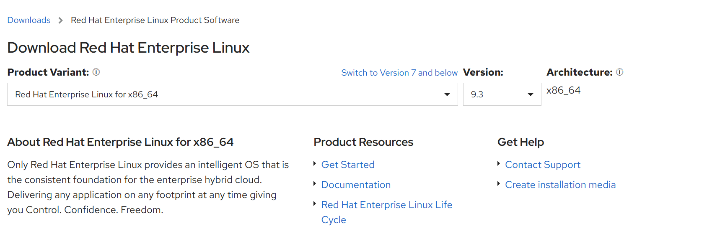

下载完整安装镜像 `rhel-9.3-x86_64-dvd.iso`。完整镜像包含安装所需软件包，适合离线安装和虚拟机练习

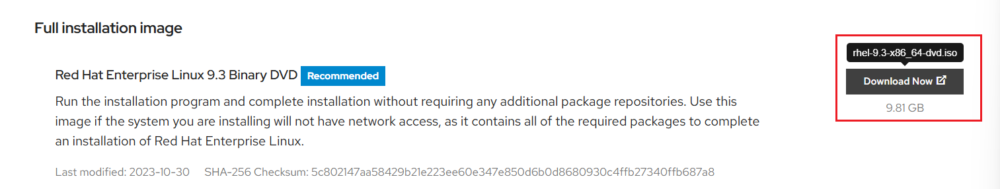

下载后可计算 SHA-256，并与下载页面公布的校验值比对。Windows PowerShell 命令如下：

```powershell
Get-FileHash .\rhel-9.3-x86_64-dvd.iso -Algorithm SHA256
```

## 创建虚拟机

1. 新建虚拟机时选择 `Custom (advanced)`，硬件兼容性保持当前 VMware 版本的默认值即可

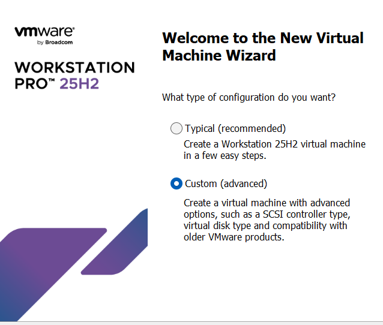

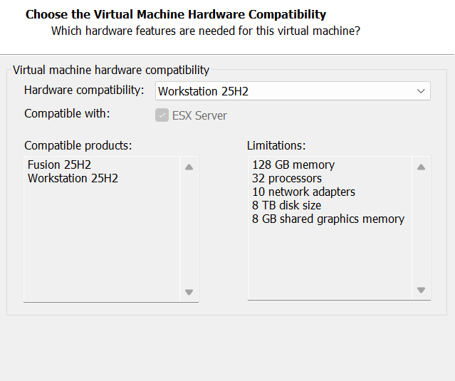

2. 选择 `I will install the operating system later`，先完成硬件配置，再手动挂载镜像

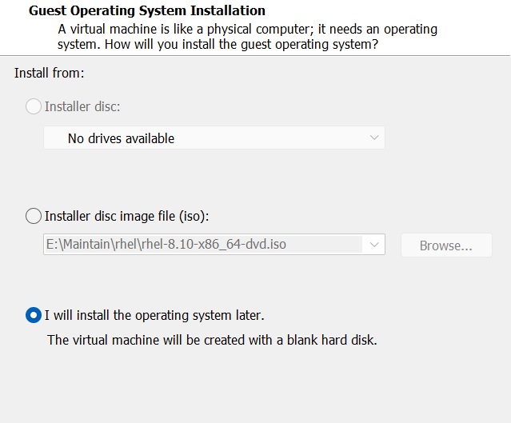

3. 客户机系统选择 `Linux`，版本选择 `Red Hat Enterprise Linux 9 64-bit`

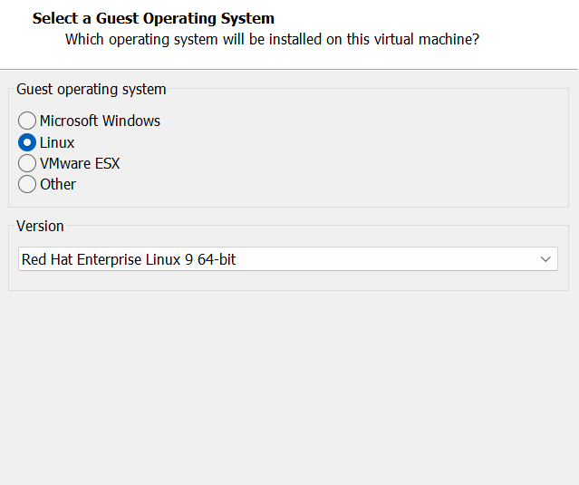

4. 设置虚拟机名称和保存位置，避免把虚拟机文件放在空间不足的磁盘上

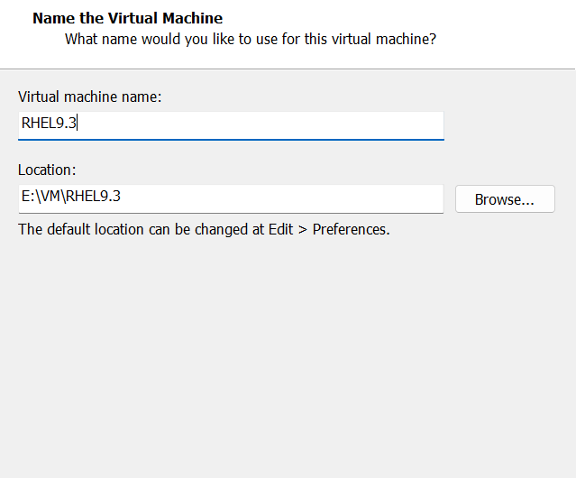

5. 配置处理器和内存。截图使用两个处理器、每个处理器两个核心，共 4 个虚拟 CPU，并分配 4096 MiB 内存

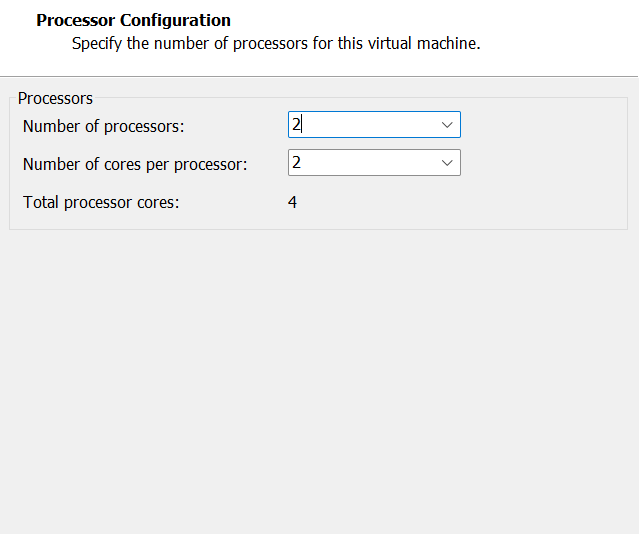

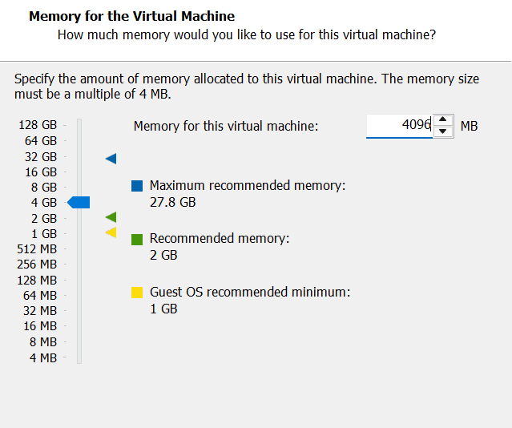

6. 网络选择 NAT，I/O 控制器保持安装向导推荐值

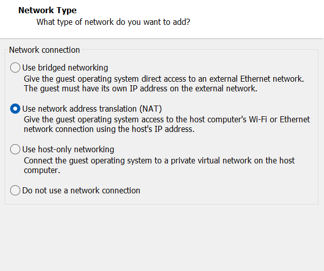

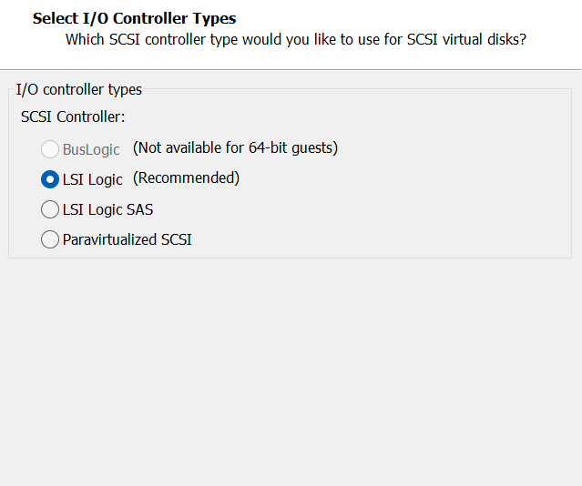

7. 磁盘类型选择推荐的 `NVMe`，并创建新的虚拟磁盘

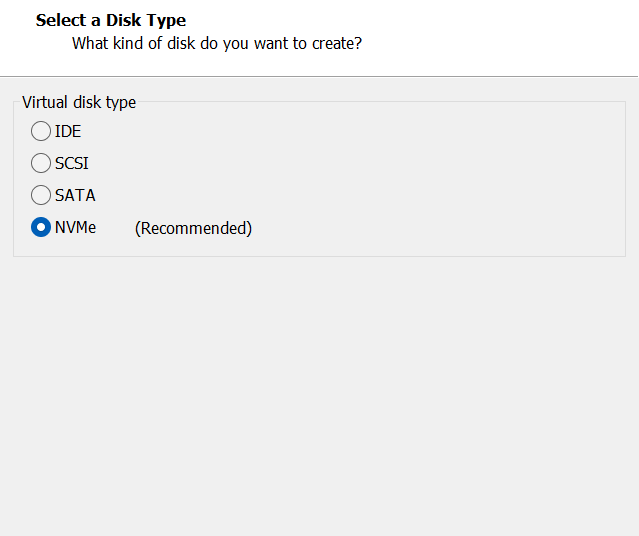

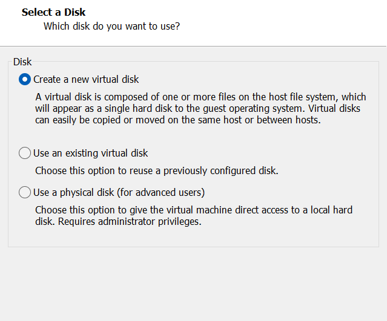

8. 示例磁盘容量为 50 GiB。立即分配全部空间会占用宿主机同等容量，空间紧张时可取消该选项，让虚拟磁盘按需增长

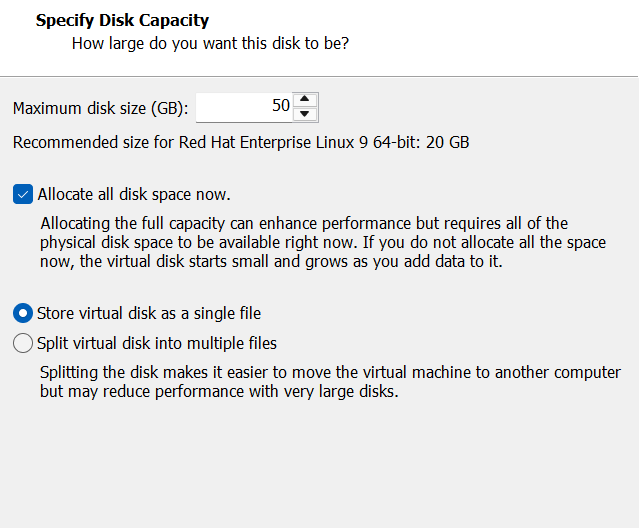

9. 确认虚拟磁盘文件名并完成创建

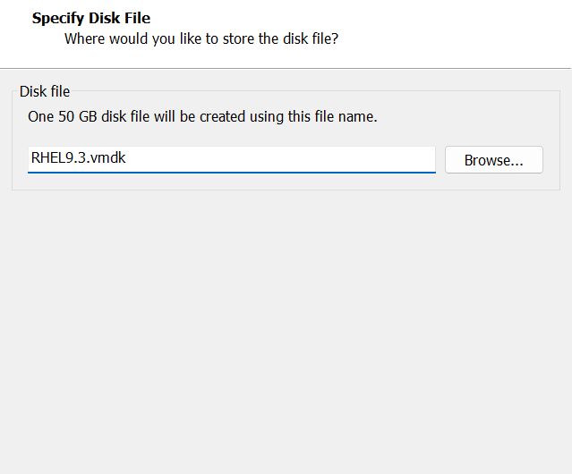

创建完成后打开虚拟机设置，在 `CD/DVD` 设备中选择 `Use ISO image file`，挂载刚下载的 RHEL 镜像，然后启动虚拟机

## 安装系统与分区

从 ISO 启动后进入安装程序。在安装摘要页面重点检查安装目的地、软件选择、网络与主机名以及用户设置

学习虚拟机可以使用自动分区；需要理解挂载点时，再选择手动分区。下面使用截图中的 50 GiB 空白虚拟磁盘演示

> **警告**：手动分区和格式化会改变所选磁盘上的数据布局。开始安装前确认选择的是新建虚拟磁盘，不要在仍有数据的磁盘上照搬操作

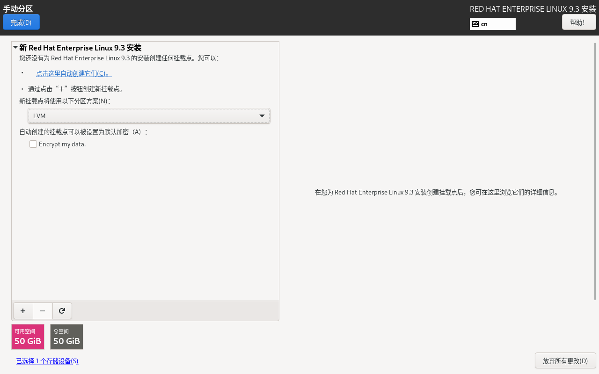

| 挂载点或分区 | 作用 | 截图示例 |
|:---|:---|:---|
| `/boot` | 保存内核、initramfs 和启动所需文件，内核升级也会占用这里 | 512 MiB |
| `/` | 根文件系统，保存未单独挂载的系统文件和用户数据 | 47.5 GiB |
| `swap` | 为内存页换出提供磁盘空间，不能等同或替代物理内存 | 2 GiB |

截图中的容量只用于本次 50 GiB 学习虚拟机。swap 应结合物理内存、工作负载和是否需要休眠等因素规划，不必套用固定的内存倍数

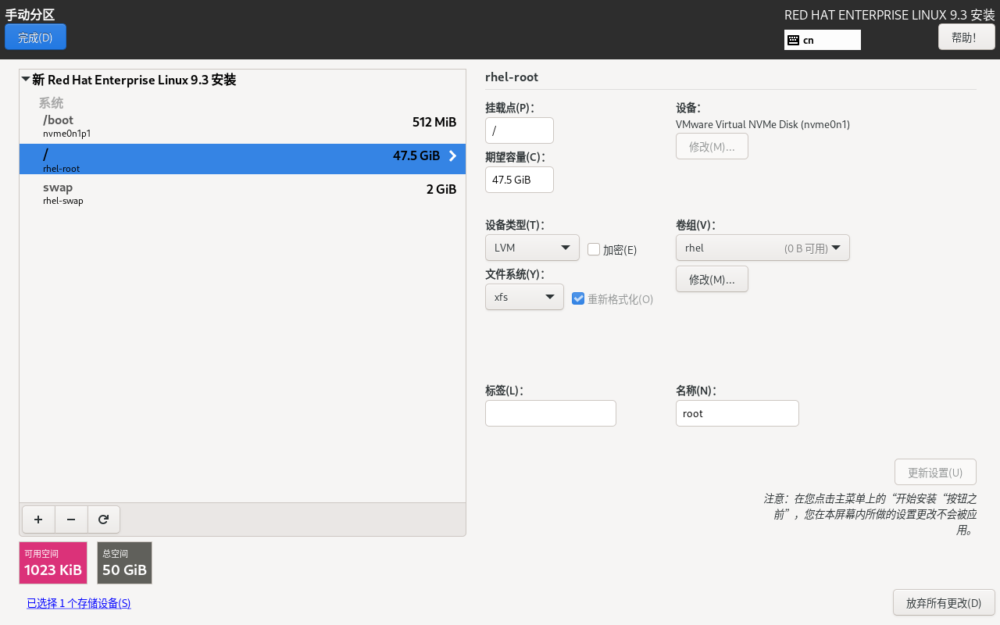

确认分区后返回安装摘要，完成 root 密码或普通用户等必需设置，再开始安装。安装结束后按提示重启；如果重启后再次进入安装程序，关闭虚拟机并断开 ISO 镜像，再从虚拟磁盘启动

## 首次登录与验证

### 本地控制台

安装完成并重启后，在虚拟机控制台输入安装时创建的用户名和密码。密码输入过程中通常不会显示字符，这是正常现象

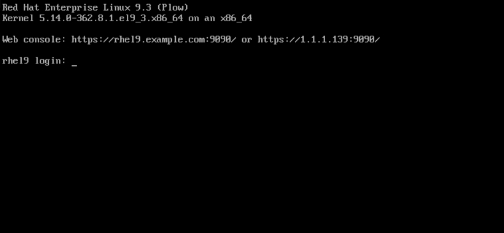

登录后检查系统版本、内核和网络地址：

```bash
cat /etc/redhat-release
uname -r
ip -brief address
```

前两条命令的示例输出如下，实际内核版本会随补丁更新而变化：

```text
Red Hat Enterprise Linux release 9.3 (Plow)
5.14.0-362.8.1.el9_3.x86_64
```

`ip -brief address` 应能看到除 `lo` 回环接口外的网卡。如果需要远程访问，还要确认该网卡已经获得可用 IP 地址

### 虚拟控制台

Linux 通常提供多个虚拟控制台，可用 `Ctrl + Alt + F1` 至 `Ctrl + Alt + F6` 切换。图形界面和文本登录界面对应的 tty 编号会随显示管理器及会话状态变化，不要固定记成某一个控制台

### SSH 远程登录

需要远程管理时，先在系统中确认 SSH 服务状态：

```bash
systemctl is-active sshd
```

服务正常运行时输出：

```text
active
```

然后在客户端使用普通用户登录，将示例用户名和地址替换为实际值：

```bash
ssh dev@192.168.1.100
```

如果连接失败，依次检查网络可达性、IP 地址、`sshd` 状态和防火墙。root 是否允许 SSH 登录由服务端配置决定，日常管理优先使用普通用户配合 `sudo`

### Cockpit Web 控制台

Cockpit 提供浏览器管理界面，适合查看系统状态和完成常见基础配置。需要使用时启动其 socket 单元：

```bash
sudo systemctl enable --now cockpit.socket
systemctl is-active cockpit.socket
```

然后在可访问该主机的浏览器中打开 `https://主机IP:9090`，使用系统账号登录

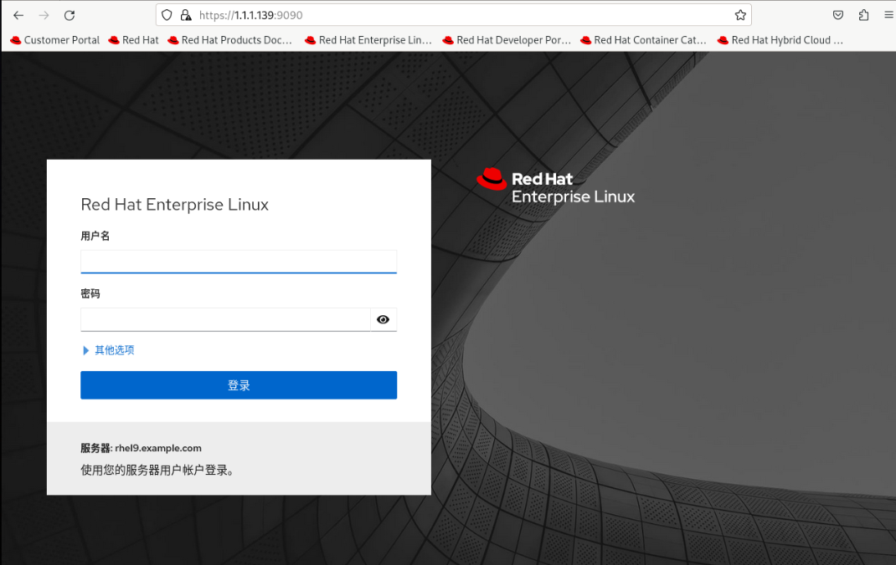

如果页面无法访问，检查服务状态、网络路径和防火墙是否允许 Cockpit 服务。Web 控制台不能替代所有命令行和配置管理操作
