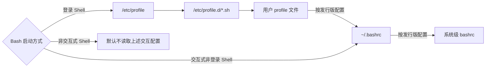
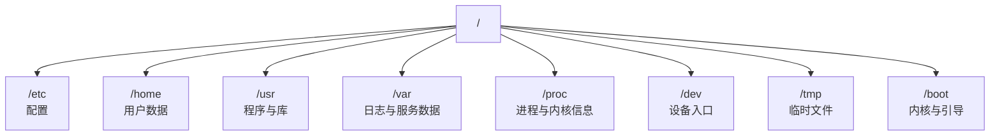
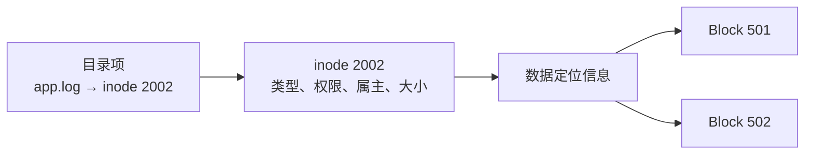
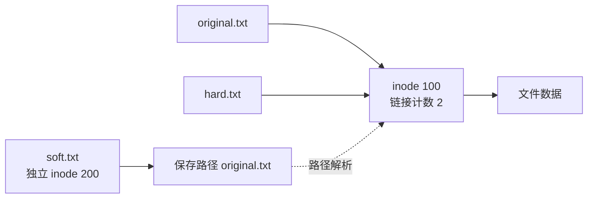
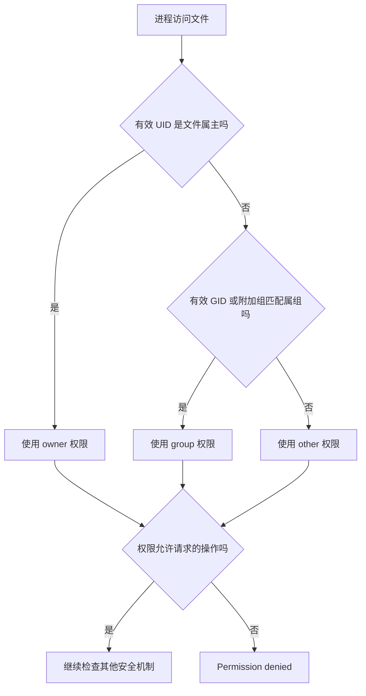
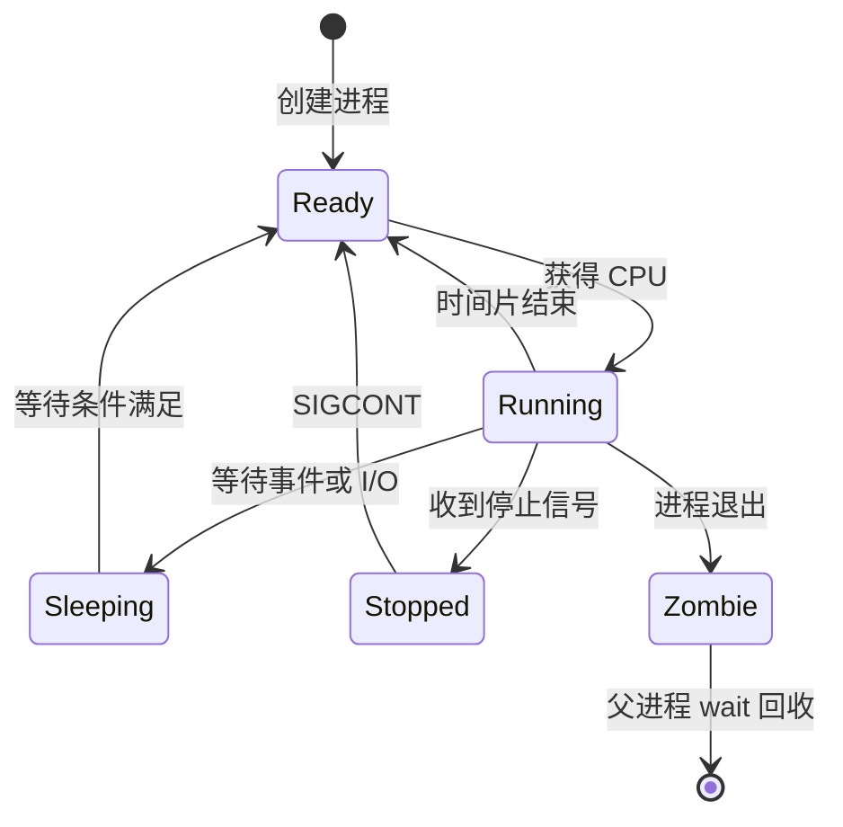
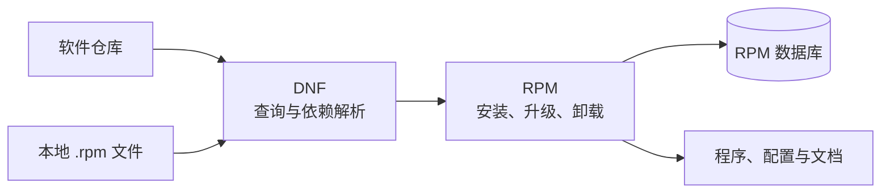
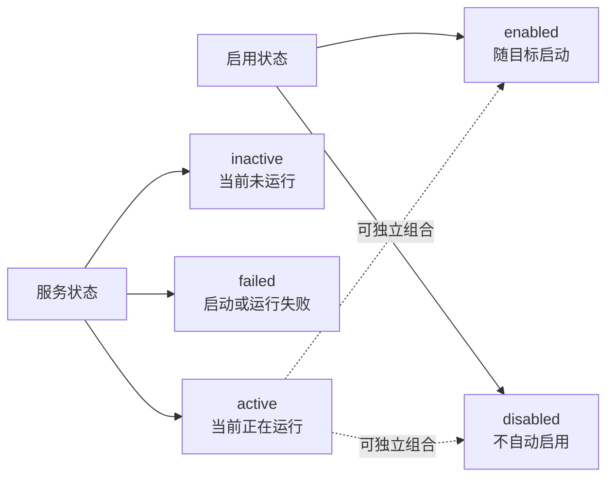
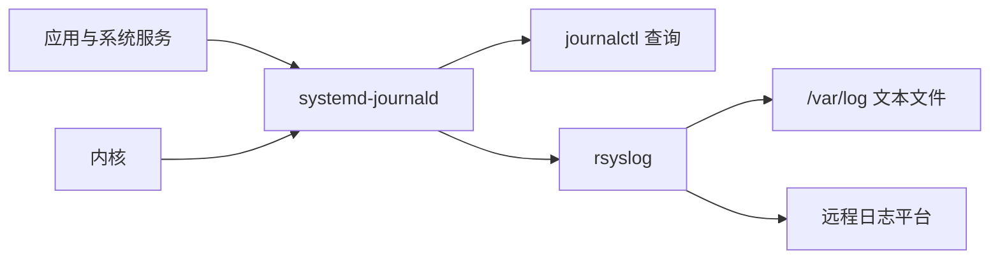

# Linux 基础

Linux 运维的核心工作可以归纳为：管理文件、控制访问、观察进程、部署软件和维护服务。本文围绕这五类任务组织常用概念与命令，并通过短示例说明如何验证结果

示例以 RHEL 9、Rocky Linux 9 和 Bash 为主要环境，命令需要管理员权限时明确使用 `sudo`。文中输出均为简化后的示例输出，实际字段会随系统版本和配置变化

## 阅读路径

| 学习目标 | 建议阅读 |
|:---|:---|
| 熟悉命令行与目录 | Shell 与命令行、目录与文件 |
| 理解磁盘、inode 和链接 | 文件系统与磁盘 |
| 管理账号和访问权限 | 用户、用户组与权限 |
| 排查 CPU、内存和进程问题 | 进程与后台任务 |
| 部署任务、软件和服务 | 计划任务、软件包管理、systemd 服务与日志 |

## Shell 与命令行

Shell 接收命令并启动程序，Bash 是 Linux 中常见的 Shell。命令通常由三部分组成：

```bash
命令 [选项] [参数]
```

```bash
# 以长格式显示 /var/log 的目录内容
ls -l /var/log
```

其中 `ls` 是程序，`-l` 修改输出格式，`/var/log` 是作用对象。多个短选项常可合并，如 `ls -la`

### 登录与交互是两个维度

| 类型 | 判断依据 | 常见例子 |
|:---|:---|:---|
| 登录 Shell | 是否建立新的登录会话 | 控制台登录、SSH 登录、`su -` |
| 非登录 Shell | 是否在已有会话中启动 | 图形终端、直接执行 `bash` |
| 交互式 Shell | 是否显示提示符并读取用户输入 | 日常终端 |
| 非交互式 Shell | 是否批量执行命令 | Shell 脚本、CI 任务 |

Bash 的配置加载与这两个维度有关：



用户登录配置按顺序查找 `~/.bash_profile`、`~/.bash_login`、`~/.profile`，只读取第一个可读文件。日常环境变量可放在用户 profile 文件中，别名和交互函数通常放在 `~/.bashrc`

```bash
# 让修改在当前 Shell 中生效
source ~/.bashrc

# 查看命令来自别名、内建命令还是可执行文件
type cd
type ls
command -v bash
```

示例输出：

```text
cd is a shell builtin
ls is aliased to `ls --color=auto'
/usr/bin/bash
```

> **注意**：脚本不要依赖交互终端中的别名和临时变量。任务脚本应显式设置所需环境，并使用绝对路径处理重要文件

### 获取帮助

| 需求 | 命令 |
|:---|:---|
| 查看 Bash 内建命令帮助 | `help cd` |
| 查看命令手册 | `man ls` |
| 快速查看选项 | `ls --help` |
| 查看命令位置 | `command -v ls` |
| 搜索手册关键词 | `man -k copy` |

## 目录与文件

Linux 将文件、设备和部分内核信息统一组织在一棵目录树中。不同磁盘和虚拟文件系统通过挂载接入这棵树



### 常用目录

| 目录 | 主要内容 | 运维场景 |
|:---|:---|:---|
| `/etc` | 系统与软件配置 | 修改服务、网络和挂载配置 |
| `/home` | 普通用户家目录 | 管理用户文件 |
| `/root` | root 家目录 | 管理员工作环境 |
| `/usr` | 用户空间程序、库和文档 | 查看已安装软件 |
| `/usr/local` | 本地管理员安装的软件 | 部署自编译程序 |
| `/var/log` | 文本日志或持久化日志 | 排查系统与服务故障 |
| `/var/lib` | 服务长期数据 | 数据库、容器和软件状态 |
| `/tmp` | 临时文件 | 短期中间数据 |
| `/run` | 本次启动后的运行状态 | PID 文件、套接字 |
| `/proc` | 内核动态生成的进程与系统信息 | 查看 CPU、内存和进程 |
| `/sys` | 设备、驱动和内核子系统信息 | 查看设备与 cgroup |
| `/dev` | 设备文件 | 访问磁盘、终端和伪设备 |
| `/boot` | 内核、initramfs 和引导文件 | 处理启动问题 |
| `/mnt`、`/media` | 临时或可移动介质挂载点 | 接入其他文件系统 |
| `/opt` | 第三方应用 | 部署独立软件目录 |

采用 usr-merge 的系统中，`/bin`、`/sbin` 和部分 `/lib*` 是指向 `/usr` 下对应目录的符号链接

### 文件操作

```bash
# 创建多级目录和空文件
mkdir -p ~/linux-lab/config
cd ~/linux-lab
touch config/app.conf

# 复制、移动和查看
cp -a config/app.conf config/app.conf.bak
mv config/app.conf.bak config/app.conf.old
ls -l config

# 删除前交互确认
rm -i config/app.conf.old
```

`cp -a` 适合保留模式、属主和时间戳等属性的归档复制，实际保留范围仍受目标文件系统和权限限制。`mv` 在同一文件系统内通常只调整目录项，跨文件系统则相当于复制后删除源文件

> **警告**：`rm -rf` 会递归删除且不逐项确认。执行前检查路径展开结果，不要用不确定的变量拼接删除路径

### 查找文件

```bash
# 在 /var/log 中查找 .log 文件
find /var/log -type f -name '*.log'

# 查找近 7 天修改过、超过 100 MiB 的普通文件
find /var -xdev -type f -mtime -7 -size +100M
```

`-xdev` 限制在当前文件系统内查找，可避免扫描其他挂载点。通配符加引号是为了让 `find` 接收模式，而不是由当前 Shell 提前展开

### 查看系统与设备信息

| 对象 | 常用入口 | 更方便的命令 |
|:---|:---|:---|
| CPU | `/proc/cpuinfo` | `lscpu` |
| 内存 | `/proc/meminfo` | `free -h` |
| 负载 | `/proc/loadavg` | `uptime` |
| 挂载 | `/proc/mounts` | `findmnt` |
| 进程 | `/proc/PID/` | `ps`、`top` |
| 块设备 | `/dev/sd*`、`/dev/nvme*` | `lsblk` |
| 空设备 | `/dev/null` | 丢弃不需要的输出 |

```bash
free -h
uptime
```

示例输出：

```text
               total        used        free      shared  buff/cache   available
Mem:           3.8Gi       1.1Gi       420Mi        85Mi       2.3Gi       2.4Gi
Swap:          2.0Gi          0B       2.0Gi

10:20:00 up 2 days,  3 users,  load average: 0.18, 0.25, 0.31
```

判断内存余量优先看 `available`，它比单独看 `free` 更接近可分配给新应用的内存。负载三个数值分别表示 1、5、15 分钟的平均可运行或不可中断任务数，需要结合 CPU 数量和 I/O 状态分析

## 文件系统与磁盘

### 从设备到目录

块设备提供按块读写的存储接口，分区划分设备空间，文件系统组织数据，挂载把文件系统接入目录树


| 概念 | 作用 | 示例 |
|:---|:---|:---|
| 块设备 | 提供存储空间 | `/dev/sda`、`/dev/nvme0n1` |
| 分区 | 划分设备空间 | `/dev/sda1`、`/dev/nvme0n1p1` |
| 逻辑卷 | 灵活分配存储 | `/dev/mapper/vg0-data` |
| 文件系统 | 管理文件、目录和元数据 | ext4、XFS |
| 挂载点 | 文件系统接入目录树的位置 | `/`、`/var`、`/data` |

ext4 通用且成熟，XFS 适合大文件和并发 I/O，也是 RHEL 系常见的默认文件系统。NFS 和 SMB 则通过网络提供共享目录，不属于本地块设备上的布局

### 查看设备与挂载

```bash
lsblk -f
findmnt /
```

示例输出：

```text
NAME   FSTYPE FSVER LABEL UUID                                 FSAVAIL FSUSE% MOUNTPOINTS
sda
├─sda1 xfs          boot  5b7f...                              420M    32% /boot
└─sda2 xfs          root  9c2a...                               28G    40% /
sdb
└─sdb1 xfs          data  a13d...                              180G    10% /data

TARGET SOURCE    FSTYPE OPTIONS
/      /dev/sda2 xfs    rw,relatime,seclabel,attr2,inode64,logbufs=8
```

先通过 `lsblk -f` 确认设备、文件系统和挂载点，再用 `findmnt` 核对实际挂载关系。设备名可能随硬件和启动顺序变化，持久挂载优先使用稳定的 UUID

### 配置 /etc/fstab

`/etc/fstab` 定义持久挂载，系统启动和执行 `mount -a` 时会读取其中的记录。将示例 UUID 替换为 `lsblk -f` 查到的实际值，并确保 `/data` 挂载点已存在：

```ini
# 设备                  挂载点  类型  选项      dump  fsck
UUID=a13d-example-uuid  /data   xfs   defaults  0     0
UUID=b29c-example-uuid  none    swap  sw        0     0
```

每行包含六个字段：

| 字段 | 含义 | 常用值 |
|:---|:---|:---|
| 设备 | 要挂载的块设备或网络资源 | `UUID=...`、`/dev/sdb1` |
| 挂载点 | 文件系统接入目录树的位置 | `/data`；交换分区使用 `none` |
| 文件系统类型 | 挂载时使用的文件系统类型 | `xfs`、`ext4`、`swap`、`nfs` |
| 挂载选项 | 逗号分隔的挂载参数 | `defaults`、`ro`、`noexec` |
| dump | 是否供 `dump` 工具备份 | 通常为 `0` |
| fsck | 启动时检查文件系统的顺序 | ext 系列通常根为 `1`、其他为 `2`；`0` 表示不检查 |

常见挂载选项：

| 选项 | 作用 |
|:---|:---|
| `defaults` | 等价于 `rw,suid,dev,exec,auto,nouser,async` |
| `rw`、`ro` | 以读写或只读模式挂载 |
| `noexec` | 禁止直接执行该文件系统上的二进制程序 |
| `nosuid` | 忽略 SUID 和 SGID 权限位 |
| `nodev` | 不解析该文件系统上的块设备或字符设备文件 |
| `auto`、`noauto` | 是否在启动或执行 `mount -a` 时自动挂载 |
| `_netdev` | 标记网络文件系统，等待网络就绪后再挂载 |
| `errors=remount-ro` | 文件系统出错时重新挂载为只读，常用于 ext4 |
| `uid=`、`gid=`、`umask=` | 设置 vfat 等文件系统挂载后的默认属主、属组和权限掩码 |

修改后先检查配置并尝试挂载，不要直接重启试错：

```bash
sudo findmnt --verify
sudo mount /data
findmnt /data
```

> **警告**：`mkfs` 会重建文件系统元数据并破坏原有目录结构。执行前必须再次核对设备，并确认已有可靠备份

### df 与 du 解决什么问题

`df` 从文件系统角度查看已用空间，`du` 从目录项角度统计可见文件占用。两者统计口径不同，适合回答不同问题

```bash
df -hT
df -i /
du -xh --max-depth=1 /var | sort -h
```

示例输出：

```text
Filesystem     Type  Size  Used Avail Use% Mounted on
/dev/sda2      xfs    50G   42G  8.0G  84% /

Filesystem      Inodes IUsed IFree IUse% Mounted on
/dev/sda2       25M    320K  25M     2% /

1.2G    /var/cache
3.8G    /var/log
6.1G    /var/lib
11G     /var
```

* 分区空间不足：用 `df -hT` 定位挂载点，再用 `du` 找大目录
* inode 耗尽：用 `df -i` 检查大量小文件造成的元数据消耗
* `du` 统计不到但 `df` 仍显示占用：检查已删除却仍被进程打开的文件，可用 `sudo lsof +L1`

### inode、Block 与目录项

在 ext4、XFS 等文件系统中，文件名不是文件内容本身。目录项把文件名映射到 inode，inode 保存权限、属主、时间戳和数据定位信息，Block 保存实际内容



```bash
stat app.log
```

示例输出：

```text
  File: app.log
  Size: 6000            Blocks: 16         IO Block: 4096   regular file
Device: 802h/2050d      Inode: 2002        Links: 1
Access: (0644/-rw-r--r--)  Uid: (1000/dev)  Gid: (1000/dev)
Modify: 2026-11-09 10:00:00 +0800
Change: 2026-11-09 10:00:00 +0800
 Birth: 2026-11-09 09:30:00 +0800
```

| 时间 | 含义 |
|:---|:---|
| `atime` | 最近访问时间，更新策略受挂载选项影响 |
| `mtime` | 文件内容最近修改时间，`ls -l` 默认显示它 |
| `ctime` | inode 元数据最近变化时间，不是创建时间 |
| `btime` | 创建时间，需要文件系统和接口支持 |

### 硬链接与软链接

硬链接为同一 inode 增加另一个目录项；软链接是独立文件，保存目标路径



```bash
cd ~/linux-lab
printf 'hello\n' > original.txt
ln original.txt hard.txt
ln -s original.txt soft.txt
ls -li original.txt hard.txt soft.txt
```

示例输出：

```text
100 -rw-r--r-- 2 dev dev 6 Nov 9 10:00 original.txt
100 -rw-r--r-- 2 dev dev 6 Nov 9 10:00 hard.txt
200 lrwxrwxrwx 1 dev dev 12 Nov 9 10:00 soft.txt -> original.txt
```

| 对比项 | 硬链接 | 软链接 |
|:---|:---|:---|
| inode | 与目标共享 | 独立 inode |
| 跨文件系统 | 不支持 | 支持 |
| 链接目录 | 通常不允许普通用户创建 | 支持 |
| 删除原路径 | 其他硬链接仍可访问 | 链接失效 |
| 修改内容 | 所有硬链接看到同一内容 | 默认作用于目标文件 |

> **注意**：硬链接不是独立备份，清空或改写任一链接指向的内容，其他链接也会看到变化

## 用户、用户组与权限

### 用户身份

内核使用用户标识符（User ID，UID）和组标识符（Group ID，GID）判断身份。root 的 UID 为 0，普通用户和系统用户的 UID 分配范围由发行版配置决定

| 文件 | 保存内容 |
|:---|:---|
| `/etc/passwd` | 用户名、UID、主组 GID、家目录、登录 Shell |
| `/etc/shadow` | 本地密码散列与密码有效期 |
| `/etc/group` | 组名、GID、附加组成员 |
| `/etc/skel` | 新建用户家目录的初始模板 |

创建练习账号并加入附加组：

```bash
sudo groupadd ops
sudo useradd -m -s /bin/bash dev
sudo passwd dev
sudo usermod -aG ops dev
id dev
getent passwd dev
```

示例输出：

```text
uid=1001(dev) gid=1001(dev) groups=1001(dev),1002(ops)
dev:x:1001:1001::/home/dev:/bin/bash
```

`usermod -aG` 中的 `-a` 表示追加附加组；省略它会替换原附加组列表。已有会话不会自动刷新组列表，需要重新登录或启动新的登录会话

### rwx 权限

`ls -l` 的第一组字段同时表示文件类型和访问权限：

```text
-rw-r--r--
││  │  └─ 其他人：只读
││  └──── 属组：只读
│└─────── 属主：读写
└──────── 普通文件；目录为 d，符号链接为 l
```

| 权限 | 数字 | 普通文件 | 目录 |
|:---|---:|:---|:---|
| `r` | 4 | 读取内容 | 列出目录项名称 |
| `w` | 2 | 修改或截断内容 | 配合 `x` 创建、删除、重命名目录项 |
| `x` | 1 | 执行程序 | 进入目录并解析其中的路径 |

目录的 `r` 和 `x` 容易混淆：`r` 让你看到名称，`x` 让你沿路径访问对象。读取 `/data/app.log` 需要路径各级目录的 `x`，以及文件本身的 `r`

删除文件主要修改父目录，因此通常需要父目录的 `w+x`，而不是文件自身的 `w`。Sticky Bit、ACL 和只读挂载等规则还会继续限制操作

### 权限判断顺序

无扩展 ACL 时，内核选择最匹配的权限类别，不会把三组权限相加：



```bash
cd ~/linux-lab
chmod u=rw,g=r,o= original.txt
chmod 640 original.txt
sudo chown dev:ops original.txt
ls -l original.txt
```

示例输出：

```text
-rw-r----- 1 dev ops 6 Nov 9 10:00 original.txt
```

`chmod 640` 与示例中的符号模式等价。递归使用 `chmod -R` 或 `chown -R` 前先确认目录范围，避免把可执行位、属主或特殊权限批量改错

### umask 与新建文件

umask 用于屏蔽新建对象的权限位。常见程序创建普通文件时请求 `0666`，创建目录时请求 `0777`

```bash
umask
umask -S
umask 027
touch umask-file.txt
mkdir umask-dir
ls -ld umask-file.txt umask-dir
```

示例输出：

```text
0027
u=rwx,g=rx,o=
-rw-r----- 1 dev dev 0 Nov 9 10:10 umask-file.txt
drwxr-x--- 2 dev dev 6 Nov 9 10:10 umask-dir
```

这里的结果是按位清除权限：普通文件为 `0666 & ~0027 = 0640`，目录为 `0777 & ~0027 = 0750`。umask 只影响之后创建的对象，不修改已有文件

### 特殊权限、ACL 与 sudo

| 特殊权限 | 数字 | 主要用途 |
|:---|---:|:---|
| SUID | 4 | 执行支持的二进制时，以文件属主作为有效 UID，如 `passwd` |
| SGID | 2 | 二进制使用文件属组；目录中的新对象继承父目录属组 |
| Sticky Bit | 1 | 共享目录中限制用户删除或重命名他人的目录项，如 `/tmp` |

普通 `rwx` 只能表达属主、属组和其他人。访问控制列表（Access Control List，ACL）可给指定用户或组单独授权：

```bash
sudo mkdir -p /srv/project
sudo setfacl -m u:dev:rx /srv/project
getfacl /srv/project
```

示例输出：

```text
# file: srv/project
# owner: root
# group: root
user::rwx
user:dev:r-x
group::r-x
mask::r-x
other::---
```

`user:dev:r-x` 表示 dev 获得读取和遍历权限，`mask` 是命名用户及组类条目的有效权限上限。访问目录仍需其父目录的 `x`；需要让新建对象继承规则时，可设置默认 ACL，例如 `setfacl -d -m g:ops:rx /srv/project`

`sudo` 按策略以其他用户身份执行命令，默认目标是 root。RHEL 系常允许 `wheel` 组成员使用 sudo：

```ini
%wheel  ALL=(ALL)  ALL
```

```bash
# 安全编辑配置并检查语法
sudo visudo

# 查看当前用户获得的授权
sudo -l
```

> **警告**：授权 Shell、编辑器或能够写系统文件的命令，往往等价于授予完整 root 权限。配置 sudo 时按实际任务收敛命令和参数范围

## 进程与后台任务

进程是程序的一次运行实例，内核通过进程标识符（Process ID，PID）管理它。`PPID` 表示父进程 PID，进程树可以帮助判断服务由谁启动、异常子进程来自哪里

### 进程状态



| `ps` 状态 | 含义 | 排查重点 |
|:---|:---|:---|
| `R` | 正在运行或等待 CPU | CPU 是否饱和 |
| `S` | 可中断睡眠，等待事件 | 正常等待或下游无响应 |
| `D` | 不可中断睡眠，常见于内核 I/O 等待 | 存储、NFS 和内核日志 |
| `T`、`t` | 作业控制停止或调试停止 | `SIGSTOP`、调试器 |
| `Z` | 已退出但父进程尚未回收 | 父进程的 `wait()` 逻辑 |

僵尸进程本身不继续占用 CPU 和应用内存，重点是检查父进程。父进程先退出的子进程会被系统中的收养者接管，并不一定会变成僵尸进程

### 查看进程与资源

```bash
# 按 CPU 使用率排序，查看前 5 条进程记录
ps -eo user,pid,ppid,stat,%cpu,%mem,comm --sort=-%cpu | head -n 6

# 查看进程父子关系
pstree -p
```

示例输出：

```text
USER         PID    PPID STAT %CPU %MEM COMMAND
root        1420       1 R    72.5  8.2 stress
nginx       1088    1076 S     2.1  1.4 nginx
root        1076       1 S     0.0  0.8 nginx
root           1       0 Ss    0.0  0.4 systemd
dev         1310    1280 S     0.0  0.2 bash
```

`ps` 的 `%CPU` 是累计 CPU 时间与进程运行时长的比值，`%MEM` 是 RSS 占物理内存的比例；需要观察实时变化时使用 `top`。查看内存详情时还要区分虚拟地址空间和实际驻留内存：

| 指标 | 含义 |
|:---|:---|
| `VSZ`、`VIRT` | 进程虚拟地址空间大小，不等于实际占用 RAM |
| `RSS`、`RES` | 当前驻留内存，包含部分共享页 |
| `SHR` | 可能与其他进程共享的驻留内存 |
| `avail Mem` | 估算的可供新应用使用的内存 |

`top` 中常用 `P` 按 CPU 排序、`M` 按内存排序、`1` 展开每个逻辑 CPU、`c` 显示完整命令、`q` 退出

| CPU 字段 | 含义 |
|:---|:---|
| `us` | 用户态程序占用的时间 |
| `sy` | 内核态代码占用的时间 |
| `id` | 空闲时间 |
| `wa` | 有未完成 I/O 时的 CPU 空闲等待时间 |
| `st` | 虚拟 CPU 等待宿主机调度的时间 |

`wa` 高只提供 I/O 排查线索，还要结合磁盘延迟、进程状态和日志判断

### 信号与终止顺序

| 信号 | 常见编号 | 作用 |
|:---|:---|:---|
| `SIGTERM` | 15 | 请求进程退出，程序可执行清理 |
| `SIGKILL` | 9 | 强制终止，程序无法捕获或清理 |
| `SIGHUP` | 1 | 终端挂断；部分服务用它重载配置 |
| `SIGINT` | 2 | 终端中断，常由 `Ctrl+C` 触发 |
| `SIGSTOP` | 19 | 强制停止，不能捕获或忽略 |
| `SIGCONT` | 18 | 继续已停止的进程 |

```bash
# 先确认 PID 和命令，再请求退出
ps -p 1420 -o pid,ppid,user,stat,cmd
kill -TERM 1420

# 确认进程是否仍存在
ps -p 1420 -o pid,stat,cmd
```

优先使用 `SIGTERM`，等待应用清理并确认无效后再考虑 `SIGKILL`。由 systemd 管理的服务优先使用 `systemctl stop` 或 `restart`，不要只杀主进程而绕过服务管理器

### 调整调度权重与后台运行

`nice` 值影响普通分时任务竞争 CPU 时的相对权重，范围通常为 `-20` 到 `19`，数值越小，调度权重越高

```bash
# 启动低权重任务
nice -n 10 /usr/local/bin/batch-job

# 将已有进程的 nice 值设为 10
renice -n 10 -p 1420
```

| 方式 | 适用场景 | 终端退出后的行为 |
|:---|:---|:---|
| `command &` | 临时后台任务 | 不保证继续运行 |
| `Ctrl+Z`、`bg`、`fg` | 暂停、后台继续、切回前台 | 仍与当前 Shell 和终端相关 |
| `nohup command >app.log 2>&1 < /dev/null &` | 简单长期任务 | 忽略 SIGHUP，但仍可能被其他信号终止 |
| `tmux`、`screen` | 需要重新连接的交互任务 | 会话可保持并重新接入 |
| systemd service | 正式服务 | 由服务管理器按配置维护 |

## 计划任务

一次性任务使用 `at`，周期任务常用 `crontab`，需要依赖管理、随机延迟或更精确触发条件时可使用 systemd timer

### crontab 时间表达式

用户级任务通过 `crontab -e` 编辑，每行前五个字段表示时间，后面直接写命令：

```text
┌───────────── 分钟：0～59
│ ┌─────────── 小时：0～23
│ │ ┌───────── 日期：1～31
│ │ │ ┌─────── 月份：1～12
│ │ │ │ ┌───── 星期：0～7，0 和 7 都可表示星期日
│ │ │ │ │
* * * * * 要执行的命令
```

| 表达式 | 执行时间 |
|:---|:---|
| `*/5 * * * *` | 每 5 分钟 |
| `0 */2 * * *` | 每 2 小时的整点 |
| `30 2 * * *` | 每天 02:30 |
| `0 3 * * 1` | 每周一 03:00 |
| `0 8-18/2 * * 1-5` | 工作日 08:00 至 18:00，每 2 小时 |

```bash
# 查看和编辑当前用户的任务
crontab -l
crontab -e
```

假设 `/usr/local/bin/health-check.sh` 已部署且可执行，示例任务如下：

```cron
# 每 5 分钟执行健康检查，并同时记录标准输出和标准错误
*/5 * * * * /usr/local/bin/health-check.sh >> /var/log/health-check.log 2>&1
```

脚本应使用绝对路径、显式设置 `PATH`，并确保运行用户对日志目录有写权限。cron 不自动加载交互式 Shell 的全部环境；命令中的 `%` 需要写成 `\%`，例如 `date +\%F`

> **注意**：`/etc/crontab` 和 `/etc/cron.d/*` 在时间字段后还要写运行用户名，与用户 `crontab -e` 的格式不同。`crontab -r` 会删除当前用户整份任务表，执行前先用 `crontab -l > crontab.bak` 保存备份

RHEL 系可检查 `crond` 状态和执行日志：

```bash
systemctl status crond
sudo journalctl -u crond --since today
```

## 软件包管理

RPM 负责软件包格式、安装事务和本机包数据库，DNF 在此基础上处理仓库元数据、依赖解析和批量事务。RHEL 8/9 中的 `yum` 命令由 DNF 提供兼容入口



### 使用 DNF

| 目标 | 命令 |
|:---|:---|
| 查看已启用仓库 | `dnf repolist` |
| 搜索软件 | `dnf search nginx` |
| 查看包详情 | `dnf info nginx` |
| 安装软件 | `sudo dnf install nginx` |
| 安装本地包并解析依赖 | `sudo dnf install ./package.rpm` |
| 升级指定软件 | `sudo dnf upgrade nginx` |
| 卸载软件 | `sudo dnf remove nginx` |
| 查找文件由哪个包提供 | `dnf provides '*/sshd'` |
| 查看历史事务 | `dnf history` |

```bash
dnf provides '*/sshd'
```

示例输出：

```text
openssh-server-8.7p1-38.el9.x86_64 : An open source SSH server daemon
Repo        : baseos
Matched from:
Filename    : /usr/sbin/sshd
```

### 查询已安装的 RPM 包

| 目标 | 命令 |
|:---|:---|
| 查询包是否安装 | `rpm -q openssh-server` |
| 查看包信息 | `rpm -qi openssh-server` |
| 列出包安装的文件 | `rpm -ql openssh-server` |
| 列出配置文件 | `rpm -qc openssh-server` |
| 查询本机文件所属包 | `rpm -qf /usr/sbin/sshd` |
| 校验已安装文件是否变化 | `sudo rpm -V openssh-server` |
| 检查 RPM 文件签名与摘要 | `rpm -K package.rpm` |

```bash
rpm -qf /usr/sbin/sshd
```

示例输出：

```text
openssh-server-8.7p1-38.el9.x86_64
```

`rpm -K` 检查包文件，`rpm -V` 对比已安装文件与 RPM 数据库，两者用途不同。正常安装优先使用 DNF，不要用 `--nodeps` 跳过依赖检查来掩盖问题

Debian、Ubuntu 使用 dpkg 和 APT，常见对应关系如下：

| 目标 | RHEL 系 | Debian、Ubuntu |
|:---|:---|:---|
| 刷新仓库元数据 | `dnf makecache` | `sudo apt update` |
| 安装软件 | `sudo dnf install 包名` | `sudo apt install 包名` |
| 卸载软件 | `sudo dnf remove 包名` | `sudo apt remove 包名` |
| 查询已安装包 | `rpm -q 包名` | `dpkg -s 包名` |
| 查询文件归属 | `rpm -qf 路径` | `dpkg -S 路径` |

## systemd 服务与日志

systemd 是系统和服务管理器，`systemctl` 用于管理 service、socket、timer、mount、target 等单元。服务管理要同时区分**当前是否运行**和**下次启动是否自动启用**



### 管理服务

```bash
# 当前状态与开机启用状态
systemctl status sshd
systemctl is-active sshd
systemctl is-enabled sshd

# 启动并设置开机自启
sudo systemctl enable --now sshd

# 修改应用配置后，按服务支持情况重载或重启
sudo systemctl reload sshd
sudo systemctl restart sshd
```

示例输出：

```text
active
enabled
```

| 操作 | 命令 | 结果 |
|:---|:---|:---|
| 启动 | `systemctl start 服务` | 只改变当前状态 |
| 停止 | `systemctl stop 服务` | 只改变当前状态 |
| 开机启用 | `systemctl enable 服务` | 不自动启动当前服务 |
| 取消启用 | `systemctl disable 服务` | 不自动停止当前服务 |
| 启用并立即启动 | `systemctl enable --now 服务` | 同时处理两种状态 |

`reload` 要求服务支持配置重载。修改 systemd 单元文件后需要执行 `systemctl daemon-reload`，它只让 systemd 重读单元配置，不会自动重启服务

### 兼容旧版 SysV 启动脚本

旧版 SysV init 系统通过 `/etc/rc.d` 组织服务启动脚本。现代 RHEL 系统使用 systemd，这些目录主要用于理解旧系统和运行兼容脚本：

```text
/etc/rc.d/
├── init.d/       # 实际的服务管理脚本
├── rc0.d/ ... rc6.d/
│                 # 各运行级别使用的脚本链接
└── rc.local      # 旧式本地启动命令
```

`rc0.d` 到 `rc6.d` 对应运行级别，常见的有 `0` 关机、`1` 单用户、`3` 多用户文本模式、`5` 图形模式和 `6` 重启。目录中的 `S01network`、`K90network` 等文件通常是指向 `init.d` 脚本的符号链接：`S` 表示启动，`K` 表示停止，两位数字控制执行顺序

`/etc/rc.local` 通常是指向 `/etc/rc.d/rc.local` 的符号链接。部分 systemd 系统可通过 `rc-local.service` 兼容执行该脚本，但要求系统提供相应单元且脚本具有执行权限。新的开机任务优先使用 systemd service 或 timer

### 编写最小 service

假设 `/usr/local/bin/demo-server` 已安装并可执行，专用用户 `demo` 已存在。创建 `/etc/systemd/system/demo-server.service`：

```ini
[Unit]
Description=Demo application
After=network.target

[Service]
Type=simple
User=demo
Group=demo
ExecStart=/usr/local/bin/demo-server
Restart=on-failure
RestartSec=5

[Install]
WantedBy=multi-user.target
```

`Type=simple` 表示 `ExecStart` 启动的进程就是主进程，程序应保持前台运行。`Restart=on-failure` 让异常退出后的服务自动恢复，`WantedBy` 决定启用时接入哪个启动目标

```bash
# 校验单元文件，再让 systemd 重读配置
sudo systemd-analyze verify /etc/systemd/system/demo-server.service
sudo systemctl daemon-reload

# 启动、启用并验证
sudo systemctl enable --now demo-server.service
systemctl is-active demo-server.service
systemctl is-enabled demo-server.service
```

如果启动失败，先查看单元状态和最近日志：

```bash
systemctl status demo-server.service --no-pager
sudo journalctl -u demo-server.service -n 50 --no-pager
```

### 查询日志

`systemd-journald` 收集结构化日志，使用 `journalctl` 查询；`rsyslog` 可按规则写入文本日志或转发到远程平台。两者可以协同工作



| 需求 | 命令 |
|:---|:---|
| 查看指定服务日志 | `journalctl -u sshd` |
| 实时跟随 | `journalctl -f` |
| 查看最近 50 行 | `journalctl -n 50` |
| 查看本次启动日志 | `journalctl -b` |
| 按时间过滤 | `journalctl --since '2026-11-09 09:00' --until '2026-11-09 10:00'` |
| 查看错误及以上级别 | `journalctl -p err` |
| 查看磁盘占用 | `journalctl --disk-usage` |

RHEL 系常见 `/var/log/messages` 和 `/var/log/secure`，Debian、Ubuntu 常见 `/var/log/syslog` 和 `/var/log/auth.log`。这些文件是否存在取决于 rsyslog 等服务的安装和规则

## 时间与区域设置

系统时间影响日志关联、证书验证、计划任务和分布式系统。配置时区使用 IANA 名称，例如 `Asia/Shanghai`，避免使用有歧义的 `CST`

```bash
# 查看时间、时区和同步状态
timedatectl status

# 设置时区并启用网络时间同步
sudo timedatectl set-timezone Asia/Shanghai
sudo timedatectl set-ntp true

# 查看系统区域设置
localectl status
```

示例输出：

```text
               Local time: Mon 2026-11-09 10:30:00 CST
           Universal time: Mon 2026-11-09 02:30:00 UTC
                 RTC time: Mon 2026-11-09 02:30:00
                Time zone: Asia/Shanghai (CST, +0800)
System clock synchronized: yes
              NTP service: active
```

`set-ntp true` 只启用受支持的时间同步服务，最终是否同步成功应看 `System clock synchronized` 和对应服务状态

## 常见问题的检查路径

排障时先收集证据，再实施变更。下面的命令组合用于缩小范围，不把单一指标直接当作根因

| 现象 | 第一轮检查 | 根据结果继续 |
|:---|:---|:---|
| 服务无法访问 | `systemctl status`、`ss -lntup` | 查服务日志、监听地址和防火墙 |
| 服务启动失败 | `systemctl status --no-pager` | `journalctl -u 服务 -n 50`，再检查配置与权限 |
| CPU 持续偏高 | `top`、`ps -eo ... --sort=-%cpu` | 确认进程、线程、负载和应用日志 |
| 磁盘空间不足 | `df -hT`、`du -xh --max-depth=1` | 定位大文件；空间未释放时检查 `lsof +L1` |
| 无法读写文件 | `id`、`ls -ld`、`namei -l 路径` | 检查路径各级目录、文件权限和 ACL |
| 定时任务未执行 | `crontab -l`、cron 服务状态 | 查 cron 日志、脚本路径、环境和执行权限 |

例如排查路径权限时，`namei -l /srv/project/app.log` 会逐级显示 `/`、`/srv`、`/srv/project` 和文件的属主及权限，比只执行 `ls -l app.log` 更容易定位是哪一级目录缺少 `x`
