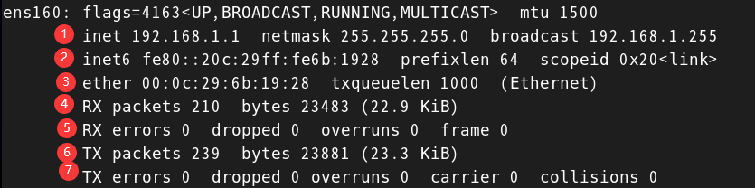
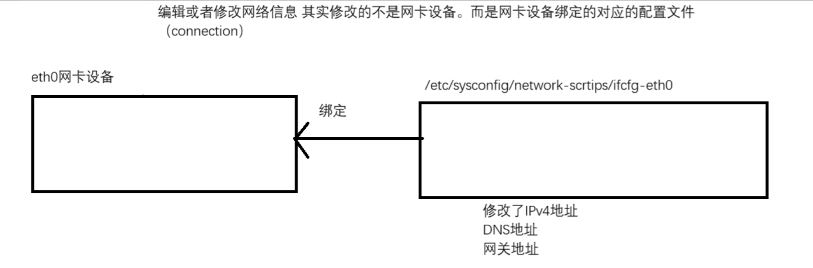
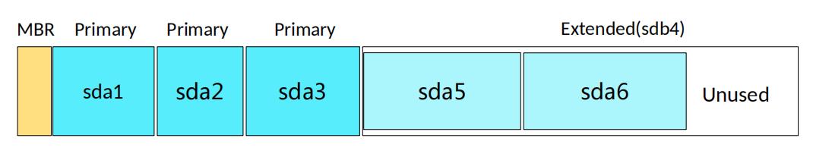
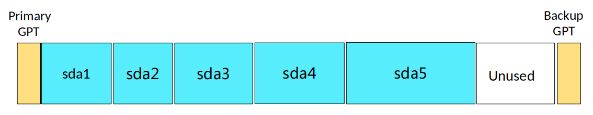
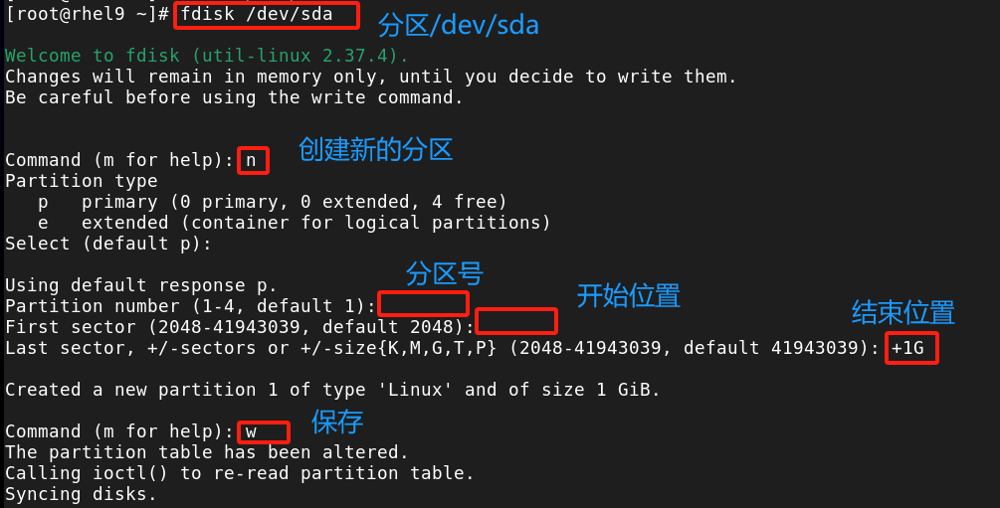
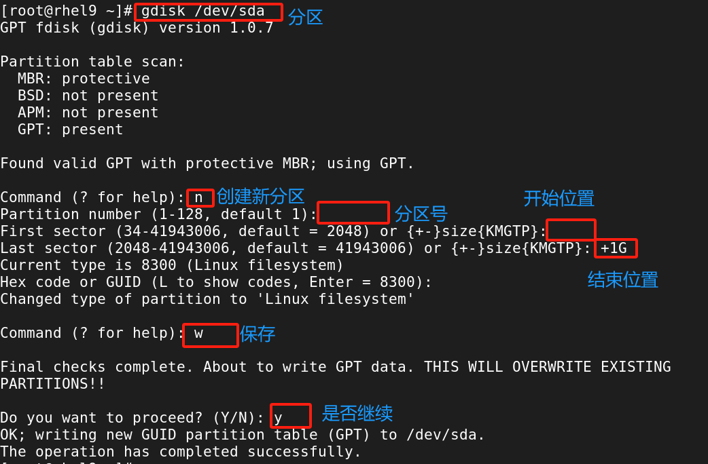
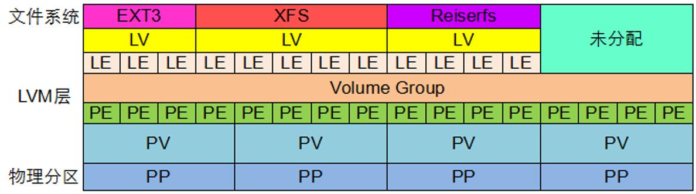

# 系统管理

## 重置root密码

目前最标准、最安全的方法是使用`rd.break`中断启动流程，必须能够**物理接触服务器**，或者通过**虚拟机控制台**进行操作，SSH 远程连接无法完成次操作

**1）步骤一：**重启并进入 GRUB 模式

使用方向键切换，并按`e`进入编辑模式（只会临时修改本次启动的内核参数，不会永久修改配置文件`/etc/default/grub`）

**2）步骤二：**修改内核启动参数

找到以`linux`、`linux16`或`linuxefi`开头的那一行，从末尾删除到ro，然后添加

```bash
rd.break

# rd.break是一个dracut参数，作用是告诉系统在加载完内存文件系统后、挂载真实的根文件系统前，立即中断启动过程，并弹出具有root权限的紧急shell
# 此时，真实的系统根目录被临时挂载在/sysroot目录下，且处于只读状态(ro)
```

按`Ctrl + X`使用修改后的参数启动系统

**3）步骤三：**重新挂载根文件系统为读写模式

在弹出的`switch_root:/#`提示符下输入：

```bash
mount -o remount,rw /sysroot

# 真实的根文件系统挂载在/sysroot下，默认为只读，修改密码需要拥有写/etc/shadow文件权限，因此必须先将其挂载为读写模式(rw)
```

**4）步骤四：**切换根目录

```bash
chroot /sysroot

# 当前shell环境为内存文件系统，非真实系统，需要使用chroot命令将当前根目录切换到/sysroot
# 这样passwd命令才能修改真实系统的/etc/shadow文件
```

**5）步骤五：**重置root密码

```bash
passwd root
```

**6）步骤六：**强制SELinux重新打标签

```bash
touch /.autorelabel

# 强制恢复所有文件的正确安全上下文，如果不做这一步，重启后即使密码正确，也会因为SELinux拦截而无法登录系统
```

**7）步骤七：**退出并继续启动

```bash
exit  # 退出 chroot 环境，回到 initramfs 的 shell
exit  # 退出 initramfs shell，系统继续正常的启动流程
```


# Linux网络管理

## 网卡设备命名

1）云服务器上的设备名

* `eth0`：传统方式的命名（RHEL6- 默认）

`ethx`，根据系统开机时，加载到设备的顺序进行命名，比如`eth0、eth1、eth2`

```bash
eth0: flags=4163<UP,BROADCAST,RUNNING,MULTICAST>  mtu 1500
        inet 192.168.0.131  netmask 255.255.255.0  broadcast 192.168.0.255
        inet6 fe80::f816:3eff:fe1a:72f5  prefixlen 64  scopeid 0x20<link>
        ether fa:16:3e:1a:72:f5  txqueuelen 1000  (Ethernet)
        RX packets 24591  bytes 34154500 (32.5 MiB)
        RX errors 0  dropped 0  overruns 0  frame 0
        TX packets 2160  bytes 163369 (159.5 KiB)
        TX errors 0  dropped 0 overruns 0  carrier 0  collisions 0

lo: flags=73<UP,LOOPBACK,RUNNING>  mtu 65536
        inet 127.0.0.1  netmask 255.0.0.0
        inet6 ::1  prefixlen 128  scopeid 0x10<host>
        loop  txqueuelen 1000  (Local Loopback)
        RX packets 0  bytes 0 (0.0 B)
        RX errors 0  dropped 0  overruns 0  frame 0
        TX packets 0  bytes 0 (0.0 B)
        TX errors 0  dropped 0 overruns 0  carrier 0  collisions 0
```

2）VMware虚拟机上的设备名

* `ens160/ens224`：基于设备特征的命名（RHEL7+ 默认）

接口类型：en（以太网设备）、wl（无线局域网设备）、ww（无线局域网设备）

固件类型：s（热插拔）、o（板载设备）、P（pci设备）

```bash
ens160: flags=4163<UP,BROADCAST,RUNNING,MULTICAST>  mtu 1500
        inet 20.0.0.130  netmask 255.255.255.0  broadcast 20.0.0.255
        inet6 fe80::6b8d:1c62:7877:2730  prefixlen 64  scopeid 0x20<link>
        ether 00:0c:29:66:cf:0e  txqueuelen 1000  (Ethernet)
        RX packets 47514  bytes 25176653 (24.0 MiB)
        RX errors 0  dropped 0  overruns 0  frame 0
        TX packets 37144  bytes 4066635 (3.8 MiB)
        TX errors 0  dropped 0 overruns 0  carrier 0  collisions 0

ens224: flags=4163<UP,BROADCAST,RUNNING,MULTICAST>  mtu 1500
        inet 10.0.0.128  netmask 255.255.255.0  broadcast 10.0.0.255
        inet6 fe80::d252:e747:2763:a8e5  prefixlen 64  scopeid 0x20<link>
        ether 00:0c:29:66:cf:18  txqueuelen 1000  (Ethernet)
        RX packets 6431  bytes 1739282 (1.6 MiB)
        RX errors 0  dropped 0  overruns 0  frame 0
        TX packets 4929  bytes 458694 (447.9 KiB)
        TX errors 0  dropped 0 overruns 0  carrier 0  collisions 0

lo: flags=73<UP,LOOPBACK,RUNNING>  mtu 65536
        inet 127.0.0.1  netmask 255.0.0.0
        inet6 ::1  prefixlen 128  scopeid 0x10<host>
        loop  txqueuelen 1000  (Local Loopback)
        RX packets 482  bytes 47840 (46.7 KiB)
        RX errors 0  dropped 0  overruns 0  frame 0
        TX packets 482  bytes 47840 (46.7 KiB)
        TX errors 0  dropped 0 overruns 0  carrier 0  collisions 0
```

## 修改系统网卡设备为传统命名

内核启动参数修改

* RHEL9 之前的版本

修改内核参数，在开机的时候读取到俩个内核参数：`biosdevname=0/net.ifnames=0`

```bash
vim /etc/default/grub

# 末尾处添加两个内核参数
GRUB_CMDLINE_LINUX="resume=UUID=762c21ff-718c-46c1-9b18-766dc353d162 rhgb quiet net.ifnames=0 biosdevname=0"
```

```bash
# 重新生成/boot/grub2/grub.cfg配置文件
grub2-mkconfig -o /boot/grub2/grub.cfg

# 重启系统生效
reboot
```

* RHEL9 版本做法

修改 `/boot/loader/entries` 目录下正常内核的.conf配置文件

```bash
# 末尾处添加两个内核参数
options root=UUID=9e7f0e3f-a69a-4529-90d7-34108977ee42 ro resume=UUID=762c21ff-718c-46c1-9b18-766dc353d162 rhgb quiet net.ifnames=0 biosdevname=0

# 重启系统生效
reboot
```

## 网络管理工具

### 查看网络

Linux 网络工具经历了两代更替，RHEL8/9 已默认弃用旧版（需手动 yum install net-tools）

| 功能       | net-tools           | iproute2              | 核心差异                     |
|:-------- |:------------------- |:--------------------- |:------------------------ |
| 接口/IP    | `ifconfig`          | `ip addr` / `ip a`    | 支持多IP、CIDR、作用域、生命周期      |
| 路由       | `route -n`          | `ip route` / `ip r`   | 显示策略路由、proto来源、metric优先级 |
| 端口/连接    | `netstat`           | `ss`                  | 直接读内核netlink，速度快10倍+     |
| ARP/邻居缓存 | `arp`               | `ip neigh`            | 支持IPv6邻居发现(NDP)          |
| 隧道/策略    | `iptunnel`/`iprule` | `ip tunnel`/`ip rule` | 统一语法，支持复杂策略路由            |



```bash
UP：网卡启动状态
BROADCAST：支持广播
RUNNING：网卡已接入
MULTICAST：支持组播
mtu 1500：一次性传输的最大数据包大小（字节）

1、Ipv4地址 子网掩码地址 广播地址
2、Ipv6地址 Ipv6速率
3、Mac地址  最大速率
4、数据包接受大小
5、接受错误的数据包大小
6、发送数据包大小
7、发送错误的数据包大小
```


```bash
Destination：目标网络或主机地址
Gateway：网关地址
Genmask：网络掩码
Flags：
  - U 路由可用
  - G 需要经过网关
  - H 主机路由
  - D 动态
  - R 回滚
Metric：路由优先级，值越小优先级越高
Ref：引用计数，表示有多少其他路由依赖此路由
Use：该路由被查找的次数
Iface：数据包从哪个网络接口发出
```


```bash
default：等同于 0.0.0.0/0，表示默认路由
via：下一条网关地址
dev：出口网络接口
metric：路由优先级，数值越小越优先
proto：
  - kernel 由内核自动添加
  - static 手动添加
  - dhcp、ra
scope：
  - global 可路由到全局
  - link 仅在同一链路有效
  - host 仅限本机
src：建议使用源 IP 地址
```


### 配置网络

Linux上的网络服务：管理网络的服务的

* `network`：RHEL7 及之前版本使用的网络服务，每次修改网络配置之后，都需要重启network服务，配置才会生效

* `NetworkManager`：RHEL8 版本开始，默认使用此服务，提供 `nmtui、nmcli` 工具

> 新版本配置文件目录：`/etc/NetworkManager/system-connections`

#### ifconfig

* 查看网络接口信息

```bash
# 显示所有已激活的网络接口信息
ifconfig

# 显示所有接口，包括未激活
ifconfig -a

# 显示指定接口
ifconfig ens160
```

* 配置 IP 地址和掩码

```bash
# 设置IP和子网掩码
ifconfig ens160 192.168.1.10/24

# 为网卡添加第二个 IP 地址
ifconfig ens160 add 192.168.1.20/24

# 删除指定IP地址
ifconfig ens160 del 192.168.1.20
```

* 启用/禁用网卡

```bash
ifconfig ens160 up

ifconfig ens160 down
```

#### ip

* 管理网络设备（ip link）

```bash
# 显示所有网络设备
ip link show
ip link show dev ens33

# 激活、禁用设备
ip link set ens160 up
ip link set ens160 down

# 修改MTU
ip link set ens160 mtu 1500

# 修改MAC地址（需要down）
ip link set ens160 address 00:11:22:33:44:55

# 重命名设备
ip link set ens33 name eth0
```

* 管理IP地址（ip addr）

```bash
# 显示所有地址、指定设备地址
ip addr show
ip addr show dev ens160

# 添加、删除一个IP地址
ip addr add 192.168.1.10/24 dev ens33
ip addr del 192.168.1.10/24 dev ens33
```

* 管理路由表（ip route）

```bash
# 显示主路由表
ip route show

# 显示所有路由表
ip route show table all

# 添加、删除路由
ip route add default via 10.0.0.1 dev ens160
ip route del default via 10.0.0.1 dev ens160

ip route add 10.51.145.0/24 dev eth0
ip route del 10.51.145.0/24 dev eth0
# 到达目标网段 / 主机
ip route add 192.168.2.0/24 via 10.0.0.2 dev ens160
ip route add 10.0.0.5/32 via 10.0.0.2 dev ens160
ip route del 192.168.2.0/24 via 10.0.0.2
```


* route

```bash
route add 目的地（default） dev 网卡设备名  gw  网关地址
route del 目的地（default） dev 网卡设备名  gw  网关地址

route add -host 主机IP地址 dev 网卡设备名 gw 网关地址
route del -host 主机IP地址 dev 网卡设备名 gw 网关地址

route add -net 网段/子网掩码 dev 网卡设备名 gw 网关地址
route del -net 网段/子网掩码 dev 网卡设备名 gw 网关地址
```

* nmcli



```bash
nmcli networking
nmcli networking on

# 管理网卡设备
nmcli device status
nmcli device connect/delete
nmcli device up/down

# 管理配置文件
nmcli connection show
nmcli connection add/delete
nmcli connection modify
nmcli connection reload
nmcli connection up/down

add：新增
modify：修改存在的connection
down：禁用connection
up：激活connection，如果通过modify修改了connection配置信息，记得up
show：查看列出connection
delete：删除connection
```


# 存储与共享存储

## autofs

autofs 按需自动挂载，支持本地文件系统以及网络文件系统（mount能挂载的，都支持）

**其主要特点如下**

| 特性     | 说明                                           |
|:------ |:-------------------------------------------- |
| 按需挂载   | 仅在访问目录时触发挂载，闲置超时（默认300s）自动卸载                 |
| 广泛兼容   | 支持所有 `mount` 支持的类型：本地磁盘、ISO、NFS、CIFS、SSHFS 等 |
| 纯客户端配置 | 仅需在**客户端**配置，服务端/存储端无需任何改动                   |
| 服务化管理  | 以守护进程运行，完全由 `systemctl` 控制                   |

**安装与服务管理**

```bash
yum install autofs -y
systemctl enable --now autofs

# 修改配置后平滑重载
systemctl reload autofs
```

**配置文件**

autofs 采用`主配置` + `子配置`两级结构：

1）主配置：`/etc/auto.master`

定义基准挂载点与子配置文件的映射关系

```bash
# <基准目录>  <子配置文件路径>  [可选参数]
/cdrom  /etc/auto.iso
```

2）子配置文件：自定义路径，如`/etc/auto.iso`

```bash
# <子目录名>  <挂载选项>  <设备或网络路径>
cdrom -fstype=iso9660,ro :/dev/sr0

# 本地设备/路径前需加冒号，: 是 autofs 的固定语法标识
# 网络路径不需要加冒号
```

> **完整访问路径** = `基准目录` + `/` + `子目录名` → `/cdrom/cdrom`


# SELinux

## SELinux概念

SELinux（Security-Enhanced Linux）属于 Linux 内核的功能，主要是为了保证系统的安全性

SELinux 从三个方面管理系统，即文件标签、应用程序行为、端口标签

SELinux 三种模式：

* **强制模式（enforcing）**：SELinux 强制执行访问控制规则。系统默认在该模式下运行（强制模式会限制系统）
* **许可模式（permissive）**：SELinux 处于活动状态，但不强制执行访问控制规则，而是记录违反规则的警告，该模式主要用于测试和故障排除（相当于关闭，不会限制系统，但会记录日志，通常进行临时关闭和测试）
* **关闭模式（disable）**：SELinux 完全关闭，不拒绝任何 SELinux 违规行为，并不予记录

```bash
# 获取 selinux 模式
getenforce

# 命令实现 强制模式和许可模式之间的切换
setenforce 1/0

# 切换为关闭模式，需要修改文件并且重启系统才能生效
vim /etc/selinux/config
SELINUX=disabled
```

## 根据文件标签管理

* 查看文件标签

```bash
semanage fcontent -l
seinfo
```

* 查看安全上下文

```bash
ll -dZ /var/www/html/

drwxr-xr-x. 2 root root system_u:object_r:httpd_sys_content_t:s0 6 Jul 20  2023 /var/www/html/

# 用户:角色:类型:级别 User:Role:Type:Level

# system_u：代表与该文件或进程关联的 SELinux 用户身份，是 SELinux 内部定义的用户
# object_r：定义了该用户或对象可以扮演什么职务
# httpd_sys_content_t：类型，SELinux 策略规则主要是基于类型来匹配的
# s0：SELinux级别，用于多级安全或多类别安全的敏感度标签
```

* 修改文件的标签类型

```bash
# 临时生效，重启系统不会导致标签重置
# 只有通过 restorecon 才会导致标签重置
chcon -t 标签类型 文件

restorecon -Rv /var/www/html/index.html
```

```bash
# 永久生效（修改SELinux底层规则）
# 通常不直接改变现有文件的标签，只是改变了规则，修改后需要使用 restorecon
semanage fcontext -a -t admin_home_t /var/www/html/index.html
# 刷新标签
restorecon -Rv /var/www/html/index.html

# 给目录打标签
semanage fcontext -a -t httpd_sys_content_t "/var/www/html/demo(/.*)?"
```

> `/etc/selinux/targeted/contexts/files`：SELinux底层规则库目录 

## 根据应用行为管理

在 SELinux 中，**Boolean** 就像是一个个“功能开关”。SELinux 默认非常严格，但通过打开或关闭这些开关，管理员可以灵活地允许或禁止某些特定的功能（比如允许 Web 服务器访问数据库、允许访问 NFS 文件系统等），而不需要完全关闭 SELinux

* 查看当前的布尔值设置

```bash
# 显示所有布尔值的简单列表
getsebool -a

# 显示更详细，包括描述信息
semanage boolean -l
```

* 修改布尔值（永久生效）

```bash
semanage boolean -m httpd_use_nfs --on

setsebool httpd_use_nfs -P 1
# -P：持久化生效
```

## 根据端口标签管理

在 SELinux 的安全策略中，网络端口也有标签。每个服务只能监听属于它特定标签的端口，如果你修改了服务的默认端口，必须要告诉 SELinux 这个新端口也是合法的，否则服务会被拦截无法启动

* 查看当前端口的标签

```bash
semanage port -l | grep ssh_port
```

* 添加新的端口标签

```bash
semanage port -a -t ssh_port_t -p tcp 2222
```

* 删除端口标签

```bash
semanage port -d -t ssh_port_t -p tcp 2222
```


# 存储管理

## 概念

将磁盘存储空间划分为 n 个逻辑存储单元，每个单元可以有不同的功能。分区之间互不干扰，分区挂了不影响另外的分区数据，不同的分区可以创建不同的文件系统

文件系统：是文件存储的方式和组织结构，文件只能存储到文件系统上，而文件系统是在分区或者磁盘上创建的

挂载：将文件系统挂载给某个目录，这个目录叫做挂载点，挂载点是访问文件系统的入口

**1）MBR 分区方案**

* 分区类型：主分区、扩展分区、逻辑分区
* 分区限制：最大分区大小为2T，最多有4个主分区



> MBR 分区的引导空间位于磁盘的0磁道0扇区，大小为512字节
> 
> 其中前446字节存放的是 bootloader（引导程序），后64字节存放的磁盘分区信息，最后2字节是分区结束的标志
> 
> * 每个分区表项大小为16字节
> * 一共可以放4个分区信息

**2）GPT 分区方案**

* GPT 使用全局唯一标识符来识别磁盘和分区（所有分区都是主分区）
* 备份功能：主 GPT 位于磁盘头部，备份的GPT位于磁盘尾部
* 分区限制：最大分区大小为 8ZiB，最多有128个分区
* 分区表在磁盘的头部和尾部都有，即GPT是有备份的



> 对操作系统来说：
> 
> 1）如果是 Legacy BIOS 模式，默认为 MBR，只需要划分一个 /boot 分区
> 
> 2）如果是 UEFI BIOS 模式，默认为 GPT，需要划分 /boot 分区和 /boot/efi 分区

## 分区工具

### fdisk

fdisk 分区工具，既可以划分 MBR，rhel8 开始也可以划分 GPT。fdisk 属于交互式工具，进入 fdisk 命令界面中，只有保存才会生效

```bash
fdisk -l

d   delete a partition：删除一个分区
n   add a new partition：创建一个分区
p   print the partition table：打印分区表信息，打印分区
t   change a partition type：修改分区类型 ID type
m   print this menu：查看有哪些命令
w   write table to disk and exit：保存操作并且退出
q   quit without saving changes：不保存直接退出
g   create a new empty GPT partition table：指定GPT分区方案
o   create a new empty DOS partition table：指定MBR分区方案
```



### gdisk

gdisk 分区工具，只能划分 GPT



## 文件系统

### 概念

创建分区后，接下来需要在分区的上面创建文件系统，最后挂起来才能使用这个分区的空间

文件系统是操作系统用来组织和管理磁盘或分区上数据的一套规则和方法，创建文件系统的过程也叫做格式化（format）

大多数 Linux 文件系统（ext 系列、xfs）都包含以下核心结构：

| 组成                  | 作用                                                       |
| ------------------- | -------------------------------------------------------- |
| **超级块（Superblock）** | 存储文件系统的整体元信息：文件系统类型、大小、剩余空间、inode 数量等，相当于文件系统的"身份证"      |
| **inode（索引节点）**     | 每个文件/目录对应一个 inode，存储文件的元数据（权限、属主、时间戳、数据块指针），但不包含文件名和文件内容 |
| **数据块（Data Block）** | 真正存储文件内容的区域，文件内容被切分成若干块存储                                |
| **目录项（dentry）**     | 记录文件名与 inode 编号的映射关系，目录本质上也是一种特殊文件                       |
| **空闲空间管理**          | 记录哪些数据块和 inode 未被使用，用于分配新文件                              |

> 文件名 → 目录项查到 inode 编号 → inode 查到数据块位置 → 数据块里是真正的文件内容

 常见文件系统如下：

| 常见文件系统           | 说明                                                                                  |
| ---------------- | ----------------------------------------------------------------------------------- |
| **xfs**          | RHEL/CentOS 7+ 默认文件系统，Sgi 开发的高性能日志文件系统，擅长处理大文件和高并发 I/O，支持在线扩容，最大可支持 8EB 的文件系统       |
| **ext4**         | CentOS 6 / Ubuntu 默认文件系统，ext 系列的最终形态，支持最大 1EB 文件系统和 16TB 文件，支持延迟分配、快速 fsck 等特性，稳定可靠 |
| **ext3**         | CentOS 5 默认文件系统，在 ext2 基础上增加了日志功能（journal），意外断电后恢复速度快，但性能不如 ext4                    |
| **ext2**         | 早期的 Linux 文件系统，没有日志功能，安全性较差，现在基本已被淘汰，偶尔用于 U 盘等闪存设备（减少写入）                            |
| **btrfs**        | 新一代写时复制（COW）文件系统，支持快照、内置 RAID、数据校验等功能，Oracle 开发，目前主要用于实验环境，生产环境使用较少                 |
| **swap**         | 交换分区，当物理内存不足时，将内存中不活跃的数据临时转移到磁盘上，也算是一种特殊的文件系统                                       |
| **vfat / fat32** | Windows 的 FAT32 文件系统，Linux 兼容支持，常用于 U 盘和 SD 卡，单文件最大 4GB                             |
| **ntfs**         | Windows NT 系列的文件系统，Linux 通过 ntfs-3g 驱动支持读写，支持大文件、权限控制、日志等                           |

> **ext 系列演进**：ext2（无日志）→ ext3（加日志）→ ext4（延迟分配 + 性能优化 + 更大容量）

### 创建文件系统

* 格式化操作

```bash
mkfs -t 文件系统类型 设备路径
mkfs.文件系统类型 设备路径

# 文件系统类型：ext4、xfs（RHEL）、ntfs（Windows）
```

执行`mkfs`命令会彻底清空该设备或分区上的所有现有数据，执行前需要使用`lsblk`、`fdisk -l`确认设备路径是否正确

* 查看块设备高级属性

```bash
blkid（block identifier）

blkid | grep sda
/dev/sda2: UUID="67171fce-9dc0-4929-8eb3-016532d7a96e" TYPE="xfs" PARTUUID="fadd66f8-02"
/dev/sda1: UUID="4b4e63e7-5377-4af2-9ed3-e46c85691fff" TYPE="xfs" PARTUUID="fadd66f8-01"
```

* 查看块设备

```bash
lsblk（list block）
lsblk -f  # 包括blkid
```

### 文件系统挂载和卸载

#### 临时挂载

* 临时挂载文件系统

```bash
mount 文件系统 挂载点
mount -o remount, rw /sysroot
```

```bash
-a：将fstab文件中没有挂载的条目实现自动挂载
-r：只读挂载
-w：读写挂载
-t：指定文件系统类型 
-L：基于标签挂载（相当于文件系统名）
    不同的文件系统打标签命令不一样：
      xfs：
        xfs_admin -L 'rhcsa' /dev/sda1
        xfs_admin -L '--' /dev/sda1
      ext:
        e2label /dev/sda2 'rhce'
        e2label /dev/sda2  ''
-U：基于UUID挂载（文件系统的UUID）

-o：支持额外的挂载选项
  remount：重新挂载
  rw：读写挂载
  suid：文件系统是否支持suid权限
  exec：文件系统是否支持可执行文件
    async：异步模式，先写内存再同步刷到磁盘
    sync：同步模式，直接写到磁盘中
    atime/noatime：是否更新atime，包含目录和文件
    auto/noauto：是否支持自动挂载   mount -a
    exec/noexec：是否支持文件系统上的可执行文件运行
    dev/nodev：是否支持在此文件系统上使用设备文件
    suid/nosuid：是否支持suid的权限
    remount：重新挂载
    ro/rw：只读或者读写挂载
    user/nouser：是否允许普通用户挂载此设备，但是你还要将文件系统条目写到/etc/fstab文件中，普通用户才可以挂载（鸡肋，因为挂载都是root操作的）
    defaults：默认挂载选项，是rw, suid, dev, exec, auto, nouser, and async的组合
```

#### 永久挂载

* 永久挂载（/etc/fstab）

告诉系统在开机时，自动将指定的硬盘分区挂载到指定的目录下，并规定挂载的方式和检查规则

```bash
/dev/sda1 /data1 ext4 defaults,rw,nouser,exec 0 0
/dev/sda2 /data2 xfs defaults  0 0

# 设备路径 挂载点 文件系统类型 挂载参数 dump备份 fsck检查文件系统错误（0不检查、1根目录、2其他普通数据盘）
```

**/etc/fstab 字段详解**

| 要挂载的设备    | 挂载点（入口） | 文件系统类型 | 挂载参数     | 是否备份 | 是否检查 |
| --------- | ------- | ------ | -------- | ---- | ---- |
| /dev/sdb1 | /data   | xfs    | defaults | 0    | 0    |

* 第一列：device，指定要挂载的文件系统的设备名称或块信息，除了指定设备文件外，也可以使用UUID、LABEL来指定分区（推荐用UUID，设备名可能变化）

```bash
blkid | grep sdb1   # 查看文件系统的UUID
```

* 第二列：dir，指定挂载点的路径（挂载点目录必须提前创建）
* 第三列：type，指定文件系统的类型，如ext3、ext4、xfs等
* 第四列：options，指定挂载的参数，默认为defaults

| 参数          | 含义                                       |
| ----------- | ---------------------------------------- |
| async/sync  | 是否同步方式运行，默认async（异步）                     |
| user/nouser | 是否允许普通用户使用mount命令挂载，默认nouser             |
| exec/noexec | 是否允许可执行文件执行，默认exec                       |
| suid/nosuid | 是否允许存在suid属性的文件，默认suid                   |
| auto/noauto | 执行mount -a时，此文件系统是否被主动挂载，默认auto          |
| rw/ro       | 是否只读或者读写模式进行挂载，默认rw                      |
| defaults    | 具有rw，suid，exec，auto，nouser，async等默认参数的设定 |

* 第五列：dump，表示该挂载后的文件系统能否被dump备份命令作用

| 选项  | 含义            |
| --- | ------------- |
| 0   | 代表不做备份        |
| 1   | 代表要每天进行备份操作   |
| 2   | 代表不定日期的进行备份操作 |

* 第六列：pass，指定如何使用fsck来检查硬盘

| 选项  | 含义                                     |
| --- | -------------------------------------- |
| 0   | 代表不检查                                  |
| 1   | 检查，挂载点为 / 的（即根分区）时候，必须在这里填写1，其他的都不能填写1 |
| 2   | 检查（当1级别检验完成之后进行2级别检验）                  |

修改 fstab 后必须先验证再重启，否则写错可能导致系统无法开机（进入 emergency mode）

```bash
mount -a            # 按fstab挂载所有未挂载的条目，无报错说明语法正确
df -hT              # 确认已挂载
findmnt --verify    # 专门校验fstab语法和逻辑错误
```

* 永久挂载（rc.local）

把 mount 命令写入 /etc/rc.d/rc.local，开机时由系统执行脚本完成挂载，灵活但不规范，仅作为了解，排障时可能会遇到这种写法

```bash
# 编辑rc.local文件，加入挂载命令
vim /etc/rc.d/rc.local
mount /dev/sdb1 /data1

# 必须给rc.local可执行权限，否则开机不会执行（CentOS 7+默认无执行权限）
chmod +x /etc/rc.d/rc.local

# 确认rc-local服务已启用（RHEL 8/9中该服务默认可能被屏蔽）
systemctl status rc-local
systemctl enable --now rc-local
```

> 注意：rc.local 是串行执行且没有失败处理机制，如果挂载失败只会静默跳过，排障时不易发现，生产环境仍推荐使用 /etc/fstab

#### 卸载

* 文件系统的卸载

```bash
umount 挂载点或文件系统
```

* 检查文件系统使用情况

```bash
fuser -v /data1  # 查看谁在占用
fuser -km /data1 # 强制清理占用进程
```

## Swap交换分区

Swap 是 Linux 虚拟内存的一部分。当物理内存不足时，系统会将内存中不常用的数据页临时移动到磁盘上的 Swap 空间中，从而腾出物理内存给急需的程序使用

使用 Swap 的主要目的是防止系统发生 OOM 导致进程被强杀，保证系统稳定运行


Swap 的载体类型：

* Swap 分区：最常见且性能最好的方式。在硬盘划分出单独的分区，专门用于 swap
* Swap 文件：最灵活的方式。可以在现有文件系统中创建一个普通文件，将其格式化为 swap

### Swap创建

* 基于分区创建

```bash
# 创建分区
fdisk /dev/sda

# 格式化为 swap 文件系统
mkswap /dev/sda3

# 启用该 swap 分区
swapon /dev/sda3

# 验证
swapon --show
```

* 基于文件创建

```bash
# 创建一个 2GB 的空文件 (bs=1M, count=2048 即 2048MB = 2GB)
dd if=/dev/zero of=/swapfile bs=1M count=2048

# 设置正确的权限（非常重要！swap文件只能被root读写，否则系统会拒绝启用）
chmod 600 /swapfile

# 将该文件格式化为 swap
mkswap /swapfile

# 启用该 swap 文件
swapon /swapfile

# 验证
free -h
```

### Swap永久生效

重启后 Swap 会失效，必须写入`/etc/fstab`

* 分区方式的 fstab

```bash
# <设备/UUID>  <挂载点(目录)>  <文件系统类型>  <挂载参数>  <dump备份>  <fsck检查>
/dev/sda3     none           swap           sw         0          0

# 或者带优先级 (pri=10，数字越大优先级越高)
/dev/sda3  none  swap  sw,pri=10  0  0
```

* 文件方式的 fstab

```bash
/swapfile  none  swap  sw  0  0
```

### Swap卸载

如果swap空间已经使用了，卸载swap的话，里面的数据不会丢失的，它会重新返回到内存空间中

```bash
swapoff /dev/sda3
```

## LVM逻辑卷

### 概念

LVM（Logical Volume Manager）是 Linux 环境下对磁盘分区进行管理的机制

在企业中，随着数据量越来越大，硬盘空间越来越小，对于标准分区而言，如果想要扩大容量，需要挂载新硬盘然后进行数据迁移，这将导致上层业务的停止，不符合企业需求，在此背景下，最好的解决方式是零停机对文件系统的大小进行调整，**可以方便实现文件系统跨越不同的磁盘和分区**。LVM 逻辑卷管理的机制就是一个完美的解决方案



* PP（物理分区）：用来存储数据的块设备，可以是分区、磁盘、RAID、SAN设备
* PV（物理卷）：基本逻辑存储块，和物理介质相比包含有与LVM相关的管理参数
* VG（卷组）：存储池，由一个或多个物理卷组成，一个PV只能分配给一个VG
* LV（逻辑卷）：类似于传统硬盘分区，在逻辑卷之上可以建立文件系统
* PE（physical extent）：物理卷划分的最小单元，具有唯一编号的PE是可以被LVM寻址的最小单元。PE大小可配置，默认为4MB
* LE（logical extent）：逻辑卷也被划分为被称为LE的可被寻址的基本单位。同一卷组中，LE大小和PE相同且一一对应，映射关系可修改

> 通俗理解：PV 是面粉，VG 是把多个面粉揉成的面团，LV 是从面团中切出来做成的馒头，PE 是分配空间的最小计量单位

**LVM 优缺点：**

| 优点 | 缺点 |
| --- | --- |
| 可以在系统运行状态下动态扩展/缩减文件系统大小 | 加入了额外的映射层，存取性能有一定影响 |
| 文件系统可以跨多个磁盘，大小不受物理磁盘限制 | 卷组中任一磁盘损坏，整个卷组数据都会受影响 |
| 可以随时将新磁盘加入 LVM 存储池 | 从卷组中移除磁盘时必须用 reducevg 命令，且不允许在快照卷组中使用 |
| 可以以镜像方式冗余重要数据到多个物理磁盘 |  |
| 可以方便地将整个卷组导出迁移到另一台机器 |  |

> 生产环境常见方案：底层用 RAID 保证冗余 + 上层用 LVM 实现动态扩展，既安全又灵活

### 创建逻辑卷

创建LV的步骤：

1）创建分区或者挂载硬盘 PP

2）创建物理卷 PV

3）将多个 PV 物理卷加入到一个 VG 卷组中

4）从 VG 卷组中划分多个 LV 逻辑卷

5）对 LV 逻辑卷格式化文件系统

6）挂载文件系统

> 创建示例：将 /dev/sdb、/dev/sdc、/dev/sdd 三个盘制作为PV物理卷，全部加入到 vgdemo 卷组中，卷组单个PE大小是4MB，在卷组上创建2个逻辑卷，分别是大小为5G的lv1和大小为10G的lv2，将lv1格式化为xfs，将lv2格式化为ext4，实现永久挂载

* 准备PP：使用parted，fdisk和gdisk创建新的分区，分区的类型为Linux LVM；也可以使用整个磁盘，RAID阵列或SAN设备

```bash
parted /dev/sdb mkpart primary 1 1025
parted -s /dev/sdb mkpart primary 1025 3097
parted /dev/sdb set 1 lvm on
parted /dev/sdb set 2 lvm on
```

* 创建物理卷 PV

```bash
[root@router ~]# pvcreate /dev/sdb /dev/sdc /dev/sdd
  Physical volume "/dev/sdb" successfully created.
  Physical volume "/dev/sdc" successfully created.
  Physical volume "/dev/sdd" successfully created.
  Creating devices file /etc/lvm/devices/system.devices
```

```bash
# 查看物理卷
[root@router ~]# pvs
  PV         VG Fmt  Attr PSize  PFree 
  /dev/sdb      lvm2 ---  10.00g 10.00g
  /dev/sdc      lvm2 ---  10.00g 10.00g
  /dev/sdd      lvm2 ---  10.00g 10.00g

[root@router ~]# pvdisplay 
  "/dev/sdb" is a new physical volume of "10.00 GiB"
  --- NEW Physical volume ---
  PV Name               /dev/sdb
  VG Name               
  PV Size               10.00 GiB
  Allocatable           NO
  PE Size               0   
  Total PE              0
  Free PE               0
  Allocated PE          0
  PV UUID               klqrnO-3JSH-4RIx-01qq-BlRR-6N75-4L0MuA

  "/dev/sdc" is a new physical volume of "10.00 GiB"
  --- NEW Physical volume ---
  PV Name               /dev/sdc
  VG Name               
  PV Size               10.00 GiB
  Allocatable           NO
  PE Size               0   
  Total PE              0
  Free PE               0
  Allocated PE          0
  PV UUID               EGU0PW-t64x-AFYc-3WYP-hSrG-ZdXT-cQvpdR

  "/dev/sdd" is a new physical volume of "10.00 GiB"
  --- NEW Physical volume ---
  PV Name               /dev/sdd
  VG Name               
  PV Size               10.00 GiB
  Allocatable           NO
  PE Size               0   
  Total PE              0
  Free PE               0
  Allocated PE          0
  PV UUID               EMYt31-Qoq0-lj1q-RHft-H0Vg-tpl9-lW94vQ
```

* 创建卷组 VG

```bash
[root@router ~]# vgcreate vgdemo /dev/sdb /dev/sdc /dev/sdd 
  Volume group "vgdemo" successfully created
   -s 选项指定单个PE的大小
```

```bash
# 查看卷组
[root@router ~]# vgs
  VG     #PV #LV #SN Attr   VSize   VFree  
  vgdemo   3   0   0 wz--n- <29.99g <29.99g

[root@router ~]# vgdisplay 
  --- Volume group ---
  VG Name               vgdemo
  System ID             
  Format                lvm2
  Metadata Areas        3
  Metadata Sequence No  1
  VG Access             read/write
  VG Status             resizable
  MAX LV                0
  Cur LV                0
  Open LV               0
  Max PV                0
  Cur PV                3
  Act PV                3
  VG Size               <29.99 GiB
  PE Size               4.00 MiB
  Total PE              7677
  Alloc PE / Size       0 / 0   
  Free  PE / Size       7677 / <29.99 GiB
  VG UUID               MqQpS3-pAJm-I7up-N5Zv-yKhw-RKWp-fJMGtH
```

* 创建逻辑卷

```bash
[root@router ~]# lvcreate -n lv1 -L 5G vgdemo 
  Logical volume "lv1" created.

[root@router ~]# lvcreate -n lv2 -l 2560 vgdemo 
  Logical volume "lv2" created.

  -L 直接指定lv大小
  -l 指定PE数量
  -n 指定逻辑卷名称
```

```bash
# 查看逻辑卷
[root@router ~]# lvs
  LV   VG     Attr       LSize  Pool Origin Data%  Meta%  Move Log Cpy%Sync Convert
  lv1  vgdemo -wi-a-----  5.00g
  lv2  vgdemo -wi-a----- 10.00g    
[root@router ~]# lvdisplay 
  --- Logical volume ---
  LV Path                /dev/vgdemo/lv1
  LV Name                lv1
  VG Name                vgdemo
  LV UUID                ZJlu6V-n0Uu-Pkb2-wcug-XUee-4rpL-cVP1qB
  LV Write Access        read/write
  LV Creation host, time router, 2026-03-29 10:09:52 +0800
  LV Status              available
  # open                 0
  LV Size                5.00 GiB
  Current LE             1280
  Segments               1
  Allocation             inherit
  Read ahead sectors     auto
  - currently set to     256
  Block device           253:0

  --- Logical volume ---
  LV Path                /dev/vgdemo/lv2
  LV Name                lv2
  VG Name                vgdemo
  LV UUID                ZHcU32-vDIR-6OtL-67sH-Se3N-276F-oGMd8I
  LV Write Access        read/write
  LV Creation host, time router, 2026-03-29 10:10:47 +0800
  LV Status              available
  # open                 0
  LV Size                10.00 GiB
  Current LE             2560
  Segments               2
  Allocation             inherit
  Read ahead sectors     auto
  - currently set to     256
  Block device           253:1
```

* 创建文件系统

```bash
[root@router ~]# mkfs.xfs /dev/vgdemo/lv1 
[root@router ~]# mkfs.ext4 /dev/vgdemo/lv2
```

* 挂载文件系统

```bash
[root@router ~]# mkdir /lv1
[root@router ~]# mkdir /lv2
[root@router ~]# mount /dev/vgdemo/lv1 /lv1
[root@router ~]# mount /dev/vgdemo/lv2 /lv2
[root@router ~]# df -Th | grep lv 
/dev/mapper/vgdemo-lv1 xfs       5.0G   68M  4.9G   2% /lv1
/dev/mapper/vgdemo-lv2 ext4      9.8G   24K  9.3G   1% /lv2

# 永久挂载 /etc/fstab
/dev/vg0/lv0 /data xfs defaults 0 0
```

### 删除逻辑卷

1）卸载文件系统挂载

2）删除 LV 逻辑卷

3）删除 VG 卷组

4）删除 PV 物理卷

```bash
[root@router ~]# umount /lv1
[root@router ~]# umount /lv2

[root@router ~]# lvremove /dev/vgdemo/lv1 
Do you really want to remove active logical volume vgdemo/lv1? [y/n]: y
  Logical volume "lv1" successfully removed.

[root@router ~]# lvremove /dev/vgdemo/lv2 /dev/vgdemo/lv3 -y 
  Logical volume "lv2" successfully removed.
  Logical volume "lv3" successfully removed.

[root@router ~]# vgremove vgdemo 
  Volume group "vgdemo" successfully removed
[root@router ~]# pvremove /dev/sdb /dev/sdc /dev/sdd 
  Labels on physical volume "/dev/sdb" successfully wiped.
  Labels on physical volume "/dev/sdc" successfully wiped.
  Labels on physical volume "/dev/sdd" successfully wiped.
```

### 扩缩逻辑卷

逻辑卷扩容，只要所在的卷组空间足够就可以直接扩；如果所在的卷组空间不够，则需要先给卷组扩容，再给逻辑卷扩容

扩容LV之后，还需要拉升文件系统的大小

```bash
lvextend -L 10G /dev/vg0/lv1
```

> 注意：`-L 100M` 与 `-L +100M` 不是一个意思，前者是扩容到 100M，后者是在原有基础上增加 100M

不同的文件系统拉升命令不一样：xfs：xfs_growfs、ext：resize2fs

```bash
# 将逻辑卷的扩容和文件系统的拉升整合为一个命令操作 -r
lvextend -L -r 10G /dev/vg0/lv1
```

在线扩容不需要卸载文件系统，可以直接在运行状态下完成

* 卷组的扩容和缩容操作

```bash
vgextend 卷组名 物理卷
vgreduce 卷组名 物理卷
```

> 缩容注意：尽量不要缩容！并且 xfs 文件系统根本不支持缩容，只有 ext 系列支持

### LVM快照

LVM 支持对 LV 做快照，相当于给文件系统做一个备份。快照采用写时复制技术（COW，Copy-On-Write），比传统备份效率高很多，创建快照时不用停止服务

快照原理：创建快照时，仅创建指向实际数据 inode 的硬链接。只要原始数据没有改变，快照就只包含指向数据的指针。当原始卷上的数据被修改时，被修改的数据会在改变之前拷贝到快照预留的空间中

```bash
# 创建快照
lvcreate -L 100M -s -n snap_lv1 /dev/vgdemo/lv1
# -s 表示创建快照，-n 指定快照名称

# 查看快照
lvs

# 用快照恢复数据
umount /lv1
lvconvert --merge /dev/vgdemo/snap_lv1
mount /dev/vgdemo/lv1 /lv1

# 删除快照
lvremove /dev/vgdemo/snap_lv1
```
