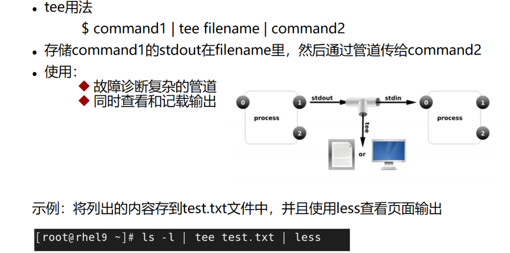
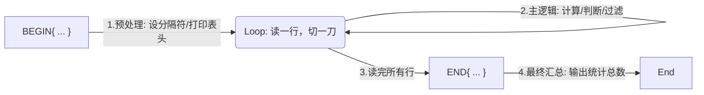

# Linux四剑客心法

| 命令 | 核心特点                   | 典型应用场景                          |
| :--- | :------------------------- | :------------------------------------ |
| find | 唯一直接操作文件系统 inode | 在系统中查找文件，结合`-exec`批量处理 |
| grep | 速度快，擅长正则搜索       | 从海量日志中查找报错信息、关键字      |
| sed  | 流式非交互编辑             | 修改配置文件、文本内容的增删改查      |
| awk  | 编程语言，擅长列处理       | 格式化报表、统计计算、逻辑判断        |

## 基本功

### 引号

使用四剑客命令时（特别是写在脚本中），除非涉及 Shell 变量扩展（需要`$VAR`），否则请**一律使用单引号`''`**包裹处理逻辑

> 别给自己找麻烦，**永远优先用单引号 **。只有明确知道需要 Shell 帮你把变量换成值的时候，再用双引号

| 引号   | 含义                                                         |
| ------ | ------------------------------------------------------------ |
| 单引号 | 所见即所得，单引号里面内容原封不动输出，不进行任何解析       |
| 双引号 | 弱引用，允许进行**变量替换**和**转义处理** ，但不会执行命令替换，不解析{}和通配符 |
| 反引号 | **优先执行**，先执行反引号里面的命令，会进行**命令替换**     |

### 重定向

>Unix/Linux中，进程启动时自带三个通道：`stdin(0)`、`stdout(1)`、`stderr(2)`

| 符号          | 描述                 | 典型用法                             |
| :------------ | :------------------- | :----------------------------------- |
| `>` 或 `1>`   | 标准输出覆盖         | `echo "ok" > status.txt`             |
| `>>` 或 `1>>` | 标准输出追加         | `echo "log entry" >> app.log`        |
| `2>`          | 标准错误覆盖         | `ls non_exist_file 2> error.log`     |
| `2>>`         | 标准错误追加         | `ls non_exist_file 2>> error.log`    |
| `2>&1`        | 错误重定向到标准输出 | `command > all.log 2>&1`             |
| `&>`          | 混合输出（Bash特有） | `command &> all.log`（等同于上一行） |
| `<`           | 标准输入重定向       | `xargs < file_list.txt`              |
| `<<`          | Here Document        | 用于脚本中内联多行输入               |

>**`&` 的作用就是“引用文件描述符”**，而不是当作普通文件名

常见使用

```bash
# 丢弃 stdout（只看报错）
ping example.com > /dev/null

# 丢弃 stderr（屏蔽报错）
rm invalid_file 2> /dev/null

# 丢弃所有输出（世界清静了）
command > /dev/null 2>&1

# 既输出到屏幕，又写入文件
command 2>&1 | tee -a file.log
```



### 通配符

用于给 Linux 中大部分命令使用，用于批量找文件名（找文件）

| 符号         | 含义                                       | 示例                                     |
| ------------ | ------------------------------------------ | ---------------------------------------- |
| `*`          | 匹配任意长度字符                           | `*.log`（所有 log 文件）                 |
| `?`          | 匹配任意**一个**字符                       | `file?.txt`（匹配 file1.txt）            |
| `{}`         | 输出序列，通常与echo、touch、mkdir配合使用 | `mkdir /data/{log,conf}`（创建两个目录） |
| `[]`         | 同正则用法，匹配括号内的任一字符           | `file[123].txt`                          |
| `[!]`、`[^]` | 取反                                       |                                          |

```bash
# 输出等宽的数字序列 01 02 03 10   001 002 ... 100
echo {01..10}
echo {01..100}

# 输出1 3 5 7 9
echo {1..10..2}

# A AC AB
echo A{,C,B}

# 找出/bin目录下面命令,命令仅有2个字符组成
ls -l /bin/??
```

### Xargs 的前世今生

你是否疑惑过：**为什么要用 xargs？**想象一下管道`|`是一根水管，流过来的是“水”（文本流）。但是 rm、mv 这些命令，它们不喝水，它们要的是“瓶装水”（一个个参数）

**Xargs 就是那个把水装进瓶子里的适配器**

- ❌ 错误：`find . -name "*.log" | rm`（rm 不读水管里的字）
- ✅ 正确：`find . -name "*.log" | xargs rm`（xargs 把字喂到 rm 的参数位）

```bash
[输入源] | xargs [选项] [目标命令] [目标命令的选项]
```

| 常用选项   | 含义                                                       |
| ---------- | ---------------------------------------------------------- |
| `-n<数字>` | 指定每次传递的参数个数                                     |
| -I 占位符  | 定义占位符（通常用`{}`），用于需要将参数插入命令中间的场景 |
| -0         | 配合 `find -print0` 使用，处理文件名中的空格或特殊字符     |
| `-p`       | 交互式确认每次操作（输入y才会执行）                        |
| `-t`       | 打印要执行的命令（**命令仍执行**）                         |
| -d<定界符> |                                                            |

**实战案例**

```bash
# 查找所有.txt文件并删除
find . -name '*.txt' | xargs rm

# 将找到的.log文件移动到/backup目录
find . -name '*.log' | xargs -I {} mv {} /backup

# 批量重命名文件
find . -name '*.jpg' | xargs -I {} mv {} {}.bak

# 在所有.py文件中搜索"import numpy"
find . -name '*.py' | xargs grep 'import numpy'

# 批量修改权限
find /data -type f | xargs chmod 644

# 处理文件名中的空格或特殊字符
# 文件名中可以包含空格、换行、制表符甚至 \n，而传统用换行分隔的方式会被这些特殊字符“欺骗”，导致文件名被错误拆分
# -print0：不会在每个文件名后加换行符（\n），而是用 空字符（null character, \0） 分隔每个文件名
# xargs -0：告诉 xargs 输入项是以空字符 \0 分隔的
find . -name '*.mp3' -print0 | xargs -0 rm

# 批量打包
find /etc/ -type f -name '*.conf' | xargs tar zcf /backup/etc-conf-v2.tar.gz

# 输出 name name name name
echo 'nameXnameXnameXname' | xargs -dX
```


## Find

`find`是四剑客中唯一直接扫描**文件系统 inode**的重型武器。它不看内容，只看“户口本”（文件名、时间、权限、大小）

find 特点：

* 实时查询文件，可以进行精确查询和模糊查询，查询时为**遍历查询**
* find 可以在查找到文件的基础上执行二次命令操作（如：搜索系统上所有以.swp结尾的文件，然后删除）
* find 支持各种条件查询（根据文件名、inode、权限、拥有人/组、文件时间戳、目录层级）
* 所有查找工具的共同特点，查找的目录必须要有`r`和`x`权限

```bash
find [路径] [条件] [动作]
```

| 维度 | 选项                   | 作用                                                    |
| ---- | ---------------------- | ------------------------------------------------------- |
| 名称 | -name                  | 指定文件名，默认精确匹配（加上*为模糊匹配）             |
|      | -iname                 | 文件名不区分大小写                                      |
| 类型 | -type [类型]           | 指定文件类型（f、d、l、s-套接字、b-块设备、c-字符设备） |
| 大小 | -size [+/-]N[单位]     | 指定文件大小范围，+10M -100k -10G                       |
| 深度 | -maxdepth              | 指定查找文件深度                                        |
| 时间 | -mtime、-atime、-ctime | 指定文件时间                                            |
| 权限 | -perm [权限模式]       | 644 (精确匹配)、/u=s (包含 SUID)                        |

>尽量不要直接在`/`目录执行无条件的`find`，这会把磁盘 I/O 打满。一定要用`-maxdepth`或指定具体子目录！

### 基于文件名/inode

* 基于文件名

```bash
# 查找file1.txt, file2.txt等
find /path -name 'file[0-9].txt'

# 查找时不区分大小写
find /path -iname 'file[0-9].txt'
```

* 基于 inode 编号

```bash
find . -inum 134400160
```

### 基于文件所有人/组

* 基于文件所有人

```bash
find . -user root
find . -uid 0
```

* 基于文件所有组

```bash
find . -group root
find . -gid 0
```

* 查询没有所有人/组

```bash
find / -nouser
find / -nogroup
```

### 基于文件大小

* 查找大于5M的文件（>5M）

```bash
find . -size +5M
```

* 查找小于5M的文件（<5M） 

```bash
find . -size -5M
```

* 查找小于等于5M，大于4M的文件（4M< X ≤5M）

```bash
find . -size 5M
```

* 查找空文件

```bash
find . -size -1M
```

* 查找小于等于1M的文件（0< X ≤1M）

```bash
find . -size 1M
```

### 基于文件类型

```bash
-type
  f：普通文件
  b：块设备
  c：字符文件
  d：目录
  l：链接文件
  p：管道文件
  s：套接字文件
```

### 基于文件权限

```bash
-perm [/|-]MODE
  MODE: 精确匹配权限
  /MODE: 任何一类(u,g,o)对象的权限中只要能一位匹配即可（或关系）
  -MODE: 每一类对象都必须同时拥有指定权限（与关系）
  0：表示不关注（只针对/或者-的场景，只有在这类场景下0才表示不关注）
```

* 精确匹配 `rw- r-- ---`

```bash
find . -perm 640
```

* 或匹配，只要 **u 有 rw** 或者 **g 有 r**，就算匹配。不看其他人权限

```bash
find . -perm /640
```

* 与匹配，只要 **u 有 rw** 并且 **g 有 r**，就算匹配。不看其他人权限

```bash
find . -perm -640
```

* 特殊权限

```bash
# 查找SUID权限的文件
find /path -perm /u=s

# 查找组可写的文件
find /path -perm /g=w
```

### 基于文件时间戳

```bash
选项：
- atime [+-] 时间：根据文件访问时间搜索
- mtime [+-] 时间：根据文件修改时间搜索
- ctime [+-] 时间：根据文件改动时间搜索(属性)

+7 表示7天以及7天之前的时间
-7 表示7天之内的时间
 7 表示7-8天的时间（包含第7天）

-atime +7
-mtime +7
-ctime +7
time单位是天数

-amin +7
-mmin +7
-cmin +7
min单位是分钟
```

* +、-、无符号的数学边界

```bash
# 假设当前是 12:00
find . -mmin -60   # 找 11:00:01 ~ 12:00:00 修改的文件（不含整60分钟前）
find . -mmin +60   # 找 11:00:00 及更早修改的文件
find . -mmin 60    # 找 10:59:00 ~ 11:00:00
```


### 基于逻辑组合类型

```bash
-a：与 默认情况下，就是逻辑与
-o：或
-not，!：非
```

* 查找大于30k小于50k的文件

```bash
# 不写，默认就为 and（-a）
find /usr/ -size +30k -size -50k -type f
```

* 查找jpg或png文件

```bash
find /path \( -name '*.jpg' -o -name '*.png' \)
```

* 排除.tmp文件

```bash
find /path ! -name '*.tmp'
```

### 基于目录层级

```bash
-maxdepth 最大搜索几个层级
-mindepth 最小搜索几个层级
```

* 指定搜索深度

```bash
find /path -maxdepth 2 -name '*.conf'  # 仅搜索两层目录
find /path -mindepth 3 -name '*.log'   # 从第三层目录开始搜索
```

### 二次命令操作

```bash
# 对每个匹配的文件，单独调用一次命令
find [路径] [条件] -exec [命令] {} \;

# 合并所有匹配的文件路径，一次性执行
find [路径] [条件] -exec [命令] {} +
```

* 批量压缩文件

```bash
find /data -name "*.log" -exec gzip {} +
```

* 批量打包文件

```bash
find /data -name "*.log" -type f -exec tar -cvf test.tar.gz {} +
```

* 逐个执行

```bash
find /tmp -name "*.tmp" -exec rm {} \;
```

* 删除七天前的日志文件（不包括第七天，实际上是8天->8天前）

```bash
find /var/log -name "*.log" -mtime +7 -exec rm {} \;
```

* 先压缩文件，再删除原文件

```bash
find . -name "*.txt" -exec gzip {} \; -exec rm {} \;
```

* 删除3.10之前的以.dbf结尾的文件

```bash
find ./ -name "*.dbf" ! -newermt "2025-03-10" -exec rm {} \;
```


## Grep

`grep`（Global Regular Expression Print）是一个强大的文本搜索命令，支持使用**正则表达式**在文件中查找匹配的行，并将其输出

`grep`是查看日志、代码搜索最高频的工具，**快**是它的代名词

```bash
grep [option] pattern file
```

| 常用参数                 | 含义                                             |
| ------------------------ | ------------------------------------------------ |
| `-A n` / `-B n` / `-C n` | 显示匹配行后`n`行 / 前`n`行 / 前后各`n`行        |
| `-i`                     | 忽略大小写                                       |
| `-v`                     | **反选**，显示不匹配的行                         |
| `-n`                     | 显示匹配行的**行号**                             |
| `-l`                     | 只列出匹配内容的**文件名**，不看具体内容         |
| -c                       | 仅输出匹配的**行数**，不显示内容                 |
| -w                       | 精确匹配整个单词（避免匹配到包含该子串的词）     |
| -o                       | 仅输出匹配的**字符串本身**（每行一个匹配项）     |
| `-r/-R`                  | 递归搜索目录（`-R`会跟随符号链接）               |
| `-E`                     | 支持拓展正则，**等同于egrep**                    |
| -P                       | 开启 Perl 兼容正则（支持更高级正则，如零宽断言） |
| -q                       | 静默模式，不输出任何信息                         |
| -e <范本样式>            | 指定字符串作为查找文件内容的范本样式             |
| `--color`                | 高亮显示匹配内容（现代系统通常默认开启）         |

**实战案例**

```bash
# 在 去掉注释行和空行
grep -Ev "^$|^#" /etc/nginx/nginx.conf

# 或者使用拓展正则
egrep -v '^$|^#' /etc/ssh/sshd_config

# 查找 500 错误及其前 2 行和后 3 行上下文
grep "500 Internal Server Error" -B 2 -A 3 access.log

# 统计 IP 地址出现的次数（提取 + 排序 + 统计）
grep -oE "[0-9]+\.[0-9]+\.[0-9]+\.[0-9]+" access.log | sort | uniq -c | sort -nr

# 检测程序是否在运行 (排除 grep 进程自身)
ps aux | grep nginx | grep -v grep

# -r: 递归查找目录 (程序员找代码神器)
grep -r "TODO" ./src
```


## Sed

sed（Stream Editor）是流水线式的**非交互编辑器**，其工作模式如下：

* Read：`sed` 每次只读**一行**到模式空间（不是整个文件读入内存，所以处理大文件很快）
* Execute：根据你给的脚本（如 `s/old/new/`）在模式空间里修改
* Print：默认情况下，处理完会自动输出到屏幕（标准输出）
* Repeat：清空模式空间，读下一行，直到文件结束

```bash
sed [选项] ' [地址范围]  动作 '  文件
      │        │          │      
      │        │          └── 对匹配的行做什么 (p/d/s...)
      │        └── 选中哪些行 (行号/正则/范围)
      └── 控制行为 (-n/-i/-r)
```

>**注意**：Sed 默认不修改原文件，只有加上`-i`才会修改，最好是先预览确认没问题后再加上`-i`修改原文件

* **选项（Options）**--控制全局行为

| 选项 | 含义     | 说明                               |
| ---- | -------- | ---------------------------------- |
| -n   | 静默模式 | 不在默认输出所有行，常与`p`连用    |
| -i   | 修改文件 | 会直接修改原文件，建议使用`-i.bak` |
| -r   | 扩展正则 | 同`grep -E`，可以使用拓展正则特性  |
| -e   | 多动作   | 允许写多个动作                     |

* 地址范围（Address）--选中哪些行

如果不写地址，默认选中全文

| 写法 | 含义       | 示例                                                         |
| ---- | ---------- | ------------------------------------------------------------ |
| 数字 | 指定行号   | `3`（第3行）                                                 |
| 正则 | 匹配内容   | `/root/`（包含root的行）                                     |
| 范围 | 起始，结束 | `1,5`（1到5行）<br/>`10,+5`（10行向下5行）<br/>`/start/,/end/`（从start到end） |
| 步长 | 间隔选择   | `1~2`（奇数行）<br/>`2~2`（偶数行）                          |
| 特殊 | 首尾       | `$`（最后一行）                                              |

>地址匹配标志：`/root/Ip`，匹配 root、Root、ROOT。即忽略大小写

* 动作命令（Command）--对选中的行做什么

| 命令                   | 说明                            |
| ---------------------- | ------------------------------- |
| `a`（append）          | 在指定行**下面**添加一/多行文本 |
| `i`（insert）          | 在指定行**上面**添加一/多行文本 |
| `c`（change）          | 替换指定整行                    |
| `w`（write）           | 将找到的行保存到新的文件中      |
| `d`（delete）          | 删除匹配行                      |
| `p`（print）           | 打印匹配行的内容（与-n连用）    |
| `s/正则/替换内容/标志` | 匹配正则内容，然后替换          |

s命令常用的标志

| 标志   | 含义            | 示例                  | 说明                                             |
| :----- | :-------------- | :-------------------- | :----------------------------------------------- |
| `g`    | **全局替换**    | `s/old/new/g`         | 默认只换每行**第 1 个**匹配项；加 `g` 换**所有** |
| `p`    | **打印**        | `s/old/new/p`         | **仅当替换成功时**，打印该行（常与 -n 连用）     |
| `w`    | **写入文件**    | `s/old/new/w log.txt` | **仅当替换成功时**，将该行写入指定文件           |
| `I`    | **忽略大小写**  | `s/old/new/I`         | 匹配时忽略大小写                                 |
| `数字` | **第 N 次替换** | `s/old/new/2`         | 只替换每行中第 **2** 个匹配项                    |
| `e`    | **执行命令**    | `s/pwd/echo 123/e`    | 把替换内容当作 shell 命令执行（⚠️极度危险，慎用） |

```bash
# 结构：sed [选项] ' 地址  命令 ' 文件

# 1. 地址标志 (放在地址斜杠后)
sed -n '/root/I p' passwd
#             ^  ^
#             |  └─ 命令 (print)
#             └──── 地址标志 (Ignore Case)

# 2. 替换命令标志 (放在 s 命令斜杠后)
sed 's/root/admin/Ip' passwd
#                 ^ ^
#                 | └─ 命令标志 (Print if substituted)
#                 └─── 命令标志 (Ignore Case)
```


**实战案例**

```bash
cat > test.txt <<EOF
1. Linux is kernel.
2. Python is language.
3. Database is storage.
4. Nginx is web server.
EOF
```

* **查**

```bash
# 打印第2行
sed -n '2p' test.txt

# 打印2到3行
sed -n '2,3p' test.txt

# 打印最后一行
sed -n '$p' test.txt

# 打印包含 "Linux" 的行
sed -n '/Linux/p' test.txt

# 范围匹配：从包含 Python 的行开始，到包含 Nginx 的行结束
sed -n '/Python/,/Nginx/p' test.txt
```

* **删**（加上`-i`则直接修改原文件）

```bash
# 删除空行
sed '/^$/d' test.txt

# 删除第3行
sed '3d' test.txt

# 删除包含 "Database" 的行
sed '/Database/d' test.txt
```

* **改**

替换语法，支持很多分隔符：`@、#、/`

```bash
s/正则/替换内容/g
```

```bash
# 将 is 替换为 WAS
sed 's/is/WAS/g' test.txt

# 分隔符冲突时，可用 # 或 @ 替代 /
sed 's#/bin/bash#/sbin/nologin#g' /etc/passwd

# 将 "hello world" 换成 "world hello"
echo "hello world" | sed -r 's/(\w+) (\w+)/\2 \1/'
```

* 增

兼容写法：`a\、i\、c\`

```bash
# sed '行号 a\要添加的内容' 文件名
# 在/etc/ssh/sshd_config配置文件中的#Port 22这一行后面新增Port 2222
sed -i.bak '/#Port 22/a\Port 2222' /etc/ssh/sshd_config

# sed '行号 i\要添加的内容' 文件名
# 在/etc/ssh/sshd_config配置文件中的#Port 22这一行前面新增Port 2222
sed -i.bak '/#Port 22/i\Port 8888' /etc/ssh/sshd_config

# sed '行号 c\要添加的内容' 文件名
# 替换/etc/selinux/config中的SELINUX=enforcing
sed '/^SELINUX=/c\SELINUX=disabled' /etc/selinux/config -i
```

```bash
# 在第2行后面添加一行
sed '2a New Line Here' test.txt

# 在最后一行添加
sed '$a The End.' test.txt

# 2~4行数据写到new.txt
sed '2,4w new.txt' test.txt
```


## awk

`awk`是一种处理文本文件的编程语言，文件的每行数据都被称为`记录`，每条记录被分成若干`字段`，每次从文件中读取一条记录

`awk`由一系列**条件**和**动作**组成，可以包含多个动作，用`;`分隔。**若没指定条件则匹配所有数据，没指定动作则默认为print**，awk默认支持拓展正则表达式

```bash
awk [options] 'BEGIN{...} Pattern{...} END{...}' 文件
```

* `BEGIN {}`：在读第一行之前执行（打印表头、定义变量）
* `Pattern {Action}`：每一行都执行一次。主处理逻辑
* `END {}`：全部行读完后执行（输出统计结果）



>平时我们写的 `awk '{print $1}'`，其实就是中间的 **Loop** 部分。BEGIN 和 END 是可选的

| 选项          | 说明                                                         |
| ------------- | ------------------------------------------------------------ |
| -F [分隔符]   | 指定分隔符，可以为字符串或正则表达式（默认为连续的空格或制表符） |
| -v var=value  | 赋值一个用户定义变量，将外部变量传递给awk                    |
| -f scriptfile | 从脚本文件中读取awk                                          |

| 内置变量                 | 描述                                               |
| ------------------------ | -------------------------------------------------- |
| FILENAME                 | 当前输入文档的名称                                 |
| FNR                      | 当前输入文档的当前行号，尤其当有多个输入文档时有用 |
| `NR`（Number of Record） | **当前行号**                                       |
| `$0`                     | 当前行全部数据                                     |
| `$n`                     | 当前行第n个字段内容（不要用`""`包裹）              |
| `NF`（Number of Fields） | 当前记录（行）的字段个数，即**列数**               |
| FS（Field Separator）    | 字段分隔符，默认为空格或Tab制表符                  |
| OFS                      | 输出字段分隔符，默认为空格                         |
| ORS                      | 输出记录分隔符，默认为\n                           |
| RS                       | 输入记录分隔符，默认为\n                           |

* 取数据

```bash
# 按列输出
df -h | awk '{print $2}'		    # 逐行打印第2列
df -h | awk '{print NR}'		    # 输出行号
df -h | awk '{print NF}'		    # 输出每行数据的列数
df -h | awk '{print $NF}' 	       # 打印每行数据的最后一列
df -h | awk '{print $(NF-1)}'      # 打印每行倒数第二列
df -h | awk '{print $0}'	        # 打印每行全部内容
df -h | awk '{print $1 "\t" $2}' | column -t  # 使用制表符，需要添加双引号

# 按行输出
df -h | awk 'NR>=2 && NR<=5'
df -h | awk 'NR==2'
```

* 做统计

配合 sort 和 uniq，这是面试必考题

```bash
# 统计 Nginx 日志中访问最多的 5 个 IP
# $1 是 IP 列
awk '{print $1}' access.log | sort | uniq -c | sort -nr | head -5
```

* 逻辑判断

```bash
# 过滤第四列以0或1开头行，输出第1，3列
awk -F ':' '$4 ~ /^[01]/ {print $1,$3}' /etc/passwd

# 取第三列大于100的行
awk -F':' '$3>=100{print $1,$3,$NF}' /etc/passwd | column -t
```

* 做计算

```bash
# 统计某个目录下所有文件的总大小
# ls -l 输出：-rw-r--r-- 1 root root  1024  Jan 1 filename
ls -l | awk '
{ sum += $5 } 
END { print "Total: " sum/1024 " KB" }'
```

* 模糊过滤

```bash
# 过滤出包含root或nobody的行
awk '/root|nobody/' /etc/passwd

# 从包含root的行到包含nobody的行
awk '/root/,/nobody/' /etc/passwd
```

* 自定义变量

```bash
awk -v x="bob" -v y=10 '{print x,y}' /tmp/hosts

# 直接调用系统变量
awk -v shell=$SHELL '{print shell}' /tmp/hosts
awk '{print "'$SHELL'"}' /tmp/hosts
```
