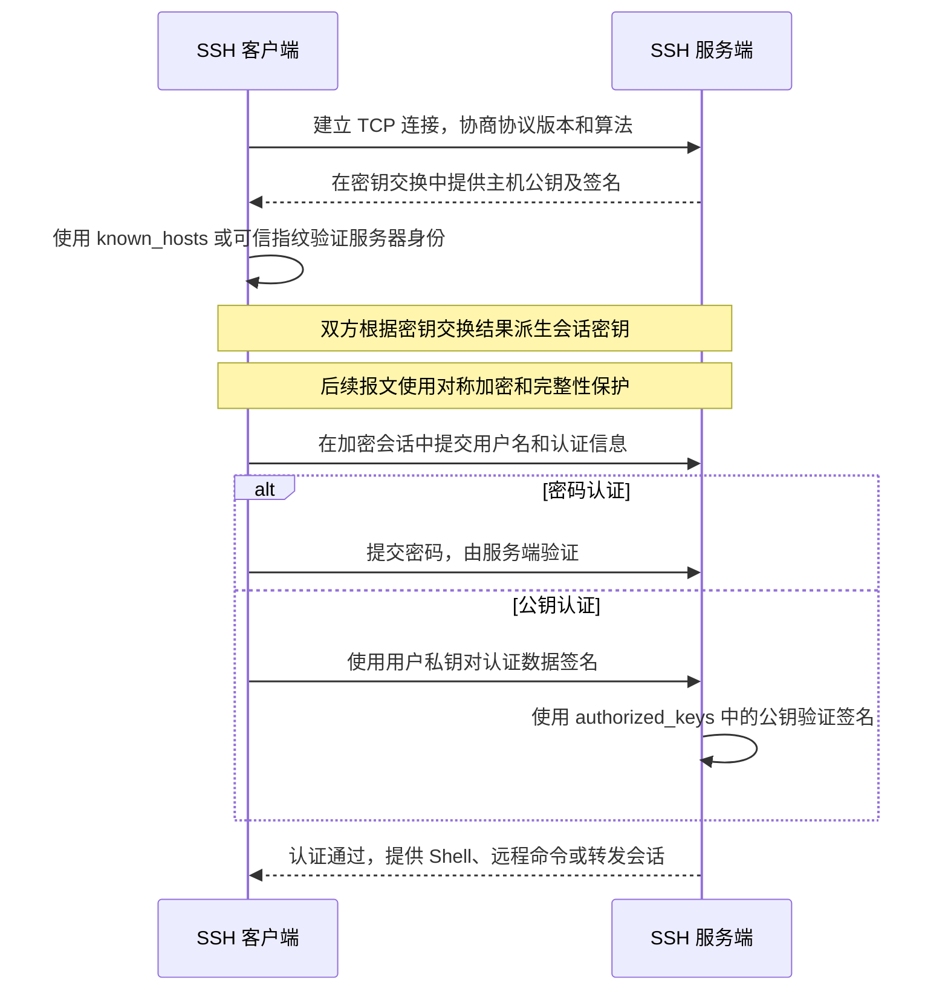
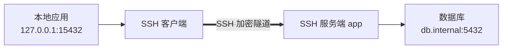

# 网络客户端

命令行网络客户端可以在终端和脚本中完成接口测试、文件下载、远程登录与加密传输。本文介绍 curl、wget 和 OpenSSH 的常用操作，示例中的域名、地址和用户名需要替换为实际值

## 阅读路径

| 学习目标 | 建议阅读 |
|:---|:---|
| 测试 HTTP 接口、分析响应 | curl |
| 下载文件、批量或递归下载 | wget、curl 与 wget 的选择 |
| 配置 SSH 登录和密钥认证 | 远程登录与执行命令、验证服务器主机密钥、配置密钥认证 |
| 传输文件、访问隔离网络 | 使用 scp、sftp 和 rsync 传输文件、端口转发、通过跳板机连接 |
| 定位连接和认证失败 | SSH 故障排查 |

## curl

curl（Client URL）是基于 libcurl 的数据传输工具，支持 HTTP、HTTPS、FTP、SFTP 等协议。运维中常用它测试 API、检查 HTTP 响应和下载文件

基本语法：

```bash
curl [选项] URL
```

### 查看响应与调试请求

直接请求网页或接口时，响应体默认写入标准输出，可以交给管道继续处理：

```bash
curl https://www.example.com
curl -sS https://api.example.com/health | python3 -m json.tool
```

`-s` 隐藏进度表，`-S` 在静默模式下仍显示错误。查看响应头有两种常见方式：

```bash
# 发送 HEAD 请求，只显示响应头
curl -I https://www.example.com

# 发送 GET 请求，显示响应头并丢弃响应体
curl -sS -D - -o /dev/null https://www.example.com
```

`-I` 依赖服务端支持 HEAD；需要判断真实 GET 接口时使用第二种方式。`-v` 可以显示连接、TLS 握手和请求头，适合定位协议与证书问题：

```bash
curl -v https://www.example.com
```

只保留状态码和总耗时，便于快速检查或写入脚本：

```bash
curl -sS -o /dev/null \
  -w 'HTTP %{http_code}, total %{time_total}s\n' \
  https://www.example.com
```

示例输出：

```text
HTTP 200, total 0.123000s
```

### 下载文件

```bash
# 保存为指定文件名
curl -o app.tar.gz https://www.example.com/app.tar.gz

# 使用 URL 最后的文件名保存，并跟随重定向
curl -fLO https://www.example.com/app.tar.gz

# 从已有文件的末尾继续下载
curl -fL -C - -O https://www.example.com/app.tar.gz
```

`-C -` 根据本地文件大小确定续传位置，服务端需要支持范围请求。下载脚本通常还应加入 `-f`，避免把 404、500 等错误页面保存成安装包：

```bash
curl -fL --retry 3 --connect-timeout 5 -O \
  https://www.example.com/app.tar.gz
```

### 提交表单与 JSON

`-d` 发送请求体，默认使用 POST 方法，并将 Content-Type 设为 `application/x-www-form-urlencoded`：

```bash
curl -d 'name=demo&role=ops' https://api.example.com/users
```

发送 JSON 时显式设置 Content-Type：

```bash
curl -H 'Content-Type: application/json' \
  -d '{"name":"demo","role":"ops"}' \
  https://api.example.com/users
```

只有确实需要覆盖默认方法时才使用 `-X`，例如发送不带请求体的 DELETE：

```bash
curl -X DELETE https://api.example.com/users/100
```

使用 `-F` 构造 `multipart/form-data`，可以上传文件：

```bash
curl -F 'file=@./image.png' -F 'description=demo' \
  https://api.example.com/upload
```

`@` 表示从本地文件读取内容；省略它只会提交普通字符串

### 请求头、认证与 Cookie

```bash
# 从环境变量读取令牌，避免把实际令牌写进笔记或脚本
curl -H "Authorization: Bearer ${TOKEN}" https://api.example.com/profile

# 只给用户名，由 curl 交互式询问密码
curl -u username https://api.example.com/profile

# 保存服务器返回的 Cookie
curl -c cookies.txt https://www.example.com/login

# 携带 Cookie 发起后续请求
curl -b cookies.txt https://www.example.com/dashboard
```

Cookie 文件可能包含登录会话，应与密码和私钥一样妥善保管

### 常用参数

| 参数 | 作用 | 使用提示 |
|:---|:---|:---|
| `-f` | HTTP 错误时返回失败 | 脚本和下载任务建议启用 |
| `-L` | 跟随重定向 | 同时限制最终 URL 是否可信 |
| `-o` | 保存到指定文件 | 与 `-O` 区分大小写 |
| `-O` | 使用远程文件名保存 | URL 末尾应包含有效文件名 |
| `-C -` | 自动确定断点并续传 | 依赖服务端支持范围请求 |
| `-H` | 添加请求头 | 可重复使用 |
| `-d` | 发送请求体 | 隐含 POST |
| `-F` | 提交 multipart 表单 | 文件参数使用 `@路径` |
| `-I` | 发送 HEAD 请求 | 不等同于 GET |
| `-v` | 输出详细通信过程 | 排查 DNS、TCP、TLS 和请求头 |
| `-sS` | 静默但保留错误 | 适合管道和脚本 |
| `--connect-timeout` | 限制连接建立时间 | 例如 `--connect-timeout 5` |
| `--max-time` | 限制整个请求时间 | 防止脚本无限等待 |
| `--retry` | 重试临时失败 | 例如 `--retry 3` |
| `-k` | 跳过证书验证 | 仅用于临时诊断 |

> **警告**：`-k` 会削弱 HTTPS 对服务器身份的验证，不能作为证书错误的正式修复方案

## wget

wget（World Wide Web Get）主要用于非交互式下载，适合批量下载、断点续传和递归抓取。它也能发送简单请求，但接口调试通常优先使用 curl

基本语法：

```bash
wget [选项] URL
```

### 基础下载

```bash
# 保存到当前目录
wget https://www.example.com/app.tar.gz

# 指定保存文件名
wget -O app.tar.gz 'https://www.example.com/download?id=100'

# 保存到 /tmp 目录
wget -P /tmp https://www.example.com/app.tar.gz
```

下载完成后检查文件大小；涉及安装包时，还应与发布方提供的校验值核对：

```bash
ls -lh app.tar.gz
sha256sum app.tar.gz
```

### 续传、批量与后台下载

```bash
# 网络中断后继续下载
wget -c https://www.example.com/app.tar.gz

# 从文件读取 URL，每行一个
wget -i urls.txt

# 限制下载速度
wget --limit-rate=300k https://www.example.com/app.tar.gz

# 后台下载，默认将日志写入 wget-log
wget -b https://www.example.com/app.tar.gz
tail -f wget-log
```

`-c` 应配合相同的 URL 和目标文件使用。如果服务器内容已经变化，续传可能拼接不同版本，下载后需要校验文件

### 递归下载

下载指定目录下的网页及其显示所需资源：

```bash
wget -r -p -np -k --wait=1 https://www.example.com/docs/
```

| 参数 | 作用 |
|:---|:---|
| `-r` | 递归跟随链接 |
| `-p` | 下载页面所需的图片、CSS、JavaScript 等资源 |
| `-np` | 不进入当前目录的上级目录 |
| `-k` | 将页面链接转换为适合本地浏览的形式 |
| `--wait=1` | 两次请求之间等待 1 秒 |

> **注意**：递归下载只用于有权访问和保存的内容，并限制目录、域名、速率与请求量，避免给目标站点造成压力

### curl 与 wget 的选择

| 需求 | 优先工具 | 原因 |
|:---|:---|:---|
| 调试 API、请求头和响应 | curl | 请求方法、请求体和输出控制更灵活 |
| 将响应交给管道处理 | curl | 默认输出到标准输出 |
| 批量或递归下载 | wget | 下载流程和递归选项更集中 |
| 简单下载并自定义请求 | 两者均可 | 按现有环境和脚本习惯选择 |
| 断点续传 | 两者均可 | curl 使用 `-C -`，wget 使用 `-c` |

## SSH

SSH（Secure Shell）用于在不安全网络中提供加密的远程登录、命令执行、文件传输和端口转发。OpenSSH 是常见的 SSH 实现，Linux、macOS 和 Windows 均可使用其客户端

| 工具 | 用途 |
|:---|:---|
| `ssh` | 登录远程系统、执行命令和建立转发 |
| `sshd` | 服务端守护进程，默认监听 TCP 22 端口 |
| `ssh-keygen` | 生成密钥、查看或管理主机指纹 |
| `ssh-copy-id` | 将用户公钥安装到服务端 |
| `ssh-agent`、`ssh-add` | 缓存已解锁私钥，减少重复输入私钥口令 |
| `scp`、`sftp` | 通过 SSH 复制和传输文件 |

客户端通常由 `openssh-client` 软件包提供，接受远程登录的主机需要安装并运行 `openssh-server`

### SSH 如何建立安全连接

SSH 使用非对称算法完成服务器身份验证、密钥交换和用户认证，实际传输的数据则由双方协商出的会话密钥进行对称加密和完整性保护



主机密钥和用户密钥承担不同职责：

| 密钥 | 证明的身份 | 私钥位置 | 公钥保存或发布位置 |
|:---|:---|:---|:---|
| 服务器主机密钥 | SSH 服务器 | 服务端 `/etc/ssh/ssh_host_*_key` | 客户端 `~/.ssh/known_hosts` 或可信指纹渠道 |
| 用户密钥 | 登录用户 | 客户端 `~/.ssh/id_ed25519` 等 | 服务端该用户的 `~/.ssh/authorized_keys` |

### 远程登录与执行命令

服务端需要运行 `sshd`，网络和防火墙需要允许访问其实际监听端口。默认端口是 TCP 22，修改端口后应在命令中显式指定：

```bash
# 使用默认端口登录
ssh ops@192.0.2.10

# 指定端口和私钥
ssh -p 2222 -i ~/.ssh/id_ed25519 ops@192.0.2.10

# 不进入交互式 Shell，只执行远程命令
ssh ops@192.0.2.10 'hostname; systemctl is-active nginx'
```

本地用户名与远程用户名相同时，可以省略 `ops@`。退出远程 Shell 使用 `exit` 或按 `Ctrl + D`

脚本中需要避免交互式密码提示时，可以限制认证方式和连接时间：

```bash
ssh -o BatchMode=yes -o ConnectTimeout=5 ops@192.0.2.10 'uptime'
```

`BatchMode=yes` 适合已经配置好密钥的任务；认证失败时直接返回非零状态，而不是等待输入

### 验证服务器主机密钥

首次连接未知服务器时，客户端会显示主机公钥指纹。应通过带外渠道向管理员核对，或在服务器本地查看：

```bash
ssh-keygen -lf /etc/ssh/ssh_host_ed25519_key.pub
```

客户端提示形式如下，只有指纹与可信来源一致时才输入 `yes`：

```text
The authenticity of host '192.0.2.10 (192.0.2.10)' can't be established.
ED25519 key fingerprint is SHA256:<服务器实际指纹>.
Are you sure you want to continue connecting (yes/no/[fingerprint])?
```

确认后，客户端将主机公钥记录到当前用户的 `~/.ssh/known_hosts`，后续连接会检查它是否变化。常用查询命令：

```bash
# 查询默认端口的主机记录
ssh-keygen -F 192.0.2.10

# 查询非默认端口的主机记录
ssh-keygen -F '[192.0.2.10]:2222'
```

主机重装或更换密钥后，旧记录会导致 `Host key verification failed`。先确认变化确实由管理员操作引起，再删除旧记录并重新验证：

```bash
ssh-keygen -R 192.0.2.10
ssh-keygen -R '[192.0.2.10]:2222'
```

> **警告**：主机指纹变化也可能表示中间人攻击。不要在未核实原因时直接删除记录，也不要用 `StrictHostKeyChecking=no` 长期绕过验证

### 配置密钥认证

公钥认证通过数字签名证明客户端持有私钥，私钥不需要发送到服务器。使用 Ed25519 生成新密钥：

```bash
ssh-keygen -t ed25519 -f ~/.ssh/id_ed25519 -C 'ops@laptop'
```

命令会提示设置私钥口令（passphrase）。口令用于保护本地私钥，与服务器登录密码不同；已有同名密钥时应更换文件名，避免覆盖

生成后得到两个文件：

| 文件 | 用途 | 是否可分享 |
|:---|:---|:---|
| `~/.ssh/id_ed25519` | 用户私钥 | 不上传、不发送给他人 |
| `~/.ssh/id_ed25519.pub` | 用户公钥 | 可以安装到目标服务器 |

使用 `ssh-copy-id` 安装公钥，这一步通常需要先用密码或其他已有方式登录：

```bash
ssh-copy-id -i ~/.ssh/id_ed25519.pub -p 2222 ops@192.0.2.10
```

该命令会把公钥追加到服务端 `ops` 用户的 `~/.ssh/authorized_keys`，不会上传私钥。Windows 自带 OpenSSH 通常没有 `ssh-copy-id`，可在 PowerShell 中执行：

```powershell
type $HOME\.ssh\id_ed25519.pub | ssh -p 2222 ops@192.0.2.10 "umask 077; mkdir -p ~/.ssh; cat >> ~/.ssh/authorized_keys"
```

在 Linux 服务端检查并修正权限：

```bash
chmod 700 ~/.ssh
chmod 600 ~/.ssh/authorized_keys
```

`.ssh` 目录和 `authorized_keys` 文件还应属于目标登录用户，其家目录不能被其他用户写入。随后在客户端的新终端中验证：

```bash
ssh -i ~/.ssh/id_ed25519 -o IdentitiesOnly=yes -p 2222 \
  ops@192.0.2.10 'whoami'
```

示例输出：

```text
ops
```

看到目标用户名即表示公钥认证成功。如果设置了私钥口令，此时要求输入的是私钥口令，而不是远程账号密码

### 使用 ssh-agent 管理私钥口令

`ssh-agent` 在当前用户环境中保存已经解锁的私钥，后续连接不必重复输入口令。桌面环境通常已经启动 agent，可先检查：

```bash
ssh-add -l
```

如果提示无法连接 agent，可在当前 Shell 启动一个：

```bash
eval "$(ssh-agent -s)"
```

加载私钥并再次查看：

```bash
ssh-add ~/.ssh/id_ed25519
ssh-add -l
```

`ssh-add -l` 只证明密钥已加载到 agent，不代表服务器一定接受它，最终仍应通过 `ssh` 实际登录验证

> **注意**：`ssh -A` 的 agent 转发会让远端会话访问本地 agent。连接跳板机优先使用 `ProxyJump`，不要把 agent 转发到不可信主机

### 配置 SSH 客户端别名

将常用连接参数写入 `~/.ssh/config`，可以让 `ssh`、`scp` 和 `sftp` 共用同一组配置：

```sshconfig
Host app
    HostName 192.0.2.10
    User ops
    Port 2222
    IdentityFile ~/.ssh/id_ed25519
    IdentitiesOnly yes
    ServerAliveInterval 60
    ServerAliveCountMax 3
```

此后使用别名即可连接：

```bash
ssh app
ssh app 'systemctl is-active nginx'
```

`ServerAliveInterval` 定期探测连接是否仍有响应，连续 3 次无响应后断开。检查最终生效的配置：

```bash
ssh -G app | grep -E '^(user|hostname|port|identityfile) '
```

Linux 上可将配置文件权限设为仅当前用户可读写：

```bash
chmod 600 ~/.ssh/config
```

### 使用 scp、sftp 和 rsync 传输文件

`scp` 适合直接复制文件或目录：

```bash
# 上传文件
scp ./app.tar.gz app:/tmp/

# 下载文件
scp app:/var/log/app.log ./

# 递归上传目录
scp -r ./config app:/tmp/
```

不使用别名时，`scp` 的端口参数是大写 `-P 2222`，与 `ssh -p` 不同。OpenSSH 9.0 起，`scp` 默认使用 SFTP 协议传输，但命令形式基本不变

`sftp` 适合交互式浏览和传输：

```bash
sftp app
```

常用交互命令：

| 命令 | 作用 |
|:---|:---|
| `pwd`、`lpwd` | 显示远端、本地当前目录 |
| `ls`、`lls` | 列出远端、本地文件 |
| `cd`、`lcd` | 切换远端、本地目录 |
| `get 文件` | 下载文件 |
| `put 文件` | 上传文件 |
| `reget 文件` | 继续下载已有文件 |
| `bye` | 退出 SFTP |

`rsync` 不是 OpenSSH 组件，但可以通过 SSH 做增量同步，适合目录和反复传输：

```bash
# 先预演，查看将发生的变更
rsync -avn ./www/ app:/tmp/www/

# 确认预演结果后执行实际同步
rsync -av --partial --progress ./www/ app:/tmp/www/
```

源路径末尾的 `/` 表示同步目录内容，而不是目录本身。`-n` 只预演而不修改目标文件，正式执行前应确认源路径、目标路径和预演输出

### 端口转发

SSH 端口转发把 TCP 连接封装进加密会话。它不仅用于远程登录，也能临时访问没有直接暴露的服务

| 类型 | 参数 | 访问方向 | 常见用途 |
|:---|:---|:---|:---|
| 本地转发 | `-L` | 本地监听端口经 SSH 服务端访问目标 | 访问内网数据库或 Web 服务 |
| 远程转发 | `-R` | 远端监听端口经 SSH 客户端访问目标 | 让远端访问本地服务 |
| 动态转发 | `-D` | 本地 SOCKS 代理由 SSH 服务端访问目标 | 为多个目标提供临时代理 |

`-N` 表示不执行远程命令，只建立转发；保持终端运行即可维持隧道，按 `Ctrl + C` 结束

#### 本地转发

将本机 `127.0.0.1:15432` 映射到数据库 `db.internal:5432`，其中 `db.internal` 由 SSH 服务端解析和访问：

```bash
ssh -N -L 127.0.0.1:15432:db.internal:5432 app
```



隧道建立后，本地数据库客户端连接 `127.0.0.1:15432`。目标地址不需要能被本机直接访问，但 SSH 服务端必须能够访问它

#### 远程转发

让 SSH 服务端所在主机的 `127.0.0.1:18080` 访问本机的 `127.0.0.1:8080`：

```bash
ssh -N -R 127.0.0.1:18080:127.0.0.1:8080 app
```

此时在服务端主机访问 `127.0.0.1:18080`，流量会经 SSH 客户端转到本地服务。示例将监听地址限制在回环接口；向其他主机开放端口还受服务端配置影响，并会扩大暴露范围

#### 动态转发

在本机建立 SOCKS5 代理：

```bash
ssh -N -D 127.0.0.1:1080 app
```

支持 SOCKS 代理的应用可以通过它访问 SSH 服务端可达的目标。使用 curl 验证：

```bash
curl --proxy socks5h://127.0.0.1:1080 https://www.example.com
```

`socks5h` 让代理解析目标主机名，目标 DNS 查询也经代理侧完成

> **注意**：端口转发可能绕过原有网络边界，只应在获得授权的环境使用，并优先绑定 `127.0.0.1`

### 通过跳板机连接

目标主机只能从跳板机访问时，使用 `ProxyJump` 建立两跳连接：

```bash
ssh -J ops@192.0.2.5 ops@10.0.0.20
```

也可以写入 `~/.ssh/config`：

```sshconfig
Host bastion
    HostName 192.0.2.5
    User ops
    IdentityFile ~/.ssh/id_ed25519

Host internal
    HostName 10.0.0.20
    User ops
    ProxyJump bastion
    IdentityFile ~/.ssh/id_ed25519
```

之后直接执行 `ssh internal`。本地客户端分别与跳板机和目标机完成 SSH 身份验证，无需把私钥复制到跳板机，也不需要 agent 转发

### SSH 故障排查

先保留客户端详细日志，再根据失败阶段检查网络、端口、主机密钥或用户认证：

```bash
ssh -vvv app
```

`-v` 可以重复以增加详细程度。常用检查命令：

```bash
# 检查本机到服务端端口能否建立 TCP 连接
nc -vz 192.0.2.10 2222

# 在服务端检查进程和监听地址
systemctl status sshd --no-pager
ss -lntp

# 查看 sshd 实际生效的认证配置
sudo sshd -T | grep -E '^(port|pubkeyauthentication|passwordauthentication|authorizedkeysfile) '

# 在 RHEL 等使用 sshd 单元名的系统查看认证日志
sudo journalctl -u sshd -n 50 --no-pager
```

Debian、Ubuntu 的服务单元通常名为 `ssh`，相应使用 `systemctl status ssh` 和 `sudo journalctl -u ssh`

| 现象 | 失败阶段 | 重点检查 |
|:---|:---|:---|
| `Connection timed out` | TCP 连接 | 路由、防火墙、安全组、目标地址和端口 |
| `Connection refused` | TCP 连接 | `sshd` 是否运行、是否监听该地址和端口 |
| `Host key verification failed` | 服务器身份验证 | 主机是否更换密钥，先核实再处理 `known_hosts` |
| `Permission denied (publickey)` | 用户认证 | 用户名、私钥选择、服务端公钥和文件权限 |
| `Permission denied (publickey,password)` | 用户认证 | 服务端允许的认证方式及账号状态 |
| 私钥提示 `bad permissions` | 客户端读取私钥 | 私钥是否仅当前用户可访问 |
| 登录后立即退出或无法执行命令 | 会话建立 | 账号 Shell、服务端强制命令和资源限制 |

> **警告**：不要在脚本中保存密码或私钥。准备禁用服务器密码登录前，必须先保持现有会话，并在另一个新会话确认密钥登录和管理权限均可用，避免把自己锁在服务器之外
