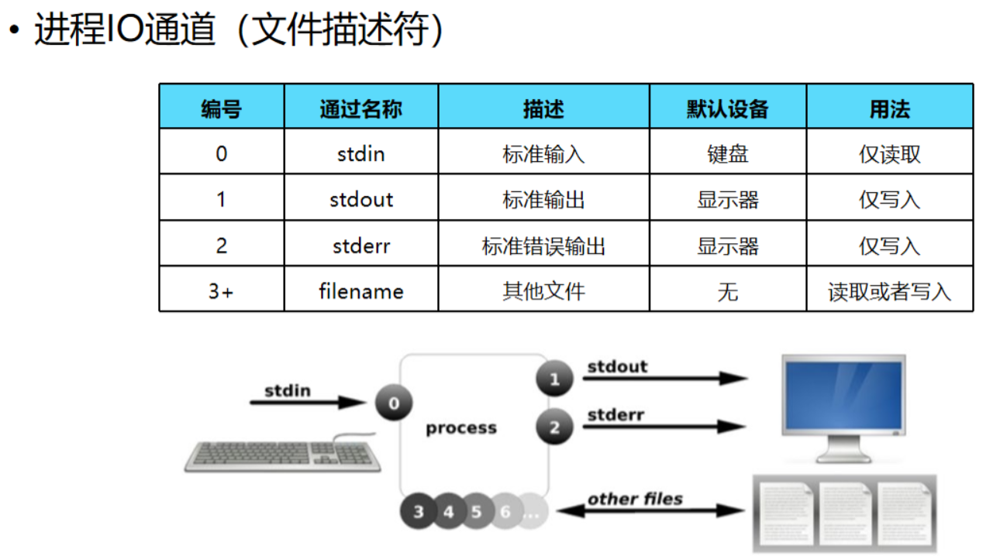

# Shell入门指南

```
███████╗██╗  ██╗███████╗██╗     ██╗
██╔════╝██║  ██║██╔════╝██║     ██║
███████╗███████║█████╗  ██║     ██║
╚════██║██╔══██║██╔══╝  ██║     ██║
███████║██║  ██║███████╗███████╗███████╗
```

## Shell简介

### shell

Shell 本质上是一个用 C 语言编写的程序，它是连接用户与 Linux/Unix 操作系统内核的**核心桥梁**。对于开发者而言，Shell 具有不可替代的“双重人格”：

* 作为`命令语言解释器`：为用户提供访问操作系统内核服务的交互界面。当你输入命令（如 ls）时，Shell 负责解释这些指令并传递给内核执行
* 作为`程序设计语言`：Shell 拥有一套完整的编程语法，由 Shell 语法编写的程序称为`Shell Script`，这也是我们在开发和运维中常说的“写 Shell”

|          | Shell                      | Shell Script             |
| -------- | -------------------------- | ------------------------ |
| **本质**   | 命令解释器 / 运行环境               | 文本文件 / 逻辑代码集合            |
| **核心职责** | 接收指令、调用内核、反馈结果             | 编排指令、处理逻辑、实现自动化          |
| **交互模式** | 实时交互（Read-Eval-Print Loop） | 批处理执行（编写 -> 运行）          |
| **示例**   | `bash`、`zsh`、`sh`          | `install.sh`、`backup.sh` |
| **依赖关系** | 脚本运行的**宿主/解释器**            | Shell 能力的**扩展/载体**       |

### Shell环境

Shell 环境并非单纯的一个“黑色窗口”，它是操作系统为用户分配的一个**运行时上下文（Runtime Context）**这个上下文决定了命令如何被解析、资源如何被分配以及进程如何被管理

一个完整的 Shell 运行环境通常由以下核心模块构成：

* `命令解释器`：负责解析和执行用户输入的命令
* `环境变量`：定义系统运行时行为的全局键值对，决定了命令搜索路径、用户身份及语言环境等
* `配置文件`：控制 Shell 启动时的初始化行为，分为“登录/非登录”和“交互/非交互”加载模式
* `用户自定义`：包括别名alias、函数和快捷方式

编写 Shell 脚本并不需要特殊的 IDE，任何文本编辑器（Vim/VSCode）配合一个解释器即可。虽然 Linux 系统中存在多种 Shell，但主流阵营主要分为四大类：

| 类型   | 全称                         | 特点                                                                 |
| ---- | -------------------------- | ------------------------------------------------------------------ |
| sh   | Bourne Shell               | Unix 标准默认 shell，**遵循 POSIX 标准**，兼容性好，基础广泛                          |
| bash | Bourne Again Shell         | Linux 标准默认 shell，功能丰富，兼容 sh，支持脚本编程                                 |
| fish | Friendly Interactive Shell | 用户友好，智能自动补全，语法高亮，开箱即用                                              |
| zsh  | Z Shell                    | macOS 默认 Shell。完全兼容 Bash，在自动补全、主题插件（如 Oh My Zsh）方面拥有极致体验，是开发者桌面的首选 |

> 在大多数现代 Linux 系统（如CentOS/Ubuntu）中，`/bin/sh`往往只是一个指向`/bin/bash`的符号链接
> 
> 当通过`sh script.sh`运行脚本时，Bash 会以**POSIX 兼容模式**启动，此时它会关闭部分 Bash 特有的扩展功能（如`[[...]]`条件判断），以模仿老式 Bourne Shell 的行为。这也是为什么有时候同一段脚本用 bash 跑没问题，用 sh 跑却报错的原因

### Shell模式

Shell 的运作模式从根本上取决于其**命令读取来源**。根据交互形式的不同，可以划分为`交互模式`和`非交互模式`

#### 交互模式

用户登录终端后的默认模式。Shell 作为一个**REPL环境**运行，即：

1. **Read**：从标准输入（Stdin）等待用户键入命令
2. **Eval**：解析并执行命令
3. **Print**：将结果输出到终端（Stdout）
4. **Loop**：再次显示提示符（Prompt），等待下一条指令

可以将 Shell 的交互模式简单理解为执行命令行。以下即为处于交互模式下

```bash
# 典型的交互式提示符（PS1变量定义）
user@host:~$
# 此时可直接输入 ls, top, docker ps 等命令
```

#### 非交互模式

Shell 脚本运行时的典型模式（批处理模式）。此模式下，Shell **不与用户进行实时交互**，而是从文件或管道中读取一系列命令，其生命周期如下：

* Shell 读取文件 -> 按顺序执行命令 -> 执行完毕后 Shell 进程自动终止 -> 控制权返回父进程

编写完脚本文件（如 script.sh）后，如何运行它是很多新手容易混淆的地方。执行方式不仅决定了权限需求，更决定了代码运行的**进程作用域**

**方式一**：解释器参数执行（Fork 子进程）

```bash
# 直接调用 Shell 程序（如 bash 或 sh），将脚本路径作为参数传递
bash script.sh
sh script.sh

# 当前 Shell 启动一个新的 子Shell 进程来解析脚本
# 脚本文件本身不需要执行权限（x），只需有读取权限（r）
```

**方式二**：直接路径执行（Fork 子进程）

```bash
# 将脚本作为可执行程序直接运行
chmod +x script.sh  # 必须先赋予执行权限
./script.sh

# Shell 依然会 Fork 一个子进程。解释器由脚本第一行的 Shebang 决定
# 必须拥有 r 和 x 权限
```

**方式三**：Sourcing 执行（当前进程）

```bash
# 使用 source 或其别名 . 来加载脚本
source script.sh
# 点与文件名之间有空格
. script.sh

# 不启动子进程，直接在当前 Shell 环境中逐行执行脚本内容
# 脚本内定义的变量、函数会直接“污染”当前终端环境；脚本内的 exit 命令会导致当前终端窗口直接关闭
```

三种方式总结如下：

| 方式        | 典型指令             | 进程归属     | 变量作用域        | 权限依赖       | Shebang          | 核心用途           |
| --------- | ---------------- | -------- | ------------ | ---------- | ---------------- | -------------- |
| **解释器执行** | `bash file.sh`   | **子进程**  | 隔离（结束后释放）    | 读取（`r`）    | 视为注释（被忽略）        | 临时运行、调试、无执行权限时 |
| **直接执行**  | `./file.sh`      | **子进程**  | 隔离（结束后释放）    | 读+执行（`rx`） | **依赖**（内核据此选解释器） | 标准化脚本          |
| **直接加载**  | `source file.sh` | **当前进程** | **保留**（污染环境） | 读取（`r`）    | 视为注释（被忽略）        | 环境变量配置、函数库加载   |


## 基本语法

### 解释器

Shell 脚本的第一行通常包含一个特殊的字符序列`#!`，技术术语称为**Shebang**（或 Hashbang）。它不仅是一行注释，更是写给**操作系统内核**看的“指令”，告诉系统其后路径所指定的程序即是解释此脚本文件的 Shell 解释器

在 Shell 中，你会见到诸如以下的注释：

* 硬编码路径：直接指定解释器的绝对路径，移植性差，找不到解释器时，脚本直接报错`File not found`

```bash
#!/bin/sh
#!/bin/bash
#!/usr/bin/python
```

* 动态查找（推荐）：`env`会根据当前用户的环境变量`PATH`，自动查找第一个匹配的程序

```bash
#!/usr/bin/env bash
#!/usr/bin/env python3
```

### 注释

各种语言都有对应的注释语法，Shell语法中，注释是特殊的语句，会被Shell解释器忽略

- 单行注释：以`#`开头，到行尾结束
- 多行注释：以`:<<EOF`开头，到`EOF`结束

```shell
# echo '这是单行注释'

:<<EOF
echo '这是多行注释'
echo '这是多行注释'
echo '这是多行注释'
EOF
```

### 引号

| 引号  | 含义                                                |
| --- | ------------------------------------------------- |
| 单引号 | 所见即所得，单引号里面内容原封不动输出                               |
| 双引号 | 双引号内的字符串会进行**变量替换**和**转义处理** ，但不会执行命令替换，不解析{}和通配符 |
| 反引号 | 优先执行，先执行反引号里面的命令，会进行命令替换                          |

在双引号中，变量引用或者命令置换是会被展开的。在单引号中不会

```bash
echo "Your home: $HOME" # Your home: /home/apps
echo 'Your home: $HOME' # Your home: $HOME
```

当局部变量和环境变量包含空格时，它们在引号中的扩展要格外注意

```bash
INPUT="A string  with   strange    whitespace."
echo $INPUT   # A string with strange whitespace.
echo "$INPUT" # A string  with   strange    whitespace.
```

### echo

#### 基本使用

`echo`用于在shell中打印shell变量的值，或者直接输出指定的字符串，在shell编程中极为常用

```bash
echo [Option] [String]

-e：启用转义字符
-E：不启用转义字符（默认）
-n：结尾不换行，默认情况下 echo 会在末尾追加一个 \n
```

* 不使用转义字符

```bash
# 默认情况下，echo输出结果自带换行符\n
name=world
echo "hello, world" # hello, world
echo "hello, \"world\"" # hello, "world"
echo "hello, \"${name}\"" # hello, "world"

# 输出含换行符的字符串
echo "YES\nNO" # YES\nNO

# 输出重定向到文件
echo "test" > test.txt

# 输出执行结果
echo `pwd` # (当前目录路径)
```

* 使用转义字符

```bash
echo -e "YES\nNO" # -e 开启转义
#  Output:
#  YES
#  NO

echo -e "YES\c" # -e 开启转义 \c 不换行
echo "NO"
#  Output:
#  YESNO
```

#### 进阶使用

控制echo输出文字的颜色

```bash
echo -e "控制序列1文本内容控制序列2"

# 控制序列组成
\e[样式代码1;样式代码2;前景色代码;背景色代码m
```

以`echo -e "\e[1;31mThis is red text\e[0m"`为例

* `\e`：等同于`\033`，表示 ANSI 转义字符的起始（Escape 字符）
* `[`：紧跟`\e`后，表示进入控制序列模式
* `1;31m`：1为样式代码，31为前景色代码，m表示控制序列结束
* `\e[0m`：0表示重置所有属性，m表示结束控制序列

以上命令，终端会输出**加粗的红色文本** `This is red text`，随后颜色和样式恢复默认

| 类型    | 代码         | 描述                      | 示例                                     |
| ----- | ---------- | ----------------------- | -------------------------------------- |
| 样式代码  | 0          | 重置所有属性（颜色、加粗、下划线等）      | \e[0m                                  |
|       | 1          | 加粗/高亮文本                 | \e[1;31m（红色加粗）                         |
|       | 4          | 下划线文本                   | \e[4mUnderline\e[0m                    |
|       | 5          | 闪烁文本（闪烁频率由终端决定）         | \e[5;31mFlashing Red\e[0m              |
|       | 7          | 反转颜色（交换前景色和背景色）         | \e[7;30;47mInverted\e[0m               |
|       | 8          | 隐藏文本（部分终端支持）            | \e[8mHidden Text\e[0m                  |
|       | 22         | 取消加粗（恢复默认粗细）            | \e[22mNormal Text\e[0m                 |
|       | 24         | 取消下划线                   | \e[24mNo Underline\e[0m                |
|       |            |                         |                                        |
| 前景色代码 | 30         | 黑色                      | \e[30mBlack Text\e[0m                  |
|       | 31         | 红色                      | \e[31mRed Text\e[0m                    |
|       | 32         | 绿色                      | \e[32mGreen Text\e[0m                  |
|       | 33         | 黄色                      | \e[33mYellow Text\e[0m                 |
|       | 34         | 蓝色                      | \e[34mBlue Text\e[0m                   |
|       | 35         | 紫色                      | \e[35mMagenta Text\e[0m                |
|       | 36         | 青色                      | \e[36mCyan Text\e[0m                   |
|       | 37         | 白色                      | \e[37mWhite Text\e[0m                  |
|       |            |                         |                                        |
| 背景色代码 | 40         | 黑色背景                    | \e[40;37mBlack BG\e[0m                 |
|       | 41         | 红色背景                    | \e[41;37mRed BG\e[0m                   |
|       | 42         | 绿色背景                    | \e[42;30mGreen BG\e[0m                 |
|       | 43         | 黄色背景                    | \e[43;30mYellow BG\e[0m                |
|       | 44         | 蓝色背景                    | \e[44;37mBlue BG\e[0m                  |
|       | 45         | 紫色背景                    | \e[45;37mMagenta BG\e[0m               |
|       | 46         | 青色背景                    | \e[46;30mCyan BG\e[0m                  |
|       | 47         | 白色背景                    | \e[47;30mWhite BG\e[0m                 |
|       |            |                         |                                        |
| 扩展功能  | 38;2;r;g;b | 自定义前景色（RGB，r/g/b为0-255） | \e[38;2;255;0;0mCustom Red\e[0m        |
|       | 48;2;r;g;b | 自定义背景色（RGB，r/g/b为0-255） | \e[48;2;0;0;255;37mCustom Blue BG\e[0m |
|       | 5m         | 闪烁（与样式代码 5 相同）          | \e[31;5mFlashing Red\e[0m              |

```bash
echo -e "\e[1;4;5;31;47m紧急状态\e[0m" # 输出闪烁的 带有下划线的 白色背景的 红色文字
```

### printf

printf 是 Shell 中用于格式化输出的命令。与 echo 不同，printf 来源于 C 语言标准库，遵循 **POSIX 标准**，因此它具有更好的**跨平台兼容性**（不会因为 OS 不同而导致行为诡异）和更强大的**文本排版能力**

其特点主要有：

- **不自动换行**：printf 不会在结尾默认添加`\n`，你需要显式地在`FORMAT`字符串中控制换行
- **格式与参数分离**：前面是“模版”，后面是“数据”

```bash
printf FORMAT [ARGUMENT]...
```

常见格式替换符

| 占位符    | 含义                  | 备注                         |
| ------ | ------------------- | -------------------------- |
| **%s** | **字符串** (String)    | 最常用                        |
| **%d** | **十进制整数** (Decimal) | 如果参数是小数会被截断，是非数字字符则报错或显示为0 |
| **%f** | **浮点数** (Float)     | 默认保留6位小数，可通过 %.2f 控制精度     |
| %b     | 转义字符串               | 会解析参数中的转义序列（如 \n, \t）      |
| %x     | 十六进制数               | 常用于数值转换                    |

常见转义字符

| 序列     | 含义              | 场景                      |
| ------ | --------------- | ----------------------- |
| **\n** | **换行**          | 几乎每条指令末尾都必须加            |
| **\t** | **水平制表符 (Tab)** | 用于简易的列对齐                |
| \\     | 反斜杠本身           | 输出路径时常用                 |
| \r     | 回车 (CR)         | 光标回到行首（常用于覆盖当前行实现简易进度条） |
| \0ddd  | 八进制字节           | 输出特殊 ASCII 字符           |

```bash
# 单引号
printf '%d %s\n' 1 "abc"
#  Output:1 abc

# 双引号
printf "%d %s\n" 1 "abc"
#  Output:1 abc

# 无引号
printf %s abcdef
#  Output: abcdef(并不会换行)

# 格式只指定了一个参数，但多出的参数仍然会按照该格式输出
printf "%s\n" abc def
#  Output:
#  abc
#  def

printf "%s %s %s\n" a b c d e f g h i j
#  Output:
#  a b c
#  d e f
#  g h i
#  j

# 如果没有参数，那么 %s 用 NULL 代替，%d 用 0 代替
printf "%s and %d \n"
#  Output:
#   and 0

# 格式化输出
printf "%-10s %-8s %-4s\n" 姓名 性别 体重kg
printf "%-10s %-8s %-4.2f\n" 郭靖 男 66.1234
printf "%-10s %-8s %-4.2f\n" 杨过 男 48.6543
printf "%-10s %-8s %-4.2f\n" 郭芙 女 47.9876
#  Output:
#  姓名     性别   体重kg
#  郭靖     男      66.12
#  杨过     男      48.65
#  郭芙     女      47.99
```

> 日常简单输出用`echo`即可；但在需要严格控制对齐（如打印表格）或处理特殊格式时，`printf`是不可替代的神器

## 变量

Bash 中没有数据类型，变量可以保存一个数字、一个字符、一个字符串等。同时无需提前声明变量，给变量赋值会直接创建变量

- 只能使用英文字母，数字和下划线，且不能以数字开头
- **变量名和等号之间不能有空格**（`name = value`是错的）
- 不能使用 bash 里的关键字（help 命令查看保留关键字）
- 可以使用驼峰（personOfName）或者现代式（person_of_name）

访问变量的语法形式为：`${var}`和`$var`。花括号是为了帮助解释器识别变量的边界，推荐使用`${var}`

```bash
word="hello"
echo ${word} # hello
```

变量赋值方法有很多，以下为常用的赋值方式：

| 赋值方法           | 格式                                                 |
| -------------- | -------------------------------------------------- |
| 直接赋值           | name=zhangsan                                      |
| 命令结果赋值         | path=\`pwd\`                                       |
| 脚本传参           | user_name=$1                                       |
| read交互式赋值（不常用） | `-p`：交互时提示信息<br>`-t`：超过时间没操作则自动退出<br>`-s`：不显示用户的输入 |

```bash
#!/bin/bash
read -p "输入要创建的用户名称：" Username
read -p "输入$Username的密码：" Password
useradd $Username
echo $Password | passwd --stdin $Username
```


### 变量类型

- **局部变量**：在当前 Shell 进程或脚本中定义的变量，仅在当前进程有效。不会被子 Shell 或子脚本继承
- **环境变量**： export 导出的变量，在当前进程及其产生的所有子进程中有效
- **Shell特殊变量**：由 Shell 程序（如 bash）启动时自动设置的只读或读写变量，用于维持 Shell 的运行

#### 环境变量

常见的环境变量：

| 变量            | 描述                                      |
| ------------- | --------------------------------------- |
| `$HOME`       | 当前用户的用户目录                               |
| `$LANG`       | 系统语言与字符集                                |
| `$PATH`       | 记录**命令位置**的环境变量，运行命令的时候bash会在PATH的路径中查找 |
| `$PWD`        | 当前工作目录                                  |
| `$UID`        | 数值类型，当前用户的用户 ID                         |
| `$PS1`        | 命令行的主提示符，用户在终端输入命令时看到的默认提示符             |
| `$PS2`        | 辅助提示符，用于多行命令输入时的提示                      |
| $RANDOM       | 0~32767之间的整数                            |
| $HISTSIZE     | history 命令记录命令上限                        |
| $HISTFILESIZE | history 历史记录文件的大小                       |
| $HISTCONTROL  | 控制历史命令记录或不记录哪些内容                        |
| $HISTFILE     | 指定历史命令的记录文件                             |

> [这里](http://tldp.org/LDP/Bash-Beginners-Guide/html/sect_03_02.html###sect_03_02_04) 有一张更全面的 Bash 环境变量列表

在 Shell 中，与环境变量相关的常用关键字及命令如下

| 关键字    | 功能                                  | 示例              |
| ------ | ----------------------------------- | --------------- |
| export | 将变量导出为环境变量，使其对子进程可见                 | export VAR=val  |
| env    | 查看当前所有的环境变量                         | env             |
| set    | 显示当前Shell的所有变量（环境变量、局部变量、 Shell 函数） | set \| grep VAR |
| unset  | 删除变量（包括环境变量），但仅影响当前Shell及子进程        | unset VAR       |

#### 特殊变量

**变量名只能包含数字、字母和下划线**，因为某些包含其他字符的变量有特殊含义，这样的变量被称为**特殊变量**

##### 位置变量

位置变量是往脚本传递参数或数据的，变量名不能修改

| 位置变量 | 含义                                                                            |
| ---- | ----------------------------------------------------------------------------- |
| `$0` | 当前脚本的文件名                                                                      |
| `$n` | 传递给脚本或函数的参数。n 为数字，表示第几个参数。例如，第一个参数是`$1`，第二个参数是`$2`<br>当`n>9`时，需要加上`{}`，避免产生歧义 |
| `$#` | 传递给脚本或函数的参数个数                                                                 |
| `$*` | 传递给脚本或函数的所有参数                                                                 |
| `$@` | 传递给脚本或函数的所有参数。被双引号包含时，与`$*`不同                                                 |

```shell
#!/bin/bash
echo "File Name: $0"
echo "First Parameter : $1"
echo "Second Parameter : $2"
echo "Quoted Values: $@"
echo "Quoted Values: $*"
echo "Total Number of Parameters : $#"

# ./test.sh Hello World

# File Name : ./test.sh
# First Parameter : Hello
# Second Parameter : World
# Quoted Values: Hello World
# Quoted Values: Hello World
# Total Number of Parameters : 2
```

> `$*`和`$@`的区别：
> 
> 1）不被双引号包含时，都以`"$1" "$2" … "$n"`的形式输出所有参数
> 
> 2）被双引号包含时a
> 
> * `"$*"`：将所有参数压缩为一个字符串 -> `"$1 $2 … $n"`
> * `"$@"`：将每个参数保留为独立的字符串 -> `"$1" "$2" … "$n"`
> 
> 在编写循环处理参数的脚本时，**永远使用 "$@"**，除非你非常确定你在做什么

##### 状态变量

| 状态变量 | 含义                                    |
| ---- | ------------------------------------- |
| `$?` | 上个命令的退出状态，或函数的返回值，非0为异常               |
| `$$` | 当前Shell进程ID。对于 Shell 脚本，就是这些脚本所在的进程ID |
| `$!` | 上一个脚本/命令（持续运行）的PID                    |
| `$_` | 上一个命令的最后一个参数                          |

退出状态指上一个命令执行后的返回结果，为一个数字。大部分命令执行成功会返回 0，失败返回 1，也有一些命令返回其他值（1 ~ 255），表示不同类型的错误

```bash
if [[ $? != 0 ]];then
  echo "error"
  exit 1;
fi
```

##### 变量子串

**变量子串**是指从一个变量的值中提取出一部分子字符串的操作，主要通过参数扩展（Parameter Expansion）实现

| 作用    | 变量子串                          | 含义                  |
| ----- | ----------------------------- | ------------------- |
| 长度统计  | ${#param}                     | 统计字符长度              |
|       |                               |                     |
| 掐头去尾  | ${param#word}                 | 删除最短匹配前缀            |
|       | ${param##word}                | 删除最长匹配前缀            |
|       | ${param%word}                 | 删除最短匹配后缀            |
|       | ${param%%word}                | 删除最长匹配后缀            |
|       |                               |                     |
| 字符串截取 | ${param:offset}               | 截取字符串（offset从0开始计算） |
|       | ${param:offset:length}        | 截取字符串（offset从0开始计算） |
|       |                               |                     |
| 模式替换  | ${param/pattern/replacement}  | 替换第一个匹配项            |
|       | ${param//pattern/replacement} | 替换所有匹配项             |

```bash
#!/bin/bash

path="/usr/local/bin/sh"
echo ${path#*/}  # usr/local/bin/sh
echo ${path##*/} # sh

file="backup.2024.tar.gz"
echo ${file%.*}  # backup.2024.tar
echo ${file%%.*} # backup
```

```bash
#!/bin/bash

str="0123456789"
echo ${str:3}   # 3456789
echo ${str:3:4} # 3456
```

```bash
#!/bin/bash

str="apple banana apple"
echo ${str/apple/orange}   # 输出 "orange banana apple"
echo ${str//apple/orange}  # 输出 "orange banana orange"
```

> `basename`等价于`${dir##*/}`，`dirname`等价于`${dir%/*}`

### 变量扩展

可以通过参数扩展为变量设置默认值

| 变量扩展                   | 含义                          |
| ---------------------- | --------------------------- |
| ${variable-default}    | 如果变量未定义，则使用默认值（不改变变量实际值）    |
| ${variable:-default}   | 如果变量未定义或为空，则使用默认值（不改变变量实际值） |
| ${variable:=default}   | 如果变量未定义或为空，则将默认值赋值给变量       |
| ${variable:+alternate} | 如果变量已定义且非空，则使用替代值（不改变变量实际值） |
| ${variable:?message}   | 如果变量未定义或为空，则显示错误消息并退出脚本     |

```bash
#!/bin/bash

# 情况 1：变量未定义
unset username
echo "Username: ${username:-"guest"}"   # 输出 "Username: guest"

# 情况 2：变量为空
username=""
echo "Username: ${username:="default_user"}"   # 输出 "Username: default_user"
echo "After assignment: $username"             # 输出 "After assignment: default_user"

# 情况 3：变量已定义
username="admin"
echo "Username: ${username:+"User exists"}"    # 输出 "Username: User exists"

# 情况 4：强制检查变量是否已设置
unset password
echo ${password:?"Password is required"}       # 输出错误并退出脚本
```

### Shell扩展体系

扩展本质上是一种 **“替换机制”**。Shell 会扫描命令行中的特殊标记（Tokens），将其替换为最终的字符串，然后才运行命令；前文的 `${var:-default}` 属于其中的参数扩展，这里按执行顺序补齐其余形式

#### 大括号扩展

大括号扩展是最先被执行的扩展。它用于生成任意字符串序列，**不仅限于已存在的文件**

* 字符串枚举

```shell
echo beg{,i,a,u}n  # begn begin began begun
```

* 序列生成

```shell
echo {0..5}       # 0 1 2 3 4 5
echo {a..e}       # a b c d e
echo {10..20..2}  # 10 12 14 16 18 20
```

#### 命令置换

允许将一个命令的**标准输出**结果，作为另一个命令的参数。当一个命令被 \`` 或 $() 包围时，命令置换将会执行

```shell
# 获取当前日期并赋值
current_time=$(date +%T)

# 查找 docker 的绝对路径并显示详情
ls -l $(which docker)
```

#### 算数扩展

Bash 处理整数运算的原生方式。算数表达式必须包在`$(( ))`中，双括号内部引用变量无需加`$`前缀

```shell
x=10
y=5

# 基础运算
echo $(( x + y ))     # Output: 15
# 复杂运算（先算乘法）
result=$(( (x + y) * 2 )) 

# C 风格的自增
echo $(( ++x ))       # x 变为 11，输出 11
```

## 数组

### 定义数组

Bash 的**索引数组**仅支持**一维**，但设计灵活：大小没有限制，且下标不必连续（稀疏数组）。下标从 0 开始；Bash 4.0+ 另外提供了以字符串为键的**关联数组**

Bash 数组用括号 () 来表示，元素之间用**空格**分隔

- 只写变量名时 `${arr}` 与 `${arr[0]}` 完全等价，**默认只取第一个元素**，这几乎总是笔误的来源

```bash
# 常规初始化（自动索引 0, 1, 2...）
colors=(red yellow "dark blue") 

# 显式指定索引（稀疏数组，不连续）
# 索引为 0, 1, 9，中间空缺
nums=([0]=0 [1]=1 [9]=99)
```

访问所有元素时，可以使用`${arr[@]}`或`${arr[*]}`。在**不加双引号**时，两者效果相同；但在**双引号**包裹下，差异巨大。这是 Shell 脚本中最容易产生 Bug 的地方

| 语法          | 双引号包裹时行为                                        | 逻辑模型           |
| ----------- | ----------------------------------------------- | -------------- |
| "${arr[@]}" | **保持原状**。将每个数组元素作为独立的参数传递                       | List\<String\> |
| "${arr[*]}" | **合并字符串**。将所有元素合并为一个长字符串，中间以第一个 IFS 字符连接（默认是空格） | String         |

```bash
colors=(red yellow "dark blue")
```

```bash
# 测试：使用 printf 打印每个参数，验证参数个数

# ${arr[*]} 把所有东西粘在一起了
printf "+ %s\n" "${colors[*]}"
# Output:
# + red yellow dark blue

# ${arr[@]} 完美保留了数组边界和内部空格
printf "+ %s\n" "${colors[@]}"
# Output:
# + red
# + yellow
# + dark blue
```

### 操作数组

| 操作类型      | 语法示例              | 说明                                        |
| --------- | ----------------- | ----------------------------------------- |
| **单元素读取** | ${colors[1]}      | 读取索引为 1 的元素                               |
| **全部元素**  | "${colors[@]}"    | 遍历、传参的标准写法，每个元素作为独立参数                     |
| **全部下标**  | "${!colors[@]}"   | 取所有**索引**，稀疏数组遍历必用                        |
| **获取长度**  | ${#colors[@]}     | 数组元素的**个数**（不是最大下标 + 1）                   |
| **元素长度**  | ${#colors[0]}     | 获取第一个元素字符串的长度                             |
| **切片**    | ${colors[@]:0:2}  | 从索引 0 开始，取 2 个元素                          |
| **末尾切片**  | ${colors[@]: -2}  | 取最后 2 个元素；**冒号后必须有空格**，否则被当成默认值语法         |
| **追加/修改** | colors+=(green)   | += 是最安全的追加方式；也可直接 colors[9]=black 赋值      |
| **删除**    | unset 'colors[1]' | **注意**：只置空该位置，索引不会重排（变稀疏了）；加引号防止方括号被当作通配符 |
| **清空**    | colors=()         | 清空所有元素；unset colors 则连变量一起删除              |

**遍历数组**

遍历是数组最主要的用途，也是踩坑最集中的地方：**数组扩展一定要加双引号**

```bash
colors=(red yellow "dark blue")

# 错误示范：不加引号，元素会被二次拆词
for c in ${colors[@]}; do echo "[$c]"; done
# Output:
# [red]
# [yellow]
# [dark]
# [blue]        <- "dark blue" 被拆成了两个

# 正确示范：加引号，数组边界和元素内部空格都完整保留
for c in "${colors[@]}"; do echo "[$c]"; done
# Output:
# [red]
# [yellow]
# [dark blue]
```

稀疏数组不能用 `for ((i=0; i<${#arr[@]}; i++))` 这类按下标计数的写法遍历——长度是元素**个数**，不等于最大下标 + 1，中间的空缺会读到空值

要遍历**下标列表**：

```bash
nums=([0]=0 [1]=1 [9]=99)

for i in "${!nums[@]}"; do
    echo "$i -> ${nums[$i]}"
done
# Output:
# 0 -> 0
# 1 -> 1
# 9 -> 99
```

**字符串与数组互转**

```bash
line="nginx 80 /usr/share/nginx"

# 字符串 -> 数组：read -a 比 arr=($line) 安全，还能用 IFS 指定分隔符
read -r -a parts <<< "$line"
echo "${#parts[@]}"      # 3

# 逗号分隔的配置行
IFS=',' read -r -a csv <<< "a,b,c"
echo "${csv[2]}"         # c

# 数组 -> 字符串：结合 IFS 实现 join（取第一个字符作连接符）
colors=(red yellow "dark blue")
(IFS=','; echo "${colors[*]}")   # red,yellow,dark blue
# 用括号起子 Shell，避免改动全局 IFS 影响后续 read/for
```

**把命令输出装进数组**

```bash
# 危险写法：按空白拆词，路径里带空格就会被拆坏
files=($(find . -name '*.log'))

# 推荐：mapfile -t 按行读取，每行一个元素
mapfile -t files < <(find . -name '*.log')
echo "${#files[@]}"

# 陷阱：管道会开启子 Shell，循环内赋值的变量出了循环就消失
files=()
find . -name '*.log' | while read -r f; do files+=("$f"); done
echo "${#files[@]}"      # 0 <- 白干了
```

**数组作为函数参数**

数组无法直接按名传递，标准做法是**展开传入、在函数内重建**：

```bash
backup() {
    local targets=("$@")     # 必须加双引号，否则元素再次被拆词
    for t in "${targets[@]}"; do
        echo "backup: $t"
    done
}

dirs=(/etc/nginx "/data/my app")
backup "${dirs[@]}"
# Output:
# backup: /etc/nginx
# backup: /data/my app
```

**关联数组（键值对）**

Bash 4.0+ 支持以字符串为键的关联数组，**必须先 `declare -A` 声明**，否则会被当成普通索引数组（`conf[host]` 会被解析为 `conf[0]`）

```bash
declare -A conf
conf[host]="10.0.0.1"
conf[port]=5432

echo "${conf[host]}:${conf[port]}"   # 10.0.0.1:5432
echo "${#conf[@]}"                   # 键值对个数：2

# 遍历键值对：顺序是无序的，不要依赖输出次序
for k in "${!conf[@]}"; do
    echo "$k = ${conf[$k]}"
done

# 判断键是否存在（Bash 4.2+），可以区分“值恰好为空”和“键不存在”
[[ -v conf[host] ]] && echo "host 已定义"
```

> Bash 不支持真正的多维数组或数组嵌套。需要二维场景时，用**拼接键**模拟：`declare -A traffic; traffic["10.0.0.1:80"]=1024`

## 运算符

Shell 的运算符体系与其“容器”密不可分。学习具体操作符之前，必须先建立对**计算容器**的认知：

- `(( ... ))`：专用于**整数运算**。支持 C 语言风格的运算符（+=, ++），无需转义
- `[[ ... ]]`：专用于**条件判断**。Bash 的关键字，支持正则和高级逻辑，比古老的`[ ... ]`更安全

| 语法        | bash   | sh  | 建议                                  |
| --------- | ------ | --- | ----------------------------------- |
| `[..]`    | ✅      | ✅   | **兼容性首选**，但要注意变量引用陷阱                |
| `[[..]]`  | ✅(更强大) | ❌   | **Bash 推荐**。功能多（正则、逻辑符），不需担心变量为空的问题 |
| `((..))`  | ✅      | ❌   | **Bash 推荐**。C 语言风格数字运算              |
| `$((..))` | ✅      | ✅   | **通用推荐**。所有 Shell 做数学运算取值的标准写法      |

### 算术运算符

Bash 原生**仅支持整数运算**。如需进行浮点数（小数）运算，必须借助 bc 或 awk。下表列出了常用的算术运算符

| 符号        | 描述         | 备注                  |
| --------- | ---------- | ------------------- |
| +、-、*、/、% | 加、减、乘、除、取余 | 注意除法 10/3 结果为 3（取整） |
| **        | 幂运算        | 2**3 等于 8           |
| ++、--     | 自增/自减      | val++               |
| +=        | 累加         | count+=10           |

**注意：**

* **表达式和运算符之间要有空格**，例如`2+2`必须写成 `2 + 2`
* 条件表达式要放在方括号之间，并且**要有空格**，例如:`[$x==$y]`必须写成 `[ $x == $y ]`
* 乘号(`*`)前边必须加反斜杠(`\`)才能实现乘法运算
* 完整的表达式要被 `` 包含（反引号）

```bash
x=10
y=3

# 方式一：$(( )) (推荐 - 用于计算赋值)
result=$(( x * y + 5 ))  
echo "Result: $result"

# 方式二：let (推荐 - 用于纯运算)
let "x += 5"  # x 变为 15

# 方式三：(( )) (常用于循环或判断)
(( x > 20 )) && echo "Too large"
```

`let`是 Bash 的内建命令，用于直接执行**整数运算和赋值**，不会自动输出结果。如上面的`let "x += 5"`等价于`(( x += 5 ))`；表达式内引用变量不需要加`$`，有空格时应加引号，也可以写成`let x+=5`

> `let`不支持小数，也不属于 POSIX 标准，脚本应使用 Bash 执行

### 关系运算符

在 Shell 中，比较**数字**和比较**字符串**使用的是两套完全不同的符号，切勿混用

| 操作符 (通用) | 含义                | C 风格替代 (仅限 (()) ) |
| -------- | ----------------- | ----------------- |
| -eq      | 等于 (Equal)        | ==                |
| -ne      | 不等于 (Not Equal)   | !=                |
| -gt      | 大于 (Greater Than) | >                 |
| -lt      | 小于 (Less Than)    | <                 |
| -ge      | 大于等于              | >=                |
| -le      | 小于等于              | <=                |

```bash
a=10
b=20

# if 条件判断 (使用中括号)
if [[ $a -lt $b ]]; then
    echo "a < b"
fi

# C 语言风格 (使用双括号)
if (( a < b )); then
   echo "a < b (C-style)"
fi
```

> **为什么 C 风格要用 `(( ))`？** 
> 
> Shell 本身没有 `>` `<` 比较符，它们在解析阶段就被当成**重定向**：`[ $a > $b ]` 等价于 `[ 10 ] >文件20`，会静默创建一个空文件。`(( ))` 是 bash 关键字，括号内按 C 算术语法解析，不经过分词和重定向；它是一条命令，求值后把“结果是否为 0”转成退出码（非 0 为真），因此能直接用在 `if`、`&&` 里

三者在“比较类型”上的区别：

| 写法              | 谁在解析      | 比较类型                           |
| --------------- | --------- | ------------------------------ |
| `[ $a -lt $b ]` | `test` 命令 | 数值                             |
| `[[ $a < $b ]]` | bash 关键字  | **字符串**（字典序，`[[ 10 > 9 ]]` 为假） |
| `(( a < b ))`   | bash 算术   | 数值                             |

括号内变量不用 `$`（`((a<b))` 也合法），但只支持整数，非数字值按 0 处理，不要用它校验输入。`$(( ))` 是取值版（`x=$((3+4))`）；`(( ))` 只提供退出码，`echo ((3+4))` 是语法错误

### 字符串运算符

在进行字符串比较时，变量最好**总是包裹双引号**`"$var"`，以防变量为空导致脚本报错

| 操作符    | 含义                         | 示例                            |
| ------ | -------------------------- | ----------------------------- |
| = / == | 字符串相等                      | [[ "$s1" == "$s2" ]]（推荐使用 ==） |
| !=     | 不相等                        | [[ "$s1" != "$s2" ]]          |
| -z     | Check if **Zero** (空)      | [[ -z "$s" ]]（长度为0则真）         |
| -n     | Check if **Non-zero** (非空) | [[ -n "$s" ]]（长度不为0则真）        |
| *无符号*  | 默认判非空                      | [[ "$s" ]] 等同于 -n             |

```bash
#!/bin/bash

app_env="dev"
target_env="prod"
api_key=""         # 模拟一个空变量
user_name="admin"

# 字符串比对
if [[ "$app_env" == "$target_env" ]]; then
    echo "环境匹配，可以部署。"
else
    echo "环境不匹配: 当前为 [${app_env}]，目标为 [${target_env}]"
fi

# 空值与非空检测，防御性编程，检查必要配置是否存在
if [[ -z "$api_key" ]]; then
    echo "[Warning] API_KEY 为空，请检查配置文件！"
fi

# 确认用户身份存在
if [[ -n "$user_name" ]]; then
    echo "当前操作用户: $user_name (Length: ${#user_name})"
fi
```

### 逻辑运算符

Shell 脚本中的逻辑控制通常通过`[[...]]`或**命令短路**实现

| 操作符  | 场景  | 说明                                   |
| ---- | --- | ------------------------------------ |
| `!`  | 非   | [[ ! -e file ]]（文件不存在）               |
| `&&` | 逻辑与 | [[ $a -gt 10 && $b -lt 20 ]]（两边同时成立） |
| \|\| | 逻辑或 | [[ $a -gt 10 \|\| $b -lt 20 ]]（任一成立） |

在旧版 Old School`[...]`中，必须使用以下逻辑运算符，**了解即可**

| 运算符  | 说明                         | 举例                                     |
| ---- | -------------------------- | -------------------------------------- |
| `-o` | 或运算，有一个表达式为 true 则返回 true。 | `[ $a -lt 20 -o $b -gt 100 ]` 返回 true  |
| `-a` | 与运算，两个表达式都为 true 才返回 true。 | `[ $a -lt 20 -a $b -gt 100 ]` 返回 false |

```bash
x=10
y=20

echo "x=${x}, y=${y}"

if [[ ${x} -lt 100 && ${y} -gt 100 ]]
then
   echo "${x} -lt 100 && ${y} -gt 100 返回 true"
else
   echo "${x} -lt 100 && ${y} -gt 100 返回 false"
fi

if [[ ${x} -lt 100 || ${y} -gt 100 ]]
then
   echo "${x} -lt 100 || ${y} -gt 100 返回 true"
else
   echo "${x} -lt 100 || ${y} -gt 100 返回 false"
fi

#  Output:
#  x=10, y=20
#  10 -lt 100 && 20 -gt 100 返回 false
#  10 -lt 100 || 20 -gt 100 返回 true
```

> 逻辑运算符，选新不选旧，不建议使用`-o`和`-a`

### 文件测试运算符

这是 Shell 自动化运维中最强大的功能之一，用于检测文件属性

| 操作符    | 含义与检测对象                           | 典型场景                     |
| ------ | --------------------------------- | ------------------------ |
| **-e** | **E**xist。路径存在即为真（文件、目录、设备、套接字均可） | 最基础的判断，后续操作的大前提          |
| **-f** | **F**ile。存在且为**普通文件**（排除目录、设备）    | 确保操作对象不是目录               |
| **-d** | **D**irectory。存在且为**目录**          | 创建日志目录前先判断是否存在           |
| **-s** | **S**ize。检测对象存在且**大小不为 0**        | 判断下载的文件是否损坏或为空           |
| **-r** | **R**ead。存在且当前用户**可读**            | 只有可读才能 grep 配置           |
| **-w** | **W**rite。存在且当前用户**可写**           | 判断日志文件是否被 chattr 锁定      |
| **-x** | E**x**ecute。存在且当前用户**可执行**        | 判断脚本是否有 +x 权限            |
| -b     | **B**lock。存在且为**块设备**文件           | 挂载磁盘、检查 /dev/sda         |
| -c     | **C**har。存在且为**字符设备**文件           | 检查串口设备、/dev/null         |
| -p     | **P**ipe。存在且为**命名管道** (FIFO)      | 进程间通信检测                  |
| -u     | S**U**ID。存在且设置了 SUID 位            | 安全审计，如检查 /usr/bin/passwd |
| -g     | S**G**ID。存在且设置了 SGID 位            | 协作组目录权限检查                |
| -k     | Stic**k**y。存在且设置了粘着位              | 检查 /tmp 目录权限（防误删）        |
| -L     | 存在且为**符号链接**（`-h` 同义）             | 区分软链与目标文件，识别断链           |
| -S     | 存在且为**套接字**文件                     | 检查 unix socket 是否在监听     |
| -O     | 存在且属主为当前**有效用户 ID**               | 判断文件是否属于自己               |
| -G     | 存在且属组为当前**有效组 ID**                | 判断文件是否属于本组               |
| -N     | 存在且自上次读取后被修改                      | 判断文件是否被改动过               |
| -t FD  | 文件描述符指向**终端**（参数是 FD，不是路径）        | 判断是否在交互终端下运行             |

```bash
#!/bin/bash

# 待检测的配置文件
config_file="/etc/hosts"
echo "Checking config: $config_file ..."

# 第一层：先看存不存在 (-e)
if [[ ! -e "$config_file" ]]; then
    echo "Error: File not found!"
    exit 1
fi

# 第二层：存在的话，判断是否为普通文件
if [[ ! -f "$config_file" ]]; then
    echo "Error: This is a directory or device, not a file!"
    exit 1
fi

# 第三层：判断文件是否为空
if [[ ! -s "$config_file" ]]; then
    echo "Warning: File is empty."
else
    # 第四层：逻辑嵌套检测权限，既要存在，又要可读，且可写
    if [[ -r "$config_file" && -w "$config_file" ]]; then
        echo "OK: File is healthy (Readable & Writable)."
    elif [[ -r "$config_file" ]]; then
        echo "Note: Read-only file."
    else
        echo "Error: Permission denied."
    fi
fi
```

## 流程控制

任何强大的脚本都离不开**逻辑判断**与**循环执行**。Shell 提供了类 C 语言风格的流程控制，但其语法对空格和符号极其敏感

### 条件语句

Shell 的条件判断主要依赖 if 和 case。其中 if 的判断基元建议无脑使用现代 Bash 的`[[ ]]`（而非旧式的`[ ]`），因为它能自动处理空变量且支持正则，表达式和方括号之间必须有空格

#### if-else

最经典的条件判断。注意 if 块结束后必须跟 fi

```bash
#!/bin/bash

# 单行极简写法（适合简单防御逻辑）
[[ ! -d "build" ]] && mkdir "build"

# 标准多分支写法
score=85

if [[ $score -ge 90 ]]; then
    echo "优秀"
elif [[ $score -ge 60 ]]; then
    echo "及格"
else
    echo "不及格"
fi
```

#### case

当你需要面对很多选项（尤其是**用户交互**或**参数解析**）时，`case`远比一堆`if-elif`优雅。它支持通配符匹配

- `|`：分割多个模式（类似 OR）
- `;;`：结束当前块（类似 break）

```bash
#!/usr/bin/env bash

# 场景：根据后缀处理文件
file_name="data.tar.gz"

# "${file_name##*.}" 提取的是 "gz" (见变量操作章节)
case "$file_name" in
    *.tar.gz|*.tgz) 
        echo "Decompressing with tar..." 
        # tar -zxvf "$file_name"
        ;;
    *.zip)
        echo "Decompressing with unzip..."
        ;;
    *)
        echo "Unknown format!"
        ;;
esac
```

> 每种情况都是匹配了某个模式的表达式。`|`用来分割多个模式，`)`用来结束一个模式序列。第一个匹配上的模式对应的命令将会被执行。`*`代表任何不匹配以上给定模式的模式。命令块儿之间要用`;;`分隔

### 循环语句

Bash 提供了 for (遍历列表), while (条件循环), until (反向循环) 和 select (交互菜单) 四种机制

#### 大括号扩展

`{1..5}` 这类写法叫**大括号扩展**（brace expansion）：执行前把**一个词生成多个词**，属于“生成”而不是“匹配”，不读文件、不判断真假

| 写法                      | 展开结果                            |
| ----------------------- | ------------------------------- |
| `{1..5}` / `{5..1}`     | `1 2 3 4 5` / `5 4 3 2 1`（自动反向） |
| `{01..10}`              | `01 02 ... 10`，按端点补零            |
| `{1..10..2}`            | `1 3 5 7 9`，第三个是步长              |
| `{a,b}` / `{1..2}{a,b}` | `a b` / `1a 1b 2a 2b`（笛卡尔积）     |
| `file{,1}.txt`          | `file.txt file1.txt`，空元素可用      |

```bash
mkdir -p /data/{logs,conf}     # 一次创建两个目录
cp app.conf{,.bak}             # 等价于 cp app.conf app.conf.bak
for h in web{01..03}; do echo "$h"; done   # web01 web02 web03
```

- 端点必须是字面量：`{1..$n}` 不会展开（大括号扩展早于变量展开），改用 `seq 1 $n` 或 C 风格 `for`
- 加引号即失效：`echo "{1..5}"` 输出字面量；内部也不能有空格
- 它发生在通配符之前：`ls {a,b}*.log` 先生成 `a*.log b*.log`，再做文件匹配
- 只在 bash/zsh 有效，`sh` 不支持；`case` 的模式也不认它（`case` 只认通配符）

#### for循环

`for`与它在 C 语言中的姊妹非常像。看起来是这样：

```shell
for arg in elem1 elem2 ... elemN
do
  ### 语句2
done
```

在每次循环的过程中，`arg`依次被赋值为从`elem1`到`elemN`。这些值还可以是通配符或者[大括号扩展](https://github.com/denysdovhan/bash-handbook/blob/master/translations/zh-CN/README.md#%E5%A4%A7%E6%8B%AC%E5%8F%B7%E6%89%A9%E5%B1%95)。

当然，我们还可以把`for`循环写在一行，但这要求`do`之前要有一个分号，就像下面这样：

```shell
for i in {1..5}; do echo $i; done
```

还有，如果你觉得`for..in..do`对你来说有点奇怪，那么你也可以像 C 语言那样使用`for`，比如：

```shell
for (( i = 0; i < 10; i++ )); do
  echo $i
done
```

当我们想对一个目录下的所有文件做同样的操作时，`for`就很方便了。举个例子，如果我们想把所有的`.bash`文件移动到`script`文件夹中，并给它们可执行权限，我们的脚本可以这样写：

```shell
DIR=/home/zp
for FILE in ${DIR}/*.sh; do
  mv "$FILE" "${DIR}/scripts"
done
# 将 /home/zp 目录下所有 sh 文件拷贝到 /home/zp/scripts
```

#### while循环

while 是构建**持续运行服务**或**按行读取文件**的神器

```shell
while [[ condition ]]
do
  ### 语句
done
```

```shell
# 基本条件循环
count=0
while [[ $count -lt 3 ]]; do
    echo "Count: $count"
    ((count++)) # 现代 Bash 数学运算推荐写法，别用 expr
done

# 逐行读取文件
# 将 file.txt 的内容一行行读入 line 变量
while read -r line; do
    echo "Processing: $line"
done < "config.txt"
```

#### until循环

逻辑与 while 刚好相反：**直到条件成立**才停止。实战中用得少，通常用于“等待某个服务启动”

```shell
# 等待 Postgres 端口 (5432) 连通
until nc -z localhost 5432; do
    echo "Waiting for DB..."
    sleep 1
done
echo "DB started!"
```

#### select循环

`select` 是 bash 专有的**交互菜单循环**：自动打印带编号的菜单、读入用户输入的序号、把选中项赋给变量，执行完循环体后**再次显示菜单**（死循环），因此必须用 `break` 退出

```shell
select var in 项1 项2 项3; do
  ### 语句
done
```

| 变量       | 含义                          |
| -------- | --------------------------- |
| `$PS3`   | 输入提示符，默认 `#? `，建议自定义        |
| `$REPLY` | 用户输入的**原始字符串**，可能是 `q`、`99` |
| `$var`   | 选中的整项内容，输入非法时为**空**         |

```bash
PS3="请选择包管理器: "
select item in bower npm gem pip; do
    [[ $REPLY == q ]] && break                        # 用 REPLY 捕获非数字指令
    [[ -n $item ]] || { echo "无效输入: $REPLY"; continue; }
    echo "你选择了: $item"
    break                                             # 处理完跳出，否则会反复询问
done
```

> 菜单与提示符都走 **stderr**，`Ctrl-D`(EOF) 也能结束循环；仅 bash/ksh 支持，且只适合交互场景，被 cron/CI 调用会一直卡在等输入

#### 控制跳转

如果想提前结束一个循环或跳过某次循环执行，可以使用 shell 的`break`和`continue`语句来实现。它们可以在任何循环中使用

* **break**：直接跳出**整个**循环（结束遍历）
* **continue**：跳过**本次**循环剩余代码，直接进入下一次

```bash
#!/bin/bash
# 寻找 10 到 20 之间的第一个能被 5 整除的数
for (( num=10; num<=20; num++ )); do
    if (( num % 5 == 0 )); then
        echo "Found divisible by 5: $num"
        break  # 找到一个就退出循环
    fi
done

# 输出：Found divisible by 5: 10 (这里只是示例，实际上 10 就是)
```


## 函数

### 函数定义

三种写法，函数体完全一样，只有兼容性差别：

```bash
name() { ...; }            # POSIX 标准，所有 shell 通用（推荐）
function name { ...; }     # bash/ksh 扩展
function name() { ...; }   # bash 专有混搭，不推荐
```

* `()` 里不能声明参数，参数在函数体内用 `$1`、`$@` 取
* `{` 后必须有空格或换行，`}` 前必须有 `;` 或换行，否则会被当作普通单词
* 同名函数重复定义会**静默覆盖**前者，不报错

### 函数调用

```bash
greet() { echo "Hello, $1"; return 0; }   # 先定义

greet "ops"                # Hello, ops：函数名 + 参数，无括号、无逗号
greet ops backup           # $1=ops $2=backup

greet "ops"; echo "$?"     # 0：$? 取 return 的返回值

if greet "ops" >/dev/null; then           # 调用也能放进条件判断
    echo "调用成功"
fi
```

### 作用域

Bash 变量只有**函数作用域**，没有块级作用域；查找顺序是**动态**的：本层 `local` → 调用者的 `local` → … → 全局

| 层次     | 可见范围                | 产生方式                      |
|:------ |:------------------- |:------------------------- |
| 普通变量   | 当前 shell + 所有函数     | `x=1`，函数内不写 `local` 就是改全局 |
| 函数局部变量 | 仅本函数及其内部调用          | `local x=1`               |
| 环境变量   | 当前 shell + 之后启动的子进程 | `export x=1`              |

#### 行为特征

- 不写 `local` 就是改全局（全局不存在则创建）

```bash
result="Original"
bad() { result="Hacked"; }   # 没写 local，修改全局的 result
bad; echo "$result"          # Hacked
```

- `{}` 不隔离变量：`for`/`if` 里的变量出了块照样能访问

```bash
f() {
    for i in 1 2 3; do last=$i; done
    echo "$last"      # 3
}
```

- 动态作用域：`f` 读到的是**调用者** `g` 的局部变量，不是按代码位置找

```bash
x=global
f() { echo "$x"; }
g() { local x=inner; f; }

g        # inner
f        # global
```

#### local 的细节

| 细节                 | 说明                     |
|:------------------ |:---------------------- |
| 执行到才生效             | `local` 是命令，之前的引用仍是外层值 |
| `local x` 不赋值      | 声明**空**变量并遮蔽外层，不是继承    |
| `local x=$x`       | 继承外层值再本地修改（常用）         |
| `-r` / `-a` / `-A` | 只读、局部数组、局部关联数组         |
| 函数返回               | 自动销毁，外层同名变量恢复原值        |

```bash
x=outer
f() {
    echo "$x"      # outer，local 还没执行
    local x=inner
    echo "$x"      # inner
}
```

### 函数传参

函数内部有自己的一套**位置参数**系统。当调用 my_func 10 20 时：

- 函数内的`$1`是 10（而不是脚本本身的第一个参数）
- 函数内的`$#`是传递给该函数的参数个数
- 函数内的`$0`仍然是**脚本文件名**，而非函数名（获取函数名需用 $FUNCNAME）

| 变量           | 描述                   |
| ------------ | -------------------- |
| `$0`         | 脚本名称                 |
| `$1 … $9`    | 函数接收的第 1 到 9 个参数     |
| `$*` or `$@` | 不包括`$0`，函数内接收的所有参数列表 |
| `$#`         | 不包括`$0`，函数内接收的参数总个数  |
| `$FUNCNAME`  | 函数名称（仅在函数内部有值）       |

```bash
#!/bin/bash

# 一个健壮的处理参数的函数模板
deploy_app() {
    local app_name=$1
    local version=${2:-"latest"} # 支持默认值

    if [[ -z "$app_name" ]]; then
        echo "Usage: $FUNCNAME <app_name> [version]"
        return 1 # 返回错误状态码
    fi

    echo "Deploying [ $app_name ] with version [ $version ]..."
    echo "Args count: $#"
    echo "Args list: $@"
}

# 调用
deploy_app "nginx" "1.24"
```

### 函数返回值

这是 Shell 函数与其他语言（Java/Python）**最大的区别**。函数有两个输出通道：

1）返回状态码

用于控制逻辑流程，范围限制`0~255`，约定0为成功，非0为失败

```bash
check_file() {
    [[ -f "$1" ]] && return 0 || return 1
}

# 调用逻辑
if check_file "/etc/hosts"; then
    echo "File exists!"
fi
```

2）返回数据结果

用于返回计算结果、字符串或处理后的数据。将结果打印到标准输出，调用者使用`$()`赋值给变量

```bash
# 错误做法：尝试 return 字符串或大数字
# calc() { return 300; } -> $? 会变成 44 (因为 300%256 = 44)

# 正确做法：echo 输出结果
calc_sum() {
    local a=$1
    local b=$2
    local result=$(( a + b ))
    echo "$result"  # 打印到 stdout
}

# 捕获数据
total=$(calc_sum 10 200) 
echo "Total is: $total" # Output: 210
```


## Shell进阶

### 流与重定向

重定向解决“值往哪去”

#### 文件描述符

进程启动时，内核默认打开三个端口



> 💡把 stdout 与 stderr 分开，是为了让管道默认只处理 stdout，报错信息不污染下游数据

#### 重定向运算符

| 运算符        | 作用                 | 记忆技巧           |
|:---------- |:------------------ |:-------------- |
| **`>`**    | **覆盖**输出 (stdout)  | 箭头指向文件，原有内容被清空 |
| **`>>`**   | **追加**输出 (stdout)  | 双箭头代表追加，保留原内容  |
| **`2>`**   | 重定向**错误** (stderr) | 显式指定 FD=2      |
| **`&>`**   | 重定向**所有** (1+2)    | `&` 代表混合       |
| **`<`**    | 重定向**输入**          | 箭头反向，从文件读取     |
| **`2>&1`** | 将 stderr 指向 stdout | 顺序敏感，须写在目标之后   |

```bash
./deploy.sh > output.log 2> error.log   # 正常日志与错误日志分离

./app_start.sh > app.log 2>&1           # 合并全部输出，2>&1 必须写在最后

./silent_task.sh > /dev/null 2>&1       # 丢弃全部输出，用于静默定时任务
```

> `/dev/null` 写入的内容会被丢弃，读取它什么也得不到

### Here Document

多行输入重定向，用于向命令投喂多行文本或动态生成配置文件

```bash
command << MARKER
    ...Content...
MARKER

# MARKER 是定界符，可用任意词（常用 EOF）
# 结尾的定界符必须顶格且后面不能有空格
```

生成配置文件与统计行数

```bash
cat > /etc/nginx/conf.d/default.conf << EOF
server {
    listen 80;
    server_name example.com;
}
EOF

wc -l << EOF
    This is a simple lookup program
    for good (and bad) restaurants
    in Cape Town.
EOF
# 3
```


## 交互自动化

Shell 脚本默认以非交互方式运行，而 `ssh`、`scp`、`passwd`、`ssh-keygen`、`ftp` 这类命令必须依赖终端对话才能继续，普通的重定向输入无法替代终端（tty），因此需要工具模拟一个伪终端来完成应答

### expect

`expect` 是 Tcl 语言的扩展，工作模型只有两步：等待子进程输出中出现指定字符串，再向标准输入发送对应的按键

#### 核心命令

| 命令             | 作用           | 说明                              |
|:-------------- |:------------ |:------------------------------- |
| `spawn`        | 启动交互式子进程     | 后续的等待与发送都作用于该进程                 |
| `expect`       | 等待输出中出现指定字符串 | 匹配成功则进入对应分支                     |
| `send`         | 向子进程发送字符串    | 需以 `\r` 结尾才会被当作回车               |
| `interact`     | 把控制权交还用户     | 之后的输入由人工完成                      |
| `exp_continue` | 继续匹配下一个字符串   | 用于一问多答的连续对话                     |
| `eof`          | 子进程结束        | 常作为 `expect` 的收尾分支              |
| `timeout`      | 等待超时         | 默认 10 秒，`set timeout -1` 表示永不超时 |

语法要点：

* 默认匹配规则是 glob 通配符，`*` 匹配任意字符；加 `-re` 才按正则匹配
* 超时且未命中任何分支时，`expect` 会继续向下执行，导致后续 `send` 发给错误的程序，因此必须显式写出 `timeout` 兜底
* 变量赋值使用 `set`；方括号 `[ ]` 在 expect 中表示命令替换，密码含特殊字符时用 `{}` 包裹

Tcl 与 bash 的常见语法差异

| 需求   | Bash               | expect                     |
| ---- | ------------------ | -------------------------- |
| 赋值   | `pass="123"`       | `set pass "123"`           |
| 打印   | `echo`             | `puts`                     |
| 取参数  | `$1`、`$#`          | `[lindex $argv 0]`、`$argc` |
| 循环   | `for i in a b; do` | `foreach i {a b} { ... }`  |
| 命令替换 | `$(cmd)`           | `[cmd]`                    |

#### 安装与验证

```bash
# CentOS / RHEL
yum install -y expect

# Ubuntu / Debian
apt install -y expect

# 验证安装
expect -c 'puts "hello"'
```

#### 基础示例

自动登录远程主机并执行命令

```tcl
#!/usr/bin/expect -f

set timeout 10
set ip   "192.168.1.10"
set user "root"
set pass "123456"

spawn ssh $user@$ip

expect {
    "yes/no"     { send "yes\r"; exp_continue }   # 首次连接的主机指纹确认
    "*assword:*" { send "$pass\r" }               # 密码提示，用 * 兼容大小写
    timeout      { puts "连接超时"; exit 1 }
}

expect "#"              # 等待登录成功后的命令提示符
send "hostname\r"
send "exit\r"
expect eof
```

执行与调试

```bash
chmod +x login.exp
expect login.exp     # 也可通过 Shebang 直接执行
expect -d login.exp  # 打印匹配过程，用于定位卡在哪一步
```

#### 与 bash 协作

bash 负责批量循环，expect 负责单台机器的对话

```bash
#!/bin/bash

for ip in 192.168.1.10 192.168.1.11 192.168.1.12; do
    expect <<EOF
    set timeout 10
    spawn ssh root@$ip
    expect {
        "yes/no"     { send "yes\r"; exp_continue }
        "*assword:*" { send "123456\r" }
    }
    expect "#"
    send "hostname\r"
    send "exit\r"
    expect eof
EOF
done
```

> ⚡定界符写 `<<EOF` 时 bash 会先展开 `$ip`，写 `<<'EOF'` 则原样传给 expect；密码中含 `$`、`[`、`"` 时需改用引号定界符或花括号保护

#### 替代方案

`expect` 依赖对输出文字的匹配，提示语一变即失效，属于兜底手段，优先级低于下列方案

| 方案                                | 适用场景          |
|:--------------------------------- |:------------- |
| `ssh -o StrictHostKeyChecking=no` | 跳过首次连接的主机指纹确认 |
| SSH 密钥                            | 免密登录的正规做法     |
| `sshpass -p 'xx' ssh ...`         | 只处理密码输入这一件事   |
| echo 'user:pass' \| chpasswd      | 批量修改用户密码      |
| Ansible                           | 批量管理多台主机      |

> ⚡密码明文写在脚本中时，文件权限应设为 `600`；通过命令行参数传密码会对所有用户可见（`ps` 可查）

## Debug

Shell 没有 IDE 断点，排错按固定顺序推进：先排除语法错误，再排除写法问题，再让失败尽早暴露，最后才逐行追踪

| 步骤  | 何时用         | 手段                                    | 对应小节      |
|:--- |:----------- |:------------------------------------- |:--------- |
| 1   | 脚本跑不起来      | `bash -n`、`shellcheck`                | 语法检查与静态分析 |
| 2   | 命令失败但脚本继续跑  | `set -Eeuo pipefail` + `trap ... ERR` | 严格模式      |
| 3   | 值不对、分支走错    | `set -x` + 自定义 `PS4`                  | 执行追踪      |
| 4   | 调用链复杂、要还原现场 | `DEBUG` 陷阱、`caller`、`FUNCNAME`        | 报错定位手段    |

> ⚡本节针对 Bash：`pipefail`、`BASH_SOURCE`、`PIPESTATUS`、`inherit_errexit` 都是 Bash 扩展，`/bin/sh` 等实现可能直接不认

### 语法检查与静态分析

运行前先过滤低级错误，比 `-x` 更早知道问题

```bash
bash -n script.sh    # 只解析不执行，查 if 漏 fi、引号不闭合
```

它只验证能否解析，与运行期无关

| 能查出                    | 查不出           |
|:---------------------- |:------------- |
| `if` 缺 `fi`、循环缺 `done` | 变量取值错误        |
| 引号未闭合、括号不匹配            | 文件或目录不存在      |
| 其他 Bash 语法错误           | 命令运行失败、条件逻辑写反 |

`shellcheck` 能查出语法检查覆盖不到的问题

```bash
shellcheck script.sh
```

两项都过再进入运行期排错

```bash
bash -n script.sh && shellcheck script.sh
```

### 严格模式（set -Eeuo pipefail）

Shell 默认行为过于宽容：命令失败继续往下跑、变量未定义当空串、管道只看最后一条命令的退出码，`set -e`、`-u`、`-o pipefail` 分别堵住这三个口子；`-E` 与退出行为无关，只决定 `trap ... ERR` 能否深入函数与子 shell

```bash
#!/bin/bash
set -Eeuo pipefail
shopt -s inherit_errexit   # bash 4.4+，让命令替换也继承 -e
```

| 选项                | 全称       | 默认行为                | 开启后               |
|:----------------- |:-------- |:------------------- |:----------------- |
| `set -e`          | errexit  | 命令失败继续执行            | 任一命令返回非 0 立即退出    |
| `set -E`          | errtrace | ERR 陷阱不传给函数和子 shell | 函数、子 shell 内部同样生效 |
| `set -u`          | nounset  | 未定义变量展开为空串          | 引用未定义变量即报错退出      |
| `set -o pipefail` | pipefail | 管道退出码取最后一个命令        | 管道中任一命令失败即整体失败    |

#### -e 的失效场景

`set -e` 并不覆盖所有失败，以下情况命令失败也不会退出

| 场景           | 示例                                | 说明                                 |
|:------------ |:--------------------------------- |:---------------------------------- |
| 条件判断         | if cmd; then、while cmd            | 条件为假属正常分支，不算错误                     |
| 逻辑连接         | cmd1 && cmd2、cmd1 \|\| cmd2       | 除最后一个命令外，失败都不触发退出                  |
| 取反           | ! cmd                             | 失败经取反后变成功                          |
| 管道非末段        | false \| true                     | 未开 pipefail 时只取末段退出码               |
| 子 shell 条件调用 | ( false; echo ok ) \|\| echo fail | 子 shell 本身受 -e 约束，豁免看整体上下文         |
| 函数被条件调用      | foo \|\| echo fail                | 函数体整体恢复宽容，内部失败不再退出                 |
| 命令替换内部       | x=$(false; echo ok)               | 默认不继承，需 `shopt -s inherit_errexit` |
| 局部赋值         | local x=$(failing_cmd)            | `local` 自身的返回码覆盖了失败，需拆成两行          |

子 shell 不是天然的豁免场景，对照组只有一行之差

```bash
set -e
( false; echo "subshell continues" )                    # false 令子 shell 退出，echo 不执行，父 shell 随即退出
( false; echo "subshell continues" ) || echo failed    # 整体位于 || 左侧，内部 -e 才被忽略
```

对允许失败的命令显式兜底，比关掉 `-e` 更安全

```bash
rm -f /tmp/lock || true           # 明确声明忽略失败
if ! grep -q pattern file; then   # 用 if 自行处理分支
    echo "not found"
fi
```

#### pipefail 的必要性

```bash
# 默认：find 报错（目录不存在）被 grep 的成功掩盖，$? 仍为 0
find /data -name '*.log' | grep error

# 开启后：$? 反映链中任一命令的失败，脚本能在 set -e 下及时停下
set -o pipefail
find /data -name '*.log' | grep error
```

准确规则：管道返回**最右侧失败命令**的退出码，全部成功才为 0；配合 `set -e`，非豁免上下文中的失败管道会直接终止脚本

未开 pipefail 时，用 `PIPESTATUS` 逐个查看各段真实状态

```bash
set +o pipefail
cat /nonexistent | sort
statuses=("${PIPESTATUS[@]}")   # 必须紧跟管道保存，任何后续命令都会覆盖它
printf 'cat exit: %s\n' "${statuses[0]}"
printf 'sort exit: %s\n' "${statuses[1]}"
```

副作用：下游提前退出会向上游发送 SIGPIPE，上游返回 141，此时 pipefail 仍会判为失败

```bash
grep pattern big.log | head -n 5   # 匹配很多时 grep 返回 141，需允许失败
grep -m 5 pattern big.log          # 只取前 5 条时直接用 -m，没有下游提前退出就没有 SIGPIPE
```

#### -u 的连带影响

开启后，未传入的位置参数、未定义的变量、空数组直接引用都可能报错，需用默认值语法兜底（展开语法见前文变量扩展表）

```bash
echo "${1:-}"       # 无参数时输出空串，不报错
count=${2:-10}      # 无参数时取默认值 10
printf '%s\n' "${arr[@]}"   # bash 4.4+ 空数组可安全展开，得到 0 个参数
```

> ⚡`"${arr[@]}"` 与 `"${arr[@]:-}"` 不等价：前者空数组展开为 0 个参数，后者可能补出 1 个空串参数，传给命令就会多一个实参；需要保持元素个数时不要随手加 `:-`

#### 完整模板

```bash
#!/bin/bash
set -Eeuo pipefail
shopt -s inherit_errexit

on_error() {
    local status=$1 line=$2 command=$3
    printf '[ERROR] exit=%s line=%s command=%s\n' "$status" "$line" "$command" >&2
    exit "$status"
}
trap 'on_error "$?" "$LINENO" "$BASH_COMMAND"' ERR

main() {
    (( $# < 1 )) && { printf 'usage: %s <config>\n' "$0" >&2; return 2; }
    local cfg=$1
    [[ -f "$cfg" ]] || { printf 'missing config: %s\n' "$cfg" >&2; return 1; }
    printf 'deploy with %s\n' "$cfg"
}

main "$@"
```

* `set -E` 让 ERR 陷阱在函数、命令替换、子 shell 内同样生效，否则函数内部的失败不会触发报错行号
* `trap` 必须用单引号，变量才会等到触发时展开；写成双引号会立刻求值，拿到的永远是初始化时的值
* 单行 `trap 'echo ...'` 只能报位置，退出码会丢；交给 `on_error` 才能把 status 一并带出去

#### ERR 陷阱的局限

| 现象             | 说明                               |
|:-------------- |:-------------------------------- |
| 语法错误不触发        | 解析阶段就已失败，只能靠 `bash -n` 先拦        |
| 豁免上下文不触发       | `if`、\|\|、`!` 内的失败与 `-e` 一样不计为错误 |
| 强制终止不触发        | 被信号杀死走的是信号处理路径，需要 `EXIT` 陷阱兼顾    |
| 重复上报           | 开了 `-E` 后函数、命令替换都继承陷阱，一个错误可能触发多次 |
| handler 内报错不递归 | 陷阱函数自身的失败不会再触发 ERR，可在里面安全地打日志    |

临时放开严格模式时，必须立即恢复；能用 `if` 处理预期失败的不要碰全局开关

```bash
if risky_command; then
    echo "success"
else
    status=$?
    echo "failed: $status" >&2
fi
```

确实需要关 `-e` 时，成对使用、尽快恢复，不要在大段业务代码里关闭

```bash
set +e
risky_command
status=$?
set -e

(( status != 0 )) && echo "failed: $status" >&2
```

### 执行追踪（-x）

`-x (xtrace)` 是最常用的调试参数，开启后 Shell 会在执行每一行命令前，将**变量替换后**的完整命令打印到标准错误输出

* 命令行临时开启（无需改脚本，用于临时排查）

```bash
bash -x script.sh
```

* Shebang 永久开启（常用于开发阶段）

```bash
#!/bin/bash -x
```

* 脚本内动态开关

```bash
set -x  # 减号代表 Activate
set +x  # 加号代表 Deactivate
```

### 追踪输出解读

启用`-x`模式运行如下脚本

```bash
#!/bin/bash
name="Shell"
echo "Hello, $name"
```

输出结果如下

```bash
+ name=Shell          <-- 赋值操作
+ echo 'Hello, Shell' <-- 变量已被展开，$name 变成了 Shell
Hello, Shell          <-- 真实的脚本执行结果
```

* `+`：调试信息的默认前缀（由 `$PS4` 控制），`+` 的个数反映追踪的嵌套层级（命令替换、子 shell 等），不能简单理解为每调用一层函数就多一个
* 变量展开：最核心的价值，可清楚看到变量在执行时的真实取值，大部分逻辑 Bug 由此暴露

自定义 `PS4` 可以补上文件名与行号，直接定位到出错位置

```bash
export PS4='+ ${BASH_SOURCE}:${LINENO}: '
# 输出：+ ./script.sh:12: echo 'Hello, Shell'
```

需要定位到函数时可再加函数名

```bash
PS4='+ ${BASH_SOURCE[0]}:${LINENO}:${FUNCNAME[0]:-main}: '
```

### 追踪日志单独落盘

`-x` 默认输出到 stderr，会和正常业务日志混在一起，用 `BASH_XTRACEFD` 指定专用 fd

```bash
#!/bin/bash

exec 9>debug.log          # 打开专用文件描述符
BASH_XTRACEFD=9           # 追踪信息改写入 9
PS4='+ ${BASH_SOURCE[0]}:${LINENO}: '

set -x
name="Shell"
echo "Hello, $name"
set +x

exec 9>&-                 # 用完关闭，避免句柄残留
```

正常输出仍在 stdout，追踪信息单独进 `debug.log`，事后分析互不干扰

> ⚡`-x` 打印的是**展开后**的命令，密码、Token、数据库连接串会原样进日志；生产环境不要全局开启，涉及凭据的代码段用 `set +x` 包起来

### 局部追踪

脚本几千行时全篇开启`-x`会被日志淹没，用 `set` 包裹可疑代码段即可

```bash
#!/bin/bash

echo "Start process..."

set -x
for (( i = 0; i < 3; i++ )); do
    echo "Processing index: $i"   # 循环体被逐行打印
done
set +x

echo "End process..."
```

适合用局部追踪的几种情况

* 排查某个函数的执行过程，或看它在什么参数下被调用
* 观察循环中的变量怎么变化
* 定位某个条件分支为什么没进去
* 确认复杂命令的引号、通配符展开成了什么样子

### 其他调试选项

已在上文讲过的 `-x` `-n` `-e` `-u` 不再重复

| 参数   | 全称          | 作用                           | 使用场景                       |
|:---- |:----------- |:---------------------------- |:-------------------------- |
| `-v` | verbose     | 打印 Shell 读到的**原始输入行**        | 与 `-x` 对照：一个看代码原文，一个看展开后实况 |
| `-f` | noglob      | 禁止路径名展开，`*`、`?`、`[]` 保持字面    | 处理含通配符的字面字符串               |
| `-i` | interactive | 强制以交互 Shell 模式运行             | 调试 `.bashrc`、提示符等交互配置      |
| `-t` | -           | 读取并执行完**一条**命令后退出            | 理解单命令执行模型，不适合验证完整脚本运行环境    |
| `-T` | functrace   | DEBUG、RETURN 陷阱继承到函数、子 shell | 深度追踪函数调用                   |

* `-v` 与 `-x` 可组合：`bash -vx script.sh`，先看到原文再看到展开结果
* `-f` 只关路径名展开，变量展开、命令替换、算术展开照常发生
* `-i` 不等于真实终端，`.bashrc` 中依赖 TTY 的行为测不出来
* `-E`（errtrace）管 `ERR` 陷阱，`-T`（functrace）管 `DEBUG`、`RETURN` 陷阱，两者不通用

### 报错定位手段

| 手段   | 写法                                   | 用途                      |
|:---- |:------------------------------------ |:----------------------- |
| 当前行号 | `$LINENO`                            | 定位出错具体行                 |
| 当前命令 | `$BASH_COMMAND`                      | 失败时正在执行的命令原文            |
| 当前文件 | `${BASH_SOURCE[0]}`                  | 出错命令所属脚本文件              |
| 调用栈  | `caller`、`$FUNCNAME`、`$BASH_LINENO`  | 查函数调用链与每层行号             |
| 错误陷阱 | `trap '...' ERR`                     | 捕获失败，配合 `set -E` 覆盖函数内部 |
| 退出陷阱 | `trap '...' EXIT`                    | 清理临时文件、释放锁              |
| 逐步执行 | `trap 'read -rp "continue? "' DEBUG` | 每执行一条命令前暂停              |

#### 调用栈

```bash
func_c() {
    echo "current: ${FUNCNAME[0]}, caller: ${FUNCNAME[1]}"
    caller                    # 输出：行号 函数名 文件名
}
func_b() { func_c; }
func_a() { func_b; }
func_a
```

`${BASH_LINENO[i]}` 与 `${FUNCNAME[i]}` 一一对应，可逐层还原调用行号

#### EXIT 陷阱

脚本正常结束或主动 `exit` 都会执行，适合做收尾

```bash
cleanup() {
    rm -f /tmp/my_script.tmp
}
trap cleanup EXIT

touch /tmp/my_script.tmp
echo "Running..."
```

清理函数要能重复执行，且自身不要再产生错误，否则会污染真正的退出码

#### DEBUG 陷阱

每条简单命令执行前触发，可实现交互式逐步

```bash
trap 'read -rp "Press Enter to continue..."' DEBUG
```

触发极其频繁，复杂脚本会刷屏，也不等于 IDE 的断点；要让它深入函数与子 shell，需配合 `set -T`